<div align="center">

# Zabbix APM Dashboard

**Ve dentro de tus aplicaciones desde Zabbix 8: qué petición es lenta, qué falla y qué viven tus usuarios.**

[](https://github.com/SimonLexRS/zabbix-apm-dashboard/actions/workflows/ci.yml)


[](LICENSE)

Español · [English](README.md)

**[🚀 Instalar paso a paso](docs/guia-ubuntu-paso-a-paso.md)** · [Qué obtienes](#qué-obtienes) · [Cómo funciona](#cómo-funciona) · [Elige tu camino](#elige-tu-camino) · [Documentación](#documentación)

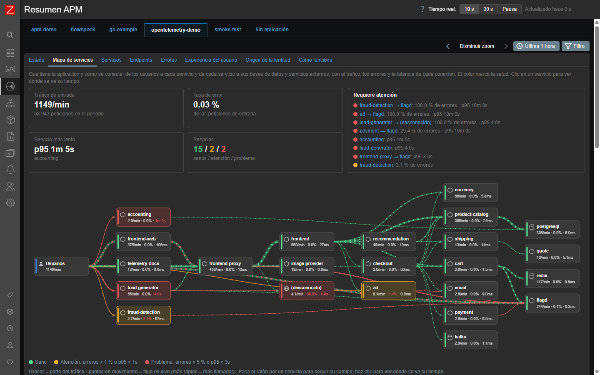

</div>

Módulos, plantillas y guías que convierten a Zabbix 8.0 en una plataforma de **monitoreo del rendimiento de aplicaciones (APM)** para cualquier aplicación con **OpenTelemetry**, en cualquier lenguaje.

## 🚀 Instálalo paso a paso

En un Ubuntu o Debian que ya tiene Zabbix 8:

```sh
git clone https://github.com/SimonLexRS/zabbix-apm-dashboard.git && cd zabbix-apm-dashboard
sudo ./scripts/setup.sh check            # comprueba los prerequisitos, no cambia nada
sudo ./scripts/setup.sh install          # ClickHouse + Collector + módulos + fuente de datos
sudo ./scripts/setup.sh demo <IP>        # opcional: tienda de prueba de unos 20 servicios
```

**Necesitas:** `sudo`, un token de API de Super admin, 4 GiB de RAM y 5 GB libres (10 GiB y 20 GB con la tienda).

**[Guía paso a paso →](docs/guia-ubuntu-paso-a-paso.md)** Qué hace cada comando, qué debes ver y qué hacer si algo falla.

## Qué obtienes

| Quieres saber | Lo encuentras en | Dónde |
|---|---|---|
| ¿Cómo se conectan mis servicios y cuál falla? | **Mapa de servicios** en vivo, con la salud y el tráfico de cada conexión | APM → Overview |
| ¿Qué servicio o endpoint va mal? | **Métricas RED:** tasa, errores y duración, con tendencia | APM → Overview |
| ¿Qué error se repite? | **Errores agrupados**, con veces, última aparición y traza | APM → Overview |
| ¿Dónde se pierde el tiempo? | **Origen de la lentitud:** código, base de datos u otros servicios, con cascadas y consultas costosas | APM → Overview |
| ¿Qué viven mis usuarios? | **RUM:** sesiones hasta el backend, cargas de página, recursos y Core Web Vitals | APM → Real user monitoring |
| ¿Cuántos pedidos tuvo hoy cada tienda y cuántas habitaciones quedan libres? | **KPIs de negocio:** los contadores y niveles de tu aplicación (pedidos, reservas, disponibilidad) por atributo, con totales completos, participación y ranking, un dashboard de comparación e ítems que el asistente puede leer | APM → Overview, host `apm-<aplicación>` |
| ¿Puedo verlo junto a mi monitoreo? | **Widgets** APM service map y APM service health | Dashboards |
| ¿Me avisa si algo va mal? | **Plantilla** con items, triggers y dashboard por aplicación | Host `apm-<aplicación>` |
| ¿Cómo conecto mi aplicación? | **Guía interactiva por lenguaje**, con comprobaciones en vivo | APM → Overview → Cómo funciona |

Respeta los roles y los APM filter de Zabbix, se actualiza en tiempo real y sigue el idioma del usuario, en español o inglés.

| Mapa de servicios: sigue el camino de un servicio | Monitoreo de usuarios reales |
|---|---|
| 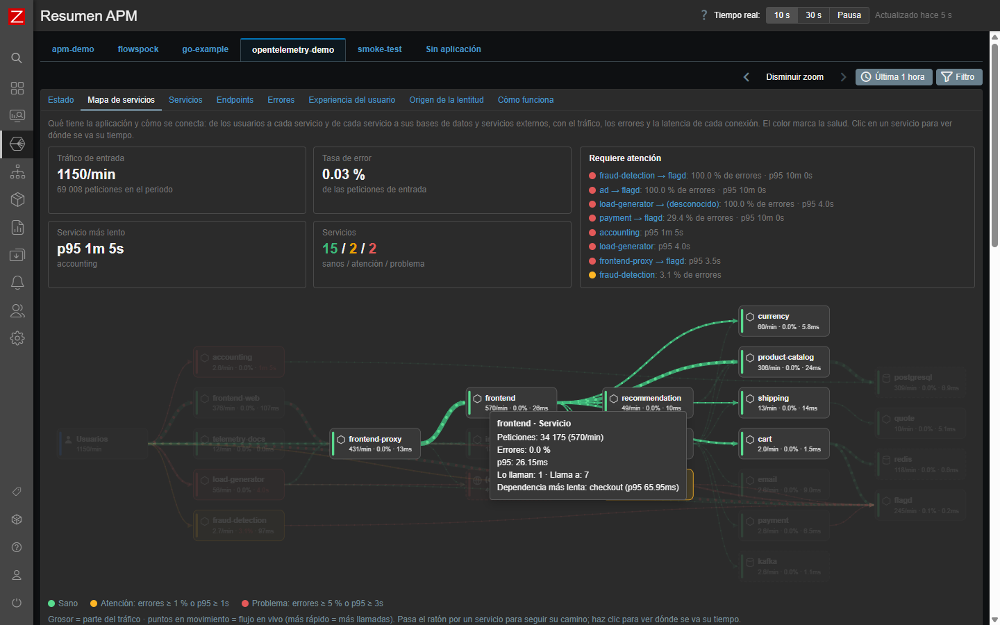 | 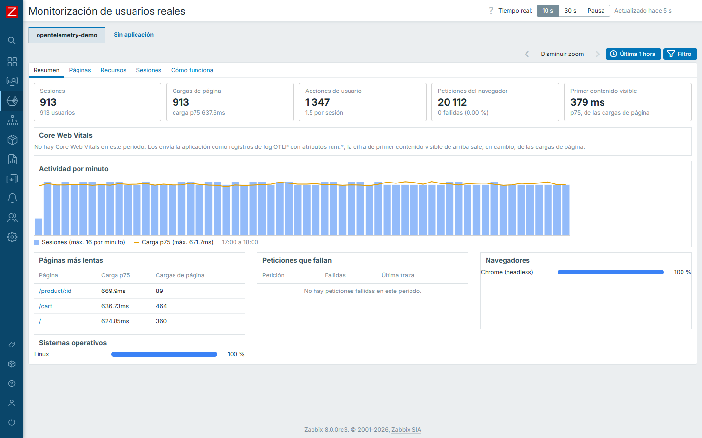 |

## Cómo funciona

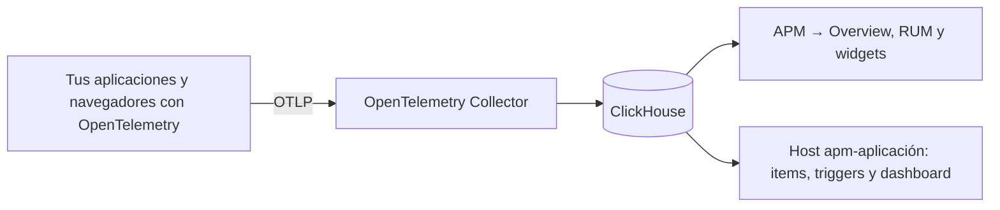

Una aplicación se identifica por el atributo estándar **`service.namespace`**. Nada en Zabbix ni en estos módulos es específico de una aplicación: para una nueva bastan las variables `OTEL_*` y un comando.

```sh
OTEL_SERVICE_NAME=checkout-api
OTEL_RESOURCE_ATTRIBUTES=service.namespace=shop
OTEL_EXPORTER_OTLP_ENDPOINT=http://<collector>:4317

python3 scripts/zabbix-apm-app.py add shop      # crea su host en Zabbix
python3 scripts/verify-app.py shop              # all checks passed
```

## Elige tu camino

| Quiero | Empieza aquí |
|---|---|
| **Instalarlo en Ubuntu con Zabbix 8** | [**Guía paso a paso**](docs/guia-ubuntu-paso-a-paso.md) |
| Verlo funcionar antes de tocar mi Zabbix | [Laboratorio en Docker](docs/lab.es.md), en 5 minutos |
| Instalarlo en varias máquinas u otra distribución | [Instalación de referencia](docs/installation.es.md) |
| Instalar solo los módulos | [Módulos](docs/install-module.es.md) |
| Conectar mi aplicación | [Agregar una aplicación](docs/add-application.es.md) y [ejemplos por stack](#ejemplos-por-stack) |
| Verlo con aplicaciones de ejemplo (API en Go, tienda, hoteles) | [Aplicaciones de ejemplo](examples/demo-apps/README.es.md), en Docker |
| Monitorear los navegadores de mis usuarios | [RUM: implementación y testing](docs/rum.es.md) |
| Seguir ventas, reservas o cualquier número del negocio | [KPIs de negocio](docs/business-kpis.es.md) |

Laboratorio, sin instalar nada en tu Zabbix:

```sh
cd examples/lab && cp .env.example .env && docker compose up -d --build && python3 ../../scripts/lab-bootstrap.py
```

## Capturas

| Guía por lenguaje, rellenada para tu aplicación | Comprobaciones en vivo |
|---|---|
| 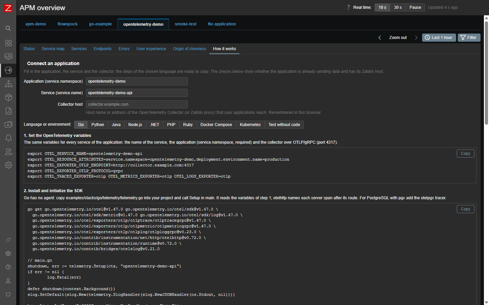 | 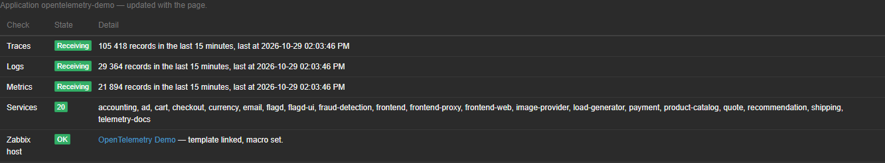 |
| **Servicios del OpenTelemetry Demo** | **La tienda de prueba** |
| 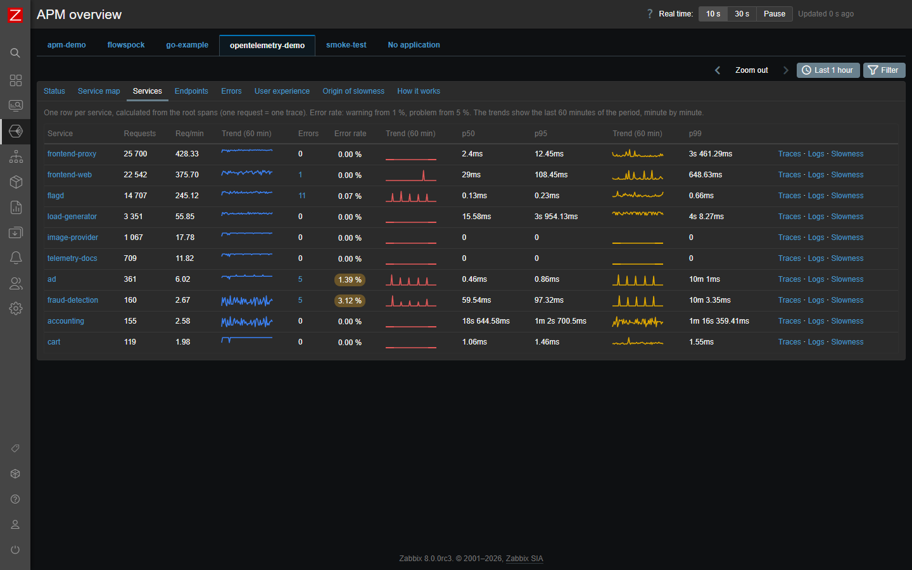 | 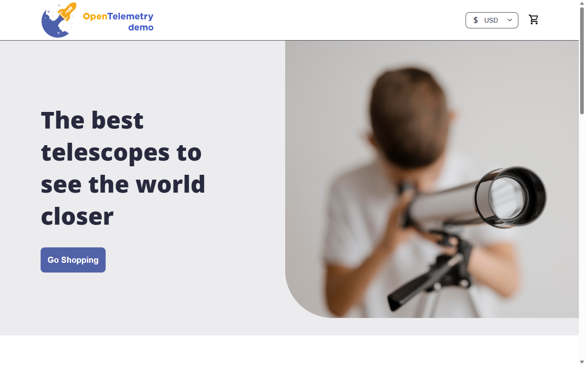 |
| **Línea de tiempo de una sesión de RUM** | **Widget del mapa en un dashboard** |
| 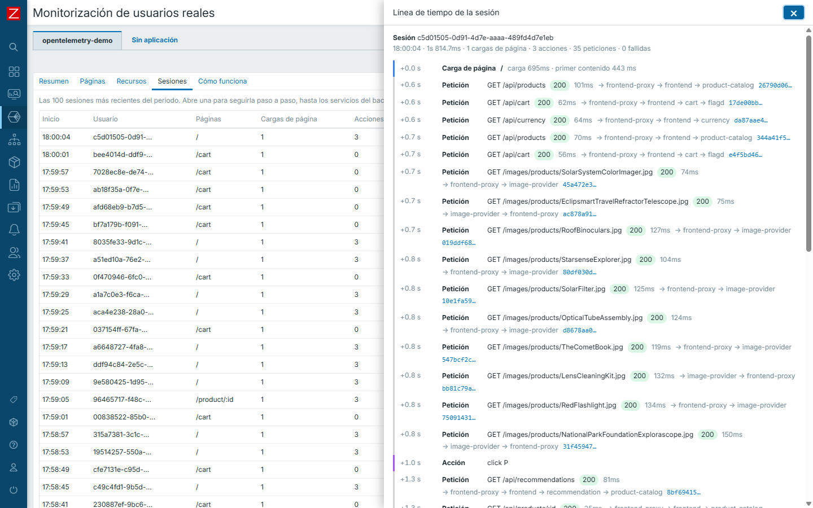 | 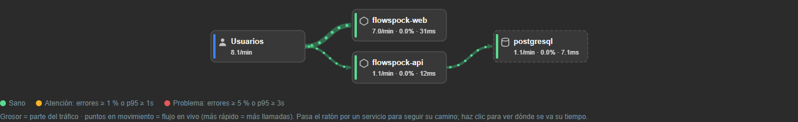 |
| **KPIs de negocio: pedidos e ingresos por tienda** | **Reservas por hotel, tema oscuro** |
| 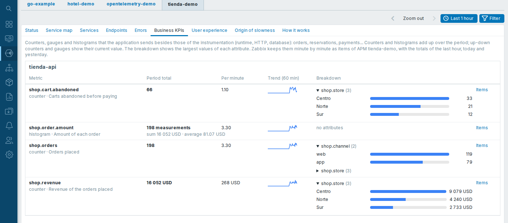 | 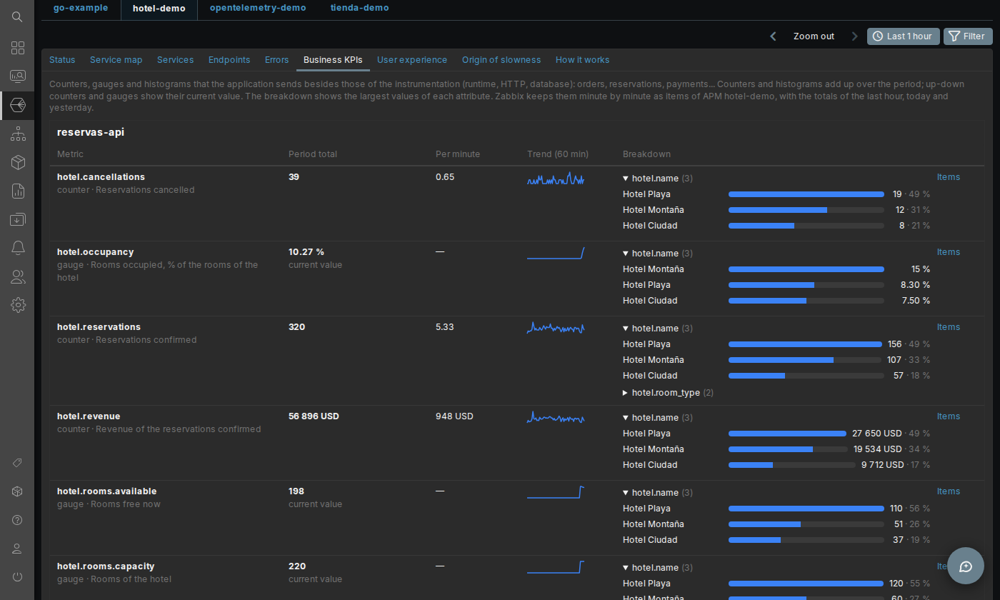 |

Más: [experiencia del usuario](docs/screenshots/user-experience.png) y [origen de la lentitud](docs/screenshots/origin-of-slowness-dark.png).

<details>
<summary><strong>Qué responde cada pestaña de APM → Overview</strong></summary>

- **Estado**: ¿llega la telemetría? Fuente de datos, conexión y registros por señal.
- **Mapa de servicios**: el estado del sistema ahora (tráfico de entrada, tasa de error, servicio más lento, qué requiere atención) y el flujo en vivo de los usuarios a los servicios, bases de datos y servicios externos. Las flechas se colorean por salud, son tan gruesas como su tráfico y tienen partículas en movimiento; pasa el ratón por un servicio para seguir su camino y ver sus cifras, y haz clic para ver dónde se va su tiempo.
- **Servicios / Endpoints**: métricas RED (tasa, errores, duración) con tendencias por minuto.
- **Errores**: fallos agrupados por servicio, endpoint y mensaje, con veces, primera y última vez y la última traza.
- **KPIs de negocio**: los contadores, indicadores e histogramas que envía la aplicación (pedidos, reservas, ingresos), con su total del periodo, tendencia y desglose por atributo ([docs/business-kpis.es.md](docs/business-kpis.es.md)).
- **Experiencia del usuario**: Core Web Vitals ([docs/rum.es.md](docs/rum.es.md)), Apdex por servicio y endpoint, e histogramas de latencia.
- **Origen de la lentitud**: tiempo por endpoint (código propio / base de datos / otros servicios), las peticiones más lentas con su cascada de spans, las consultas más costosas y los endpoints más lentos que en el periodo anterior.

El filtro de servicio acepta un texto contenido (`checkout`), un comodín (`demo-*`) o un nombre exacto (`=api`). Solo se consulta la pestaña visible, cada 10 s / 30 s o a demanda.

</details>

## Qué incluye

| Componente | Qué aporta |
|---|---|
| `modules/ApmOverview` | Páginas **APM → Overview** y **APM → Real user monitoring** |
| `modules/ApmServiceMap`, `modules/ApmServiceHealth` | Widgets de dashboard, con campo *Aplicación* |
| `templates/otel_application_otlp.json` | **OpenTelemetry application by OTLP**: el oficial *Generic OpenTelemetry by OTLP* limitado a una aplicación. [Detalles](docs/apm-template.es.md) |
| `templates/apm_services_clickhouse_http.yaml` | Opcional: items y triggers por servicio, endpoint y conexión (tasa de error, p95, Apdex) |
| `templates/apm_business_metrics_clickhouse_http.json` | **APM business metrics by ClickHouse HTTP**: descubre las métricas de negocio de una aplicación y cada valor de sus atributos, minuto a minuto y con totales diarios. [Detalles](docs/business-kpis.es.md) |
| `scripts/install.sh`, `scripts/enable-modules.py` | Instalan y habilitan los módulos |
| `scripts/zabbix-apm-app.py` | Da de alta una aplicación por API: plantilla, host y macros. Idempotente |
| `scripts/verify-app.py` | Comprueba una aplicación de punta a punta y compara Zabbix con ClickHouse |
| `scripts/test-rum.py` | Comprueba los datos del navegador y puede enviar Web Vitals sintéticos |
| `scripts/kpi-demo.py` | Envía una tienda y una cadena de hoteles con métricas de negocio y disponibilidad, para probar los KPIs |

### Ejemplos por stack

- [**Aplicaciones de ejemplo**](examples/demo-apps/README.es.md): una API en Go, una tienda y una cadena de hoteles en Docker, con los comandos para integrarlas con Zabbix (hosts, KPIs, dashboards) y qué vas a ver
- [Go](examples/stacks/go/README.es.md), ejecutable
- [Java, Python, Node.js, .NET y Kubernetes](examples/stacks/zero-code/README.es.md), sin cambiar código
- [OpenTelemetry Demo](examples/stacks/opentelemetry-demo/README.es.md): tienda de unos 20 servicios en 10 lenguajes

## Qué se comprobó

| Prueba | Alcance |
|---|---|
| **[Guía paso a paso](docs/guia-ubuntu-paso-a-paso.md), de principio a fin** | Ubuntu 26.10 ARM64, Zabbix 8.0.0rc3 compilado desde fuente, PostgreSQL, PHP 8.5, ClickHouse 26.10 y otelcol-contrib 0.164 |
| **[Verificación con cuatro aplicaciones](docs/verification.es.md)** | Zabbix 8.0.0rc3, ClickHouse 26.9 y otelcol-contrib 0.162: OpenTelemetry Demo, una API Go en producción, el ejemplo Go y `telemetrygen`. Los valores coinciden con ClickHouse |

> [!NOTE]
> **Sin ejecutar con la guía:** AMD64, otras versiones de Ubuntu y Zabbix instalado por paquetes. La prueba con un navegador real tampoco se ejecutó. Zabbix 8.0.0rc3 es una versión candidata.

## Documentación

| Empezar | |
|---|---|
| [**Guía paso a paso en Ubuntu**](docs/guia-ubuntu-paso-a-paso.md) | De un server con solo Zabbix 8 a APM completo |
| [Laboratorio](docs/lab.es.md) | Todo en Docker en tu máquina, en 5 minutos |

| Conectar | |
|---|---|
| [Agregar una aplicación](docs/add-application.es.md) | Instrumentar, llegar al Collector, crear el host y verificar |
| [Monitoreo de usuarios reales](docs/rum.es.md) | Cómo funciona, cómo se implementa y cómo hacer testing |
| [KPIs de negocio](docs/business-kpis.es.md) | Pedidos, reservas o pagos como ítems de Zabbix, por atributo, para dashboards y el asistente |
| [OpenTelemetry Demo](examples/stacks/opentelemetry-demo/README.es.md) | La tienda de prueba, con sus problemas y soluciones |

| Referencia | |
|---|---|
| [Instalación](docs/installation.es.md) | Para otras distribuciones de máquinas |
| [Módulos](docs/install-module.es.md) | Cómo funciona APM, módulos, permisos y Docker |
| [Plantilla APM](docs/apm-template.es.md) | Items, triggers, macros, ajuste y actualizaciones |
| [Verificación](docs/verification.es.md) | Qué se probó y cómo repetirlo |
| [Problemas frecuentes](docs/troubleshooting.md) | Solución de problemas (en inglés) |

## Desarrollo y forks

```sh
php tests/run.php                                   # tests de los módulos (no necesitan Zabbix)
python3 scripts/build-otlp-app-template.py --check  # plantilla generada al día
```

La [CI](.github/workflows/ci.yml) pasa el lint de PHP 8.2–8.4 y de JavaScript, ejecuta los tests, valida manifests y plantillas, comprueba que la plantilla generada está al día, compila el ejemplo Go e instala y desinstala en un frontend simulado. Las traducciones están en `modules/*/lang/es.php`, indexadas por el texto en inglés.

**¿Haces un fork?** Nada está atado a una instalación: los endpoints y las credenciales son variables, y la plantilla se genera a partir de la de Zabbix. Comprueba tus cambios en el [laboratorio](docs/lab.es.md). Los enlaces de las páginas del módulo y de los manifests apuntan a este repositorio (`OverviewHtml::DOCS_URL` en `modules/ApmOverview/includes/OverviewHtml.php` y `url` en `modules/*/manifest.json`): cámbialos si publicas tu propia documentación.

## Licencia

[AGPL-3.0](LICENSE), la licencia de Zabbix. © Simon Alex Rodriguez.
