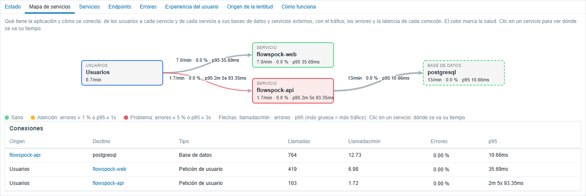

# Zabbix APM Dashboard

[English](README.md)

Módulos de frontend y un template que convierten el **APM** nativo de Zabbix 8.0 (trazas, logs y métricas de
OpenTelemetry en ClickHouse) en una vista completa del rendimiento de las aplicaciones: mapa de servicios en vivo,
métricas RED por servicio y endpoint, errores agrupados, experiencia real del usuario (Web Vitals y Apdex) y dónde se va
el tiempo de las peticiones lentas.



| Componente | Tipo | Qué aporta |
|---|---|---|
| `modules/ApmOverview` | Página (APM → Overview) | Pestañas: Estado, Mapa de servicios, Servicios, Endpoints, Errores, Experiencia del usuario, Origen de la lentitud, Cómo funciona. Actualización en tiempo real. |
| `modules/ApmServiceMap` | Widget de dashboard | El mapa de servicios en cualquier dashboard (requiere ApmOverview). |
| `modules/ApmServiceHealth` | Widget de dashboard | Tabla de servicios con peticiones, tasa de error, p50/p95/p99 y tendencia, con umbrales de color. |
| `templates/apm_services_clickhouse_http.yaml` | Template | Ítems, descubrimiento y triggers por servicio, endpoint y conexión (tasa de error, p95, Apdex, salud). |

Español e inglés: el idioma sigue al usuario de Zabbix (español para `es_*`, inglés en otro caso).

## Requisitos

- **Zabbix 8.0.0rc3** o posterior (la rc3 cambió los parámetros de las consultas a ClickHouse), con su fuente de datos APM configurada (Administration → Data source → APM): los módulos
  usan esa conexión a ClickHouse y el visor de trazas nativo.
- **ClickHouse** con las tablas del exportador `clickhouse` del OpenTelemetry Collector (`otel_traces`, `otel_logs`,
  `otel_metrics_*`), escritas por un OpenTelemetry Collector o por el colector APM de un proxy de Zabbix.
- PHP 8.2+ (el requisito del frontend de Zabbix 8.0). Sin otras dependencias.

## Inicio rápido

```sh
git clone https://github.com/SimonLexRS/zabbix-apm-dashboard.git
cd zabbix-apm-dashboard
sudo ./scripts/install.sh
```

Luego en Zabbix: **Administration → General → Modules → Scan directory**, habilita **APM Overview**, **APM service map** y
**APM service health**, y abre **APM → Overview**.

Guía completa, con el colector, los usuarios de ClickHouse y el template: [docs/installation.md](docs/installation.md)
(en inglés).

## Qué responde cada pestaña

- **Estado**: ¿llega la telemetría? Fuente de datos, conexión y registros por señal.
- **Mapa de servicios**: de qué está hecha la aplicación: usuarios → servicios → bases de datos y servicios externos,
  con llamadas/min, tasa de error y p95 en cada flecha, colores de salud y clic para ir a cada servicio.
- **Servicios / Endpoints**: métricas RED (tasa, errores, duración) con tendencias por minuto; las peticiones sin ruta se
  muestran como "(sin ruta · 404)".
- **Errores**: fallos agrupados por servicio, endpoint y mensaje, con veces, primera y última vez y la última traza.
- **Experiencia del usuario**: Core Web Vitals de navegadores reales (LCP, INP, CLS, FCP, TTFB por página y
  dispositivo, ver [docs/rum.md](docs/rum.md)), Apdex por servicio y endpoint, histogramas de latencia.
- **Origen de la lentitud**: reparto del tiempo por endpoint (código propio / base de datos / otros servicios), las
  peticiones más lentas con su cascada de spans, las consultas más costosas y los endpoints más lentos que en el periodo
  anterior.

El filtro de la página acepta un nombre de servicio: un texto contenido (`checkout`), un comodín (`demo-*`) o un nombre
exacto (`=api`, el que usan los enlaces y las sugerencias). Solo se consulta la pestaña visible, cada 10 s / 30 s o a
demanda.

## Licencia

[AGPL-3.0](LICENSE), la licencia de Zabbix. © Simon Alex Rodriguez.
