<div align="center">

# Zabbix APM Dashboard

**See inside your applications from Zabbix 8: which request is slow, what fails and what your users experience.**

[](https://github.com/SimonLexRS/zabbix-apm-dashboard/actions/workflows/ci.yml)


[](LICENSE)

English · [Español](README.es.md)

**[🚀 Install step by step](docs/ubuntu-step-by-step.md)** · [What you get](#what-you-get) · [How it works](#how-it-works) · [Choose your path](#choose-your-path) · [Documentation](#documentation)

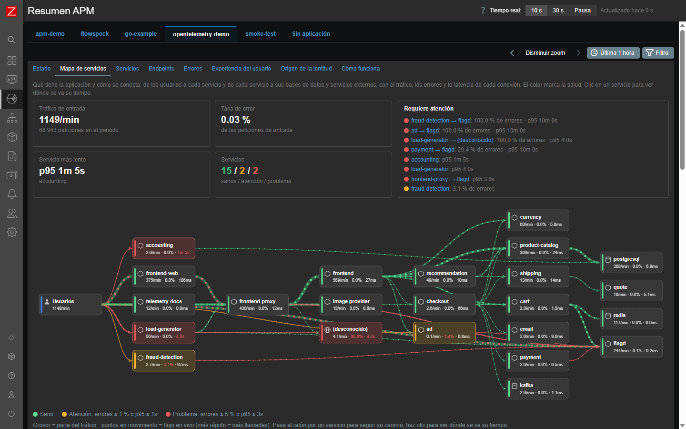

</div>

Modules, templates and guides that turn Zabbix 8.0 into an **application performance monitoring (APM)** platform for any application with **OpenTelemetry**, in any language.

## 🚀 Install it step by step

On an Ubuntu or Debian server that already runs Zabbix 8:

```sh
git clone https://github.com/SimonLexRS/zabbix-apm-dashboard.git && cd zabbix-apm-dashboard
sudo ./scripts/setup.sh check            # checks the prerequisites, changes nothing
sudo ./scripts/setup.sh install          # ClickHouse + Collector + modules + data source
sudo ./scripts/setup.sh demo <IP>        # optional: test store of about 20 services
```

**You need:** `sudo`, an API token of a Super admin, 4 GiB of RAM and 5 GB free (10 GiB and 20 GB with the store).

**[Step-by-step guide →](docs/ubuntu-step-by-step.md)** What each command does, what you must see and what to do if something fails.

## What you get

| You want to know | You find it in | Where |
|---|---|---|
| How do my services connect, and which one fails? | Live **service map**, with the health and traffic of each connection | APM → Overview |
| Which service or endpoint is doing badly? | **RED metrics:** rate, errors and duration, with trends | APM → Overview |
| Which error keeps repeating? | **Grouped errors**, with counts, last seen and trace | APM → Overview |
| Where does the time go? | **Origin of slowness:** code, database or other services, with waterfalls and expensive queries | APM → Overview |
| What do my users experience? | **RUM:** sessions down to the backend, page loads, resources, errors of the page and Core Web Vitals | APM → Real user monitoring |
| Which user did this backend error hit? | **Trace panel:** session, user and page of any trace, and back | Any trace link |
| How many orders did each store have today, and how many rooms are free? | **Business KPIs:** the counters and levels of your application (orders, reservations, availability) by attribute, with complete totals, share and rank, a comparison dashboard and items the assistant can read | APM → Overview, host `apm-<application>` |
| Can I see it next to my monitoring? | **Widgets** APM service map and APM service health | Dashboards |
| Does it alert me when something goes wrong? | **Template** with items, triggers and a dashboard per application | Host `apm-<application>` |
| How do I connect my application? | **Interactive guide per language**, with live checks | APM → Overview → How it works |

It respects Zabbix roles and APM filters, refreshes in real time and follows the user's language, English or Spanish.

| Service map: follow the path of a service | Real user monitoring |
|---|---|
| 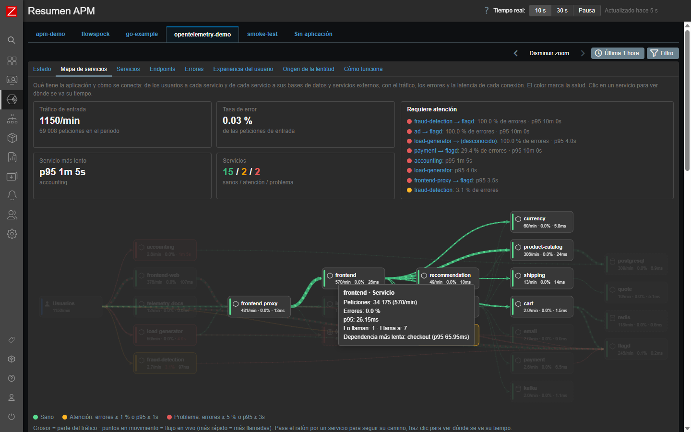 | 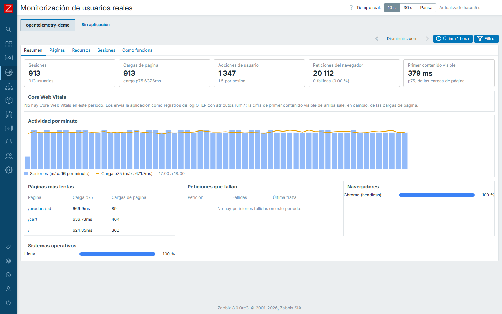 |

## How it works

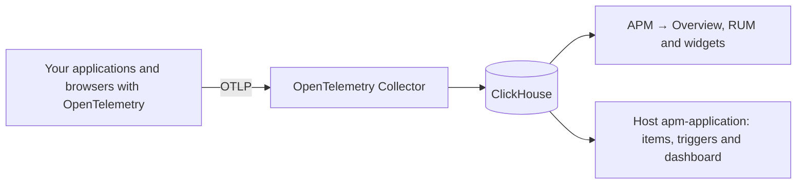

An application is identified by the standard attribute **`service.namespace`**. Nothing in Zabbix or in these modules is specific to one application: a new one needs the `OTEL_*` variables and one command.

```sh
OTEL_SERVICE_NAME=checkout-api
OTEL_RESOURCE_ATTRIBUTES=service.namespace=shop
OTEL_EXPORTER_OTLP_ENDPOINT=http://<collector>:4317

python3 scripts/zabbix-apm-app.py add shop      # creates its host in Zabbix
python3 scripts/verify-app.py shop              # all checks passed
```

## Choose your path

| I want to | Start here |
|---|---|
| **Install it on Ubuntu with Zabbix 8** | [**Step-by-step guide**](docs/ubuntu-step-by-step.md) |
| See it working before touching my Zabbix | [Docker lab](docs/lab.md), in 5 minutes |
| Install it across machines or on another distribution | [Reference installation](docs/installation.md) |
| Install only the modules | [Modules](docs/install-module.md) |
| Connect my application | [Add an application](docs/add-application.md) and [examples per stack](#examples-per-stack) |
| See it with example applications (Go API, store, hotels) | [Example applications](examples/demo-apps/README.md), in Docker |
| Monitor my users' browsers | [RUM: implementation and testing](docs/rum.md) |
| Follow sales, reservations or any business number | [Business KPIs](docs/business-kpis.md) |

Lab, without installing anything in your Zabbix:

```sh
cd examples/lab && cp .env.example .env && docker compose up -d --build && python3 ../../scripts/lab-bootstrap.py
```

## Screenshots

| Guide per language, filled in for your application | Live checks |
|---|---|
| 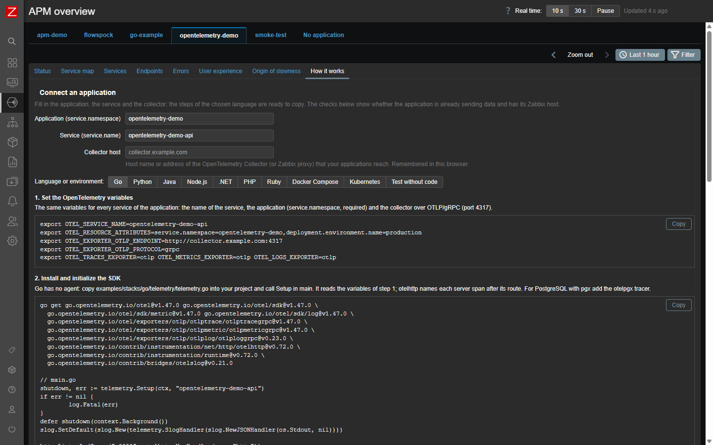 | 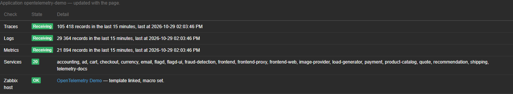 |
| **Services of the OpenTelemetry Demo** | **The test store** |
| 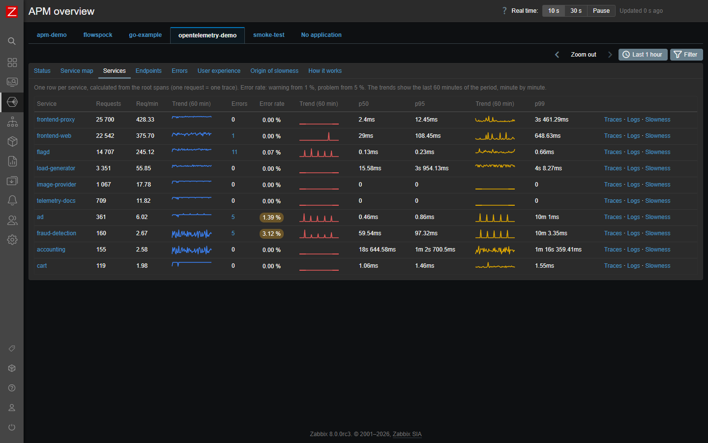 | 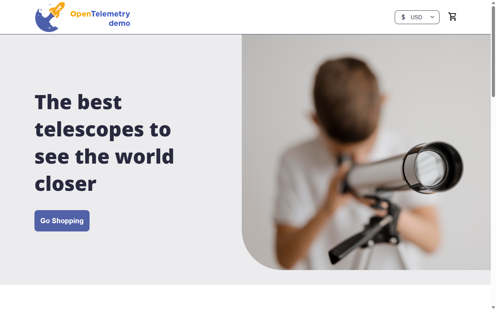 |
| **Timeline of a RUM session** | **Service map widget on a dashboard** |
| 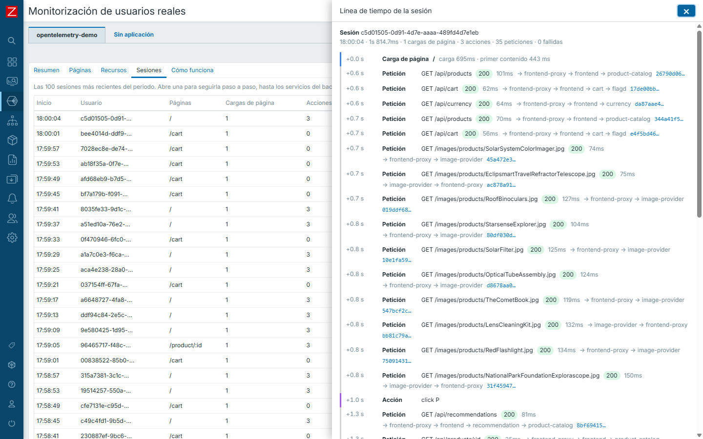 | 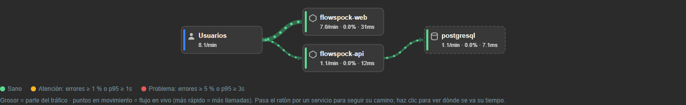 |
| **Business KPIs: orders and revenue by store** | **Reservations by hotel, dark theme** |
|  | 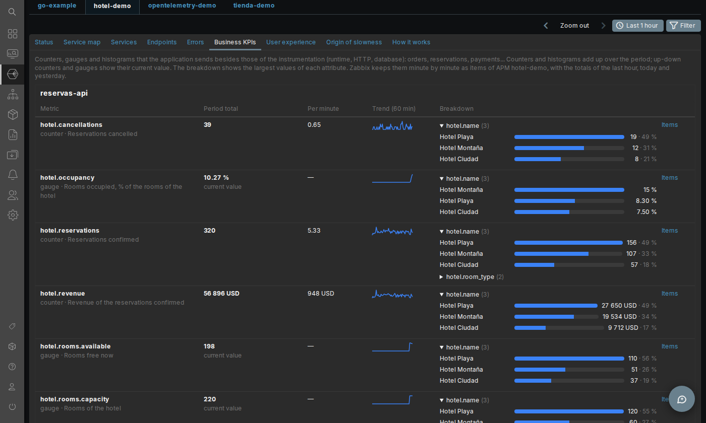 |

More: [user experience](docs/screenshots/user-experience.png) and [origin of slowness](docs/screenshots/origin-of-slowness-dark.png).

<details>
<summary><strong>What each tab of APM → Overview answers</strong></summary>

- **Status**: is telemetry arriving? Data source, connection and rows per signal.
- **Service map**: the state of the system now (incoming traffic, error rate, slowest service, what needs attention) and the live flow from users to services, databases and external services. Arrows are colored by health, as thick as their traffic, with moving particles; hover a service to follow its path and see its figures, and click it to see where its time goes.
- **Services / Endpoints**: RED metrics (rate, errors, duration) with per-minute trends.
- **Errors**: failures grouped into issues (service, operation, exception, message), each with its state: new, active, came back or resolved. A fixed error becomes resolved by itself.
- **Trace panel** (any trace link): the spans from the browser to the databases, the logs of the trace, and the session, user and page it came from.
- **Business KPIs**: the counters, gauges and histograms the application sends (orders, reservations, revenue), with their total of the period, trend and breakdown by attribute ([docs/business-kpis.md](docs/business-kpis.md)).
- **User experience**: Core Web Vitals ([docs/rum.md](docs/rum.md)), Apdex per service and endpoint, and latency histograms.
- **Origin of slowness**: time per endpoint (own code / database / other services), the slowest requests with their span waterfall, the most expensive statements and endpoints slower than in the previous period.

The service filter takes a substring (`checkout`), a wildcard (`demo-*`) or an exact name (`=api`). Only the visible tab is queried, every 10 s / 30 s or on demand.

</details>

## What's included

| Component | What it gives you |
|---|---|
| `modules/ApmOverview` | Pages **APM → Overview** and **APM → Real user monitoring** |
| `modules/ApmServiceMap`, `modules/ApmServiceHealth` | Dashboard widgets, with an *Application* field |
| `templates/otel_application_otlp.json` | **OpenTelemetry application by OTLP**: the official *Generic OpenTelemetry by OTLP* limited to one application. [Details](docs/apm-template.md) |
| `templates/apm_services_clickhouse_http.yaml` | Optional: items and triggers per service, endpoint and connection (error rate, p95, Apdex) |
| `templates/apm_business_metrics_clickhouse_http.json` | **APM business metrics by ClickHouse HTTP**: discovers the business metrics of an application and each value of their attributes, minute by minute and with daily totals. [Details](docs/business-kpis.md) |
| `scripts/install.sh`, `scripts/enable-modules.py` | Install and enable the modules |
| `scripts/zabbix-apm-app.py` | Onboards an application through the API: template, host and macros. Idempotent |
| `scripts/verify-app.py` | Checks an application end to end and compares Zabbix with ClickHouse |
| `scripts/test-rum.py` | Checks the browser data and can send synthetic Web Vitals |
| `scripts/kpi-demo.py` | Sends a store and a hotel chain with business metrics and availability, to try the KPIs |

### Examples per stack

- [**Example applications**](examples/demo-apps/README.md): a Go API, a store and a hotel chain in Docker, with the commands to integrate them with Zabbix (hosts, KPIs, dashboards) and what you see
- [Go](examples/stacks/go/README.md), runnable
- [Java, Python, Node.js, .NET and Kubernetes](examples/stacks/zero-code/README.md), without changing code
- [OpenTelemetry Demo](examples/stacks/opentelemetry-demo/README.md): a store of about 20 services in 10 languages

## What was tested

| Test | Scope |
|---|---|
| **[Step-by-step guide](docs/ubuntu-step-by-step.md), from start to finish** | Ubuntu 26.10 ARM64, Zabbix 8.0.0rc3 built from source, PostgreSQL, PHP 8.5, ClickHouse 26.10 and otelcol-contrib 0.164 |
| **[Verification with four applications](docs/verification.md)** | Zabbix 8.0.0rc3, ClickHouse 26.9 and otelcol-contrib 0.162: OpenTelemetry Demo, a Go production API, the Go example and `telemetrygen`. Values match ClickHouse |

> [!NOTE]
> **Not run with the guide:** AMD64, other Ubuntu versions and Zabbix installed from packages. The test with a real browser wasn't run either. Zabbix 8.0.0rc3 is a release candidate.

## Documentation

| Get started | |
|---|---|
| [**Step-by-step guide for Ubuntu**](docs/ubuntu-step-by-step.md) | From a server with only Zabbix 8 to full APM |
| [Lab](docs/lab.md) | Everything in Docker on your machine, in 5 minutes |

| Connect | |
|---|---|
| [Add an application](docs/add-application.md) | Instrument, reach the Collector, create the host and verify |
| [Real user monitoring](docs/rum.md) | How it works, how to implement it and how to test it |
| [Business KPIs](docs/business-kpis.md) | Orders, reservations or payments as Zabbix items, by attribute, for dashboards and the assistant |
| [OpenTelemetry Demo](examples/stacks/opentelemetry-demo/README.md) | The test store, with its problems and solutions |

| Reference | |
|---|---|
| [Installation](docs/installation.md) | For other machine layouts |
| [Modules](docs/install-module.md) | How APM works, modules, permissions and Docker |
| [APM template](docs/apm-template.md) | Items, triggers, macros, tuning and upgrades |
| [Verification](docs/verification.md) | What was tested and how to repeat it |
| [Troubleshooting](docs/troubleshooting.md) | Common problems |

## Development and forks

```sh
php tests/run.php                                   # module tests (no Zabbix needed)
python3 scripts/build-otlp-app-template.py --check  # generated template up to date
```

The [CI](.github/workflows/ci.yml) lints PHP 8.2–8.4 and JavaScript, runs the tests, validates manifests and templates, checks that the generated template is up to date, builds the Go example and installs and uninstalls into a mock frontend. Translations live in `modules/*/lang/es.php`, keyed by the English text.

**Forking it?** Nothing is tied to one installation: endpoints and credentials are variables, and the template is generated from Zabbix's own. Check your changes in the [lab](docs/lab.md). The links of the module pages and manifests point to this repository (`OverviewHtml::DOCS_URL` in `modules/ApmOverview/includes/OverviewHtml.php` and `url` in `modules/*/manifest.json`): change them if you publish your own documentation.

## License

[AGPL-3.0](LICENSE), the license of Zabbix itself. © Simon Alex Rodriguez.
