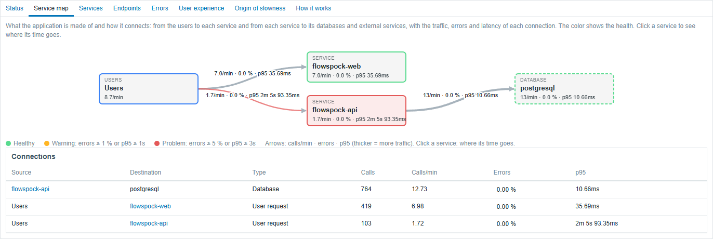
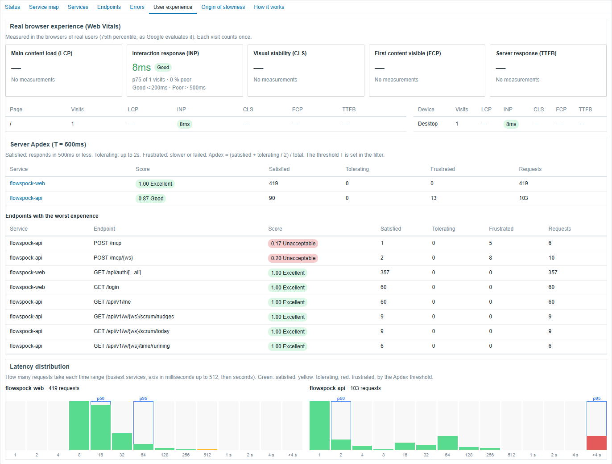
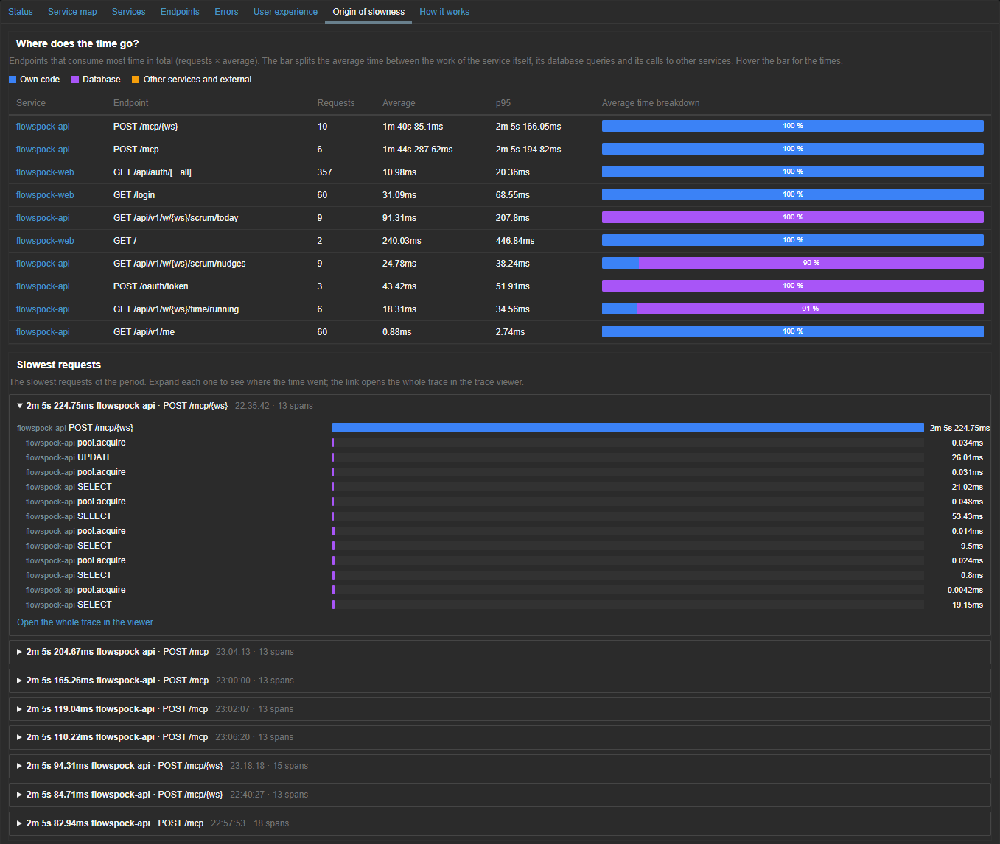

# Zabbix APM Dashboard

[Español](README.es.md)

Frontend modules and a template that turn the native **APM** of Zabbix 8.0 (OpenTelemetry traces, logs and metrics in
ClickHouse) into a full application performance view: a live service map, RED metrics per service and endpoint, grouped
errors, real user experience (Web Vitals and Apdex) and where the time of slow requests goes.



| Component | Type | What it gives you |
|---|---|---|
| `modules/ApmOverview` | Page (APM → Overview) | Tabs: Status, Service map, Services, Endpoints, Errors, User experience, Origin of slowness, How it works. Real-time refresh. |
| `modules/ApmServiceMap` | Dashboard widget | The service map on any dashboard (needs ApmOverview). |
| `modules/ApmServiceHealth` | Dashboard widget | Table of services with requests, error rate, p50/p95/p99 and trend, with color thresholds. |
| `templates/apm_services_clickhouse_http.yaml` | Template | Items, discovery and triggers per service, endpoint and connection (error rate, p95, Apdex, health). |

English and Spanish: the language follows the Zabbix user (Spanish for `es_*`, English otherwise).

## Screenshots

| User experience | Origin of slowness (dark theme) |
|---|---|
|  |  |

More in [docs/screenshots](docs/screenshots).

## Requirements

- **Zabbix 8.0.0rc3** or later (rc3 changed the ClickHouse query parameters), with its APM data source configured (Administration → Data source → APM): the modules reuse
  that ClickHouse connection and the native trace viewer.
- **ClickHouse** with the tables of the OpenTelemetry Collector `clickhouse` exporter (`otel_traces`, `otel_logs`,
  `otel_metrics_*`), written by an OpenTelemetry Collector or the APM collector of a Zabbix proxy.
- PHP 8.2+ (the Zabbix 8.0 frontend requirement). No other dependencies.

## Quick start

```sh
git clone https://github.com/SimonLexRS/zabbix-apm-dashboard.git
cd zabbix-apm-dashboard
sudo ./scripts/install.sh
```

Then in Zabbix: **Administration → General → Modules → Scan directory**, enable **APM Overview**, **APM service map** and
**APM service health**, and open **APM → Overview**.

Full guide, including the collector, ClickHouse users and the template: [docs/installation.md](docs/installation.md).
Connecting an application (instrumentation, collector, Zabbix host with the OpenTelemetry template):
[docs/add-application.md](docs/add-application.md).

## What each tab answers

The page shows one application at a time: pick it in the tabs at the top (one per `service.namespace`).

- **Status**: is telemetry arriving? Data source, connection and rows per signal.
- **Service map**: what the application is made of: users → services → databases and external services, with
  calls/min, error rate and p95 on every arrow, health colors, and click-through to each service.
- **Services / Endpoints**: RED metrics (rate, errors, duration) with per-minute trends; routeless requests shown as
  "(no route · 404)".
- **Errors**: failures grouped by service, endpoint and message, with counts, first/last seen and the latest trace.
- **User experience**: Core Web Vitals from real browsers (LCP, INP, CLS, FCP, TTFB per page and device, see
  [docs/rum.md](docs/rum.md)), Apdex per service and endpoint, latency histograms.
- **Origin of slowness**: time breakdown per endpoint (own code / database / other services), the slowest requests
  with their span waterfall, the most expensive database statements and endpoints slower than in the previous period.

The page filter takes a service name: a substring (`checkout`), a wildcard (`demo-*`) or an exact name (`=api`, what the
links and the suggestions use). Only the visible tab is queried, every 10 s / 30 s or on demand.

## Development

```sh
php tests/run.php        # service patterns, map graph, translations (no Zabbix needed)
```

CI ([.github/workflows/ci.yml](.github/workflows/ci.yml)) lints PHP 8.2–8.4 and JavaScript, runs the tests, validates the
manifests and the template, and installs/uninstalls into a mock frontend.

Translations live in `modules/*/lang/es.php`, keyed by the English text; the tests fail if a translated text has no
Spanish entry. To add a language, add `lang/<code>.php` (the Zabbix language code before `_`, e.g. `pt`).

## License

[AGPL-3.0](LICENSE), the license of Zabbix itself. © Simon Alex Rodriguez.
