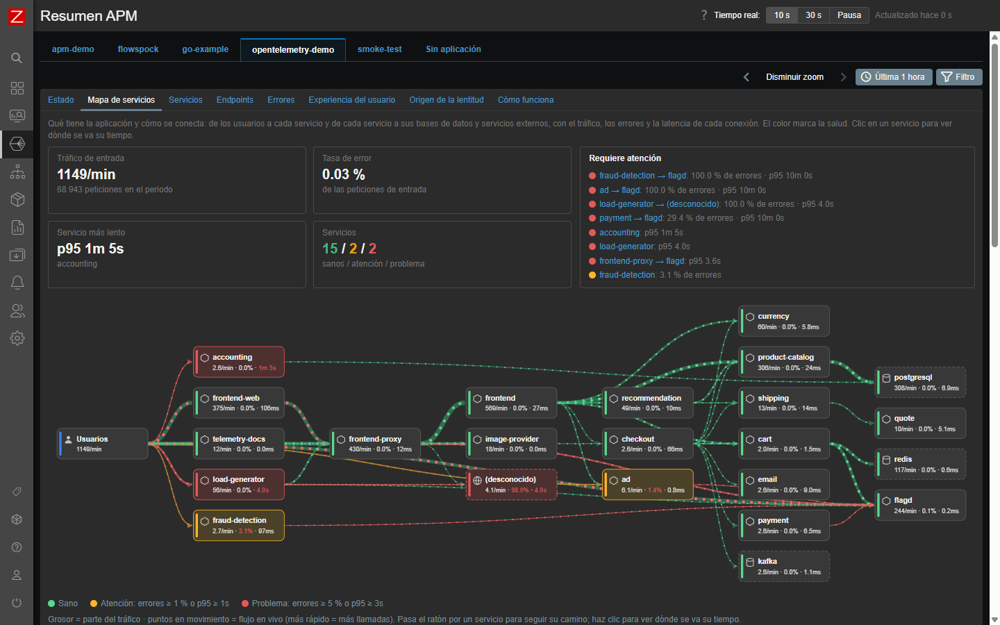
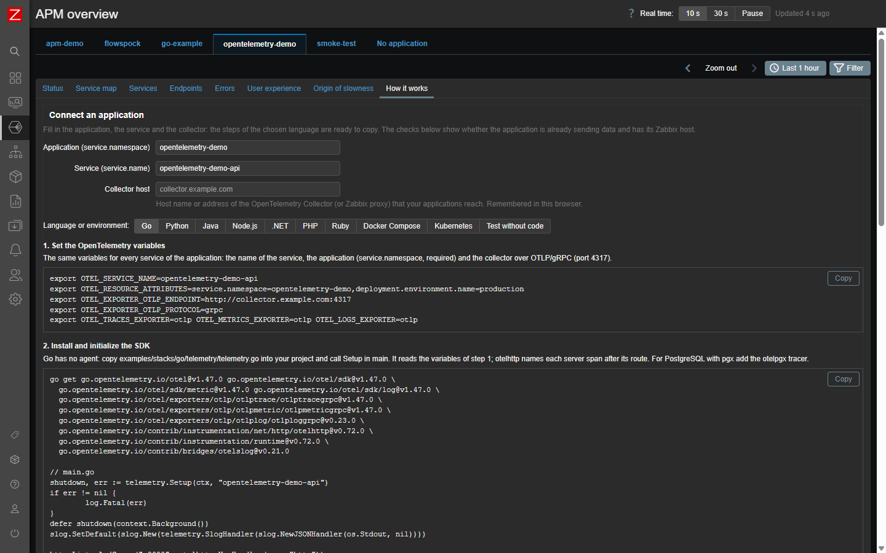
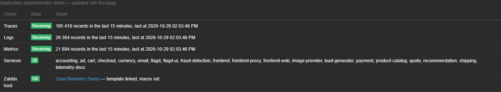
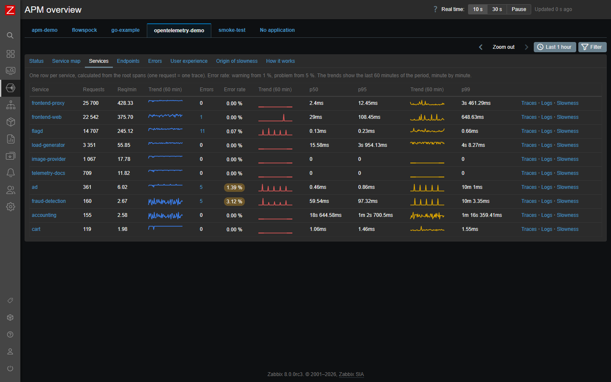
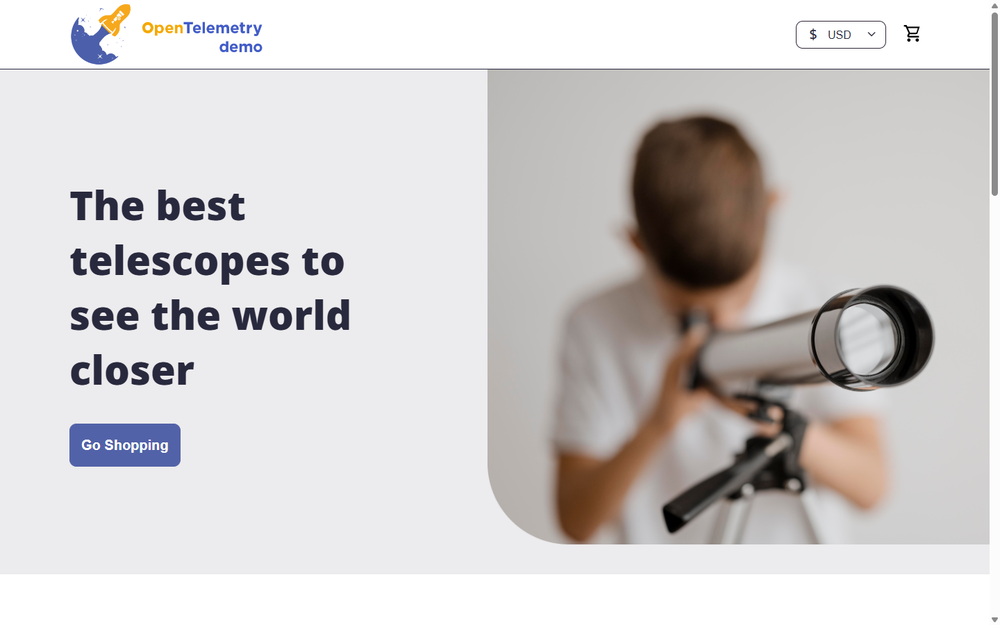
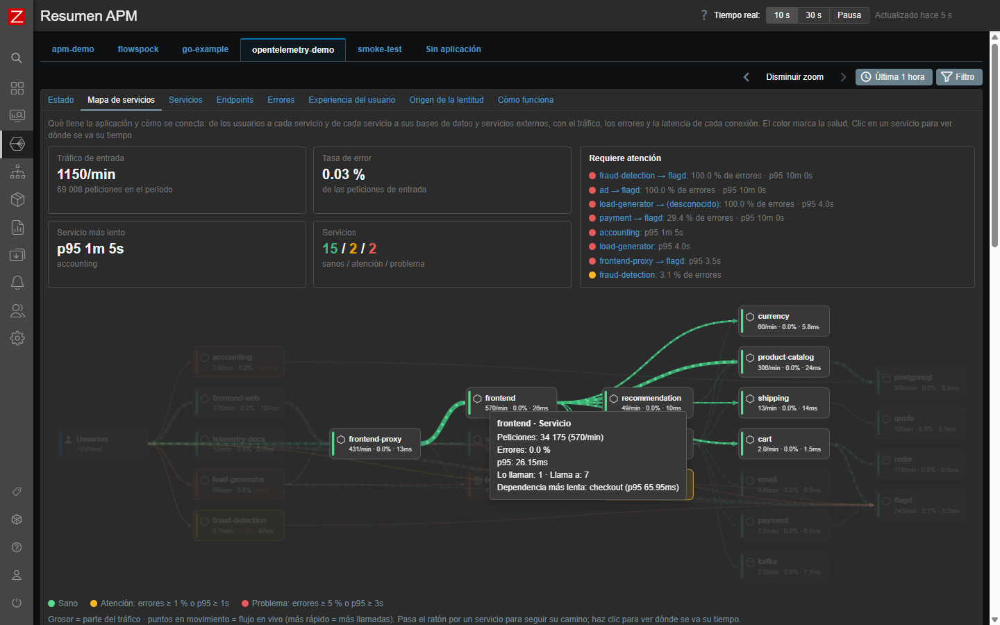
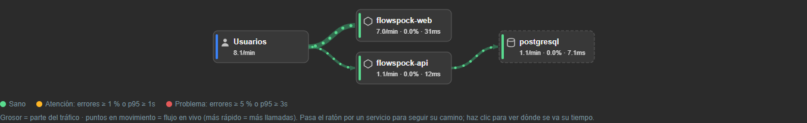

# Zabbix APM Dashboard

[Español](README.es.md)

Application performance monitoring on **Zabbix 8.0** for any application instrumented with **OpenTelemetry**: frontend
modules (service map, RED metrics per service and endpoint, grouped errors, user experience, origin of slowness, one tab
per application), a template derived from Zabbix's official OpenTelemetry template (one host per application, with
triggers), onboarding and verification scripts, and step-by-step guides for Go, Java, Python, Node.js, .NET, Kubernetes
and Docker Compose applications.



| Component | What it gives you |
|---|---|
| `modules/ApmOverview` | Page **APM → Overview**: one tab per application (`service.namespace`); Status, Service map, Services, Endpoints, Errors, User experience, Origin of slowness, and **How it works**: an interactive guide per language (Go, Python, Java, Node.js, .NET, PHP, Ruby, Docker Compose, Kubernetes) with live checks of the application. Page **APM → Real user monitoring**: page loads, sessions with their timeline down to the backend services, resources and Core Web Vitals, from the OpenTelemetry web SDK ([docs/rum.md](docs/rum.md)). Real-time refresh. |
| `modules/ApmServiceMap`, `modules/ApmServiceHealth` | Dashboard widgets: service map and service health table, with an *Application* field. |
| `templates/otel_application_otlp.json` | **OpenTelemetry application by OTLP**: the official *Generic OpenTelemetry by OTLP* limited to one application; spans by status, durations, error %, logs by severity, triggers and a dashboard. [Details](docs/apm-template.md). |
| `templates/apm_services_clickhouse_http.yaml` | Optional: items and triggers per service, endpoint and connection (error rate, p95, Apdex). |
| `scripts/zabbix-apm-app.py` | Onboards an application through the Zabbix API: template, host `apm-<namespace>`, macro. Idempotent. |
| `scripts/verify-app.py` | Checks an application end to end and compares the Zabbix values with ClickHouse. |
| `examples/stacks/` | Instrumentation per stack: [Go](examples/stacks/go/README.md) (runnable), [Java/Python/Node.js/.NET/Kubernetes](examples/stacks/zero-code/README.md), [OpenTelemetry Demo / own collector](examples/stacks/opentelemetry-demo/README.md). |

English and Spanish: the modules follow the language of the Zabbix user.

## How it works

```
your applications ──OTLP──▶ OpenTelemetry Collector ──▶ ClickHouse (zabbix.otel_*)
  service.name                                               │
  service.namespace = the application ◀── everything is keyed by it
                                                             ├──▶ APM → Overview (tab per application) + widgets
                                                             └──▶ host apm-<application>: template items, triggers, dashboard
```

An application is identified by the standard resource attribute **`service.namespace`**. Nothing in Zabbix or in these
modules is specific to one application: a new one needs the `OTEL_*` variables and one command.

## Try it in 5 minutes (lab)

Everything in Docker on your machine — Zabbix 8.0, ClickHouse, a collector, the modules and an instrumented Go
service — to see it working before touching your Zabbix: [docs/lab.md](docs/lab.md).

```sh
cd examples/lab && cp .env.example .env && docker compose up -d --build && python3 ../../scripts/lab-bootstrap.py
```

## Fork it and replicate it

Nothing in the code is tied to one installation: applications are identified by `service.namespace`, the endpoints and
credentials are variables, and the template is generated from Zabbix's own. In a fork:

1. Run the [lab](docs/lab.md) to check your changes (`php tests/run.php` and the CI run the rest).
2. Install in your Zabbix: [installation.md](docs/installation.md), modules step by step with screenshots in
   [install-module.md](docs/install-module.md).
3. Connect your applications: [add-application.md](docs/add-application.md) and [examples/stacks](examples/stacks).

Optional: the links of the module pages and manifests point to this repository (`OverviewHtml::DOCS_URL` in
`modules/ApmOverview/includes/OverviewHtml.php` and `url` in `modules/*/manifest.json`); change them to your fork if
you publish your own documentation.

## Quick start

1. **Install once per Zabbix** — ClickHouse, collector, data source, modules, template: [docs/installation.md](docs/installation.md).
2. **Instrument the application** with the standard variables (code examples per stack in [examples/stacks](examples/stacks)):

   ```sh
   OTEL_SERVICE_NAME=checkout-api
   OTEL_RESOURCE_ATTRIBUTES=service.namespace=shop
   OTEL_EXPORTER_OTLP_ENDPOINT=http://<collector>:4317
   ```

3. **Create its host:** `python3 scripts/zabbix-apm-app.py add shop`
4. **Verify:** `python3 scripts/verify-app.py shop` → `all checks passed`
5. **Look:** **APM → Overview → shop**, and **Monitoring → Hosts → apm-shop**.

Per application, in detail: [docs/add-application.md](docs/add-application.md).

## Verified

Tested on Zabbix 8.0.0rc3, ClickHouse 26.9 and otelcol-contrib 0.162 with four applications: the OpenTelemetry Demo
(~20 services, 10 languages), a Go production API, the Go example and a `telemetrygen` smoke test. Template values
match ClickHouse per application. Method, results and how to repeat it: [docs/verification.md](docs/verification.md).

## Screenshots

| How it works: guide per language, filled in for the application | Live checks of the application |
|---|---|
|  |  |
| **Services of the OpenTelemetry Demo** | **The OpenTelemetry Demo store** |
|  |  |
| **Service map: hover a service to follow its path** | **Service map widget on a dashboard** |
|  |  |

More: [user experience](docs/screenshots/user-experience.png), [origin of slowness](docs/screenshots/origin-of-slowness-dark.png).

## Documentation

| Guide | |
|---|---|
| [lab.md](docs/lab.md) | Everything in Docker on your machine, in 5 minutes |
| [installation.md](docs/installation.md) | Once per Zabbix, step by step with a check per step and a smoke test |
| [install-module.md](docs/install-module.md) | The modules in Zabbix, screen by screen |
| [add-application.md](docs/add-application.md) | Each application: instrument, reach the collector, Zabbix host, verify |
| [apm-template.md](docs/apm-template.md) | The APM template: items, triggers, macros, tuning, upgrades |
| [verification.md](docs/verification.md) | What was tested and how to repeat it |
| [rum.md](docs/rum.md) | Real user monitoring: pages, sessions, resources and Web Vitals from real browsers |
| [troubleshooting.md](docs/troubleshooting.md) | Common problems |

## What each tab answers

- **Status**: is telemetry arriving? Data source, connection and rows per signal.
- **Service map**: the state of the system now (incoming traffic, error rate, slowest service, what needs attention)
  and the live flow from users to services, databases and external services: arrows colored by health, as thick as their
  traffic, with moving particles; hover a service to follow its path and see its figures, click it to see where its time
  goes.
- **Services / Endpoints**: RED metrics (rate, errors, duration) with per-minute trends.
- **Errors**: failures grouped by service, endpoint and message, with counts, first/last seen and the latest trace.
- **User experience**: Core Web Vitals (see [docs/rum.md](docs/rum.md)), Apdex per service and endpoint, latency
  histograms.
- **Origin of slowness**: time per endpoint (own code / database / other services), the slowest requests with their
  span waterfall, the most expensive statements and endpoints slower than in the previous period.

The service filter takes a substring (`checkout`), a wildcard (`demo-*`) or an exact name (`=api`). Only the visible tab
is queried, every 10 s / 30 s or on demand.

## Development

```sh
php tests/run.php                                   # module tests (no Zabbix needed)
python3 scripts/build-otlp-app-template.py --check  # generated template up to date
```

CI ([.github/workflows/ci.yml](.github/workflows/ci.yml)) lints PHP 8.2–8.4 and JavaScript, runs the tests, validates
manifests and templates, checks the generated template, builds the Go example and installs/uninstalls into a mock
frontend. Translations live in `modules/*/lang/es.php`, keyed by the English text.

## License

[AGPL-3.0](LICENSE), the license of Zabbix itself. © Simon Alex Rodriguez.
