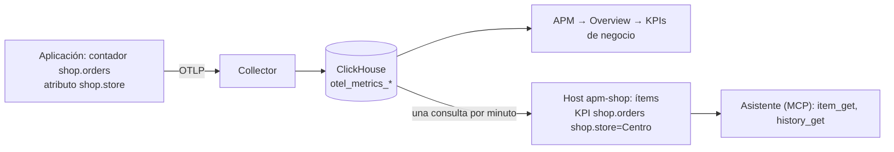

# KPIs de negocio

[English](business-kpis.md)

Tus aplicaciones ya saben lo que le importa al negocio: los pedidos de cada tienda, las reservas de cada hotel, los
pagos por moneda. Si lo envían como métricas de OpenTelemetry, Zabbix APM lo convierte en:

- la pestaña **KPIs de negocio** de **APM → Overview**: cada métrica con su total del periodo, su tendencia y un
  desglose por atributo (pedidos por tienda, reservas por hotel);
- **ítems de Zabbix** en el host de la aplicación, descubiertos por el template **APM business metrics by ClickHouse
  HTTP**: uno por métrica y por cada valor de sus atributos, minuto a minuto y hora a hora, con los totales de la última
  hora, de hoy y de ayer. Historial, gráficos, triggers y dashboards funcionan como con cualquier ítem;
- respuestas del **asistente** ([zabbix-mcp](https://github.com/SimonLexRS/zabbix-mcp)), que lee esos ítems por el
  servidor MCP de Zabbix: *"¿Cuántos pedidos tuvo hoy la tienda Centro?"*.




No se configura nada por métrica: un contador nuevo en el código aparece enseguida en la pestaña y en un minuto como
ítems.

## 1. Enviar las métricas desde la aplicación

Usa la API de métricas del SDK de OpenTelemetry, con el mismo exportador y el mismo `service.namespace` que las trazas.
Elige el instrumento según lo que significa el número:

| Instrumento | Para | Ejemplo | En Zabbix |
|---|---|---|---|
| **Counter** | cosas que ocurren | pedidos, reservas, pagos, ingresos | aumento por minuto y por hora; totales de la última hora, de hoy y de ayer |
| **Histogram** | importes de cada evento | importe de un pedido, noches de una reserva | cantidad por minuto, suma por minuto y de hoy, promedio de la última hora |
| **UpDownCounter** | niveles que suben y bajan | habitaciones ocupadas, unidades en stock | valor actual |
| **Gauge** | niveles medidos cada tanto | largo de una cola, temperatura | valor actual |

Cada **atributo** de la métrica se convierte en un desglose: `shop.store = Centro` tiene sus propios ítems. Usa
atributos con pocos valores conocidos (tienda, hotel, canal, moneda, plan). Nunca identificadores, correos, URLs ni
texto libre: cada valor es un juego de ítems, y el template ignora las claves que parecen identificadores
(`{$APM.KPI.DIMENSION.NOT_MATCHES}`).

Nombra las métricas con un prefijo de tu dominio (`shop.`, `hotel.`, `billing.`) y pon la unidad cuando es una real
(`USD`, `s`, `By`). Las anotaciones como `{order}` se quitan: el nombre ya dice qué se cuenta.

**Go** (completo en [examples/stacks/go](../examples/stacks/go/main.go), `POST /order?store=Centro`):

```go
meter := otel.Meter("shop")
orders, _ := meter.Int64Counter("shop.orders", metric.WithUnit("{order}"), metric.WithDescription("Orders placed"))
revenue, _ := meter.Float64Counter("shop.revenue", metric.WithUnit("USD"))

attrs := metric.WithAttributes(attribute.String("shop.store", store))
orders.Add(ctx, 1, attrs)
revenue.Add(ctx, amount, attrs)
```

**Python**:

```python
from opentelemetry import metrics

meter = metrics.get_meter("shop")
orders = meter.create_counter("shop.orders", unit="{order}", description="Orders placed")
orders.add(1, {"shop.store": store})
```

**Node.js**:

```js
const { metrics } = require('@opentelemetry/api');
const reservations = metrics.getMeter('hotel').createCounter('hotel.reservations', { unit: '{reservation}' });
reservations.add(1, { 'hotel.name': hotel, 'hotel.room_type': roomType });
```

**Java**:

```java
LongCounter payments = GlobalOpenTelemetry.getMeter("billing").counterBuilder("billing.payments").build();
payments.add(1, Attributes.of(AttributeKey.stringKey("billing.currency"), currency));
```

**.NET**:

```csharp
var meter = new Meter("Shop");   // y .AddMeter("Shop") en la configuración de OpenTelemetry
var orders = meter.CreateCounter<long>("shop.orders", "{order}");
orders.Add(1, new KeyValuePair<string, object?>("shop.store", store));
```

Con los agentes sin código (Java, .NET, Node.js, Python), el mismo agente exporta el meter de tu código; en .NET
regístralo con `AddMeter`.

Comprobación: **APM → Overview →** tu aplicación **→ KPIs de negocio** muestra la métrica en un minuto (el intervalo de
exportación por defecto de los SDK es 60 s).

## 2. Guardarlas como ítems de Zabbix

Enlaza el template al host de la aplicación. Con el script, el mismo que crea el host
([add-application.es.md](add-application.es.md)):

```sh
export ZABBIX_URL=http://<zabbix>/zabbix ZABBIX_API_TOKEN=<token>
export CH_URL=http://127.0.0.1:8123/ CH_USER=zabbix_ro CH_PASSWORD=<contraseña-de-lectura>
python3 scripts/zabbix-apm-app.py add shop --kpi
```

Importa **APM business metrics by ClickHouse HTTP**
([templates/apm_business_metrics_clickhouse_http.json](../templates/apm_business_metrics_clickhouse_http.json)), lo
enlaza a `apm-shop` y pone `{$APM.NAMESPACE}=shop`. Las macros de ClickHouse van al host (la contraseña como macro
secreta); sin `CH_*`, define `{$CH.URL}`, `{$CH.USER}` y `{$CH.PASSWORD}` como macros globales. La URL de ClickHouse
debe ser accesible desde el servidor (o proxy) de Zabbix que monitorea el host.

A mano: **Recolección de datos → Templates → Importar** el archivo JSON, enlazarlo al host y poner las macros.

A los 2–3 minutos, **Monitoreo → Últimos datos**, host `apm-shop`, tag `component: kpi`:

| Ítem | Clave | Qué es |
|---|---|---|
| `KPI shop.orders (checkout-api): per minute` | `apm.kpi.value["checkout-api","shop.orders"]` | pedidos de cada minuto |
| `KPI shop.orders (checkout-api): last hour` | `apm.kpi.1h[...]` | pedidos de los últimos 60 minutos |
| `KPI shop.orders (checkout-api): per hour` | `apm.kpi.hour[...]` | pedidos de cada hora de reloj, guardados en el minuto 5 de la siguiente (400 días de historial) |
| `KPI shop.orders (checkout-api): today` | `apm.kpi.today[...]` | pedidos desde las 00:00 (zona horaria del servidor) |
| `KPI shop.orders (checkout-api): yesterday` | `apm.kpi.yesterday[...]` | pedidos de ayer (400 días de historial: un valor por día) |
| `KPI shop.orders shop.store=Centro (checkout-api): per minute` | `apm.kpi.value["checkout-api","shop.orders","shop.store","Centro"]` | lo mismo, de una tienda |
| `KPI shop.order.amount (checkout-api): sum per minute` | `apm.kpi.sum[...]` | histogramas: suma de los importes; también `sum today` y `average last hour` |
| `KPI hotel.rooms.occupied (reservas-api): current` | `apm.kpi.value[...]` | contadores ascendentes/descendentes e indicadores: solo el valor actual |

Tags de cada ítem: `component: kpi`, `kpi: <métrica>`, `service`, `kind` y, por valor, `dimension: <clave>` y
`<clave>: <valor>` (por ejemplo `shop.store: Centro`). Úsalos en dashboards, en triggers y para encontrar los ítems por
la API.

El template no trae triggers sobre los KPIs: qué está mal depende de cada negocio. Agrégalos en el host, por ejemplo
*sin pedidos en 15 minutos en horario de atención*:

```
sum(/apm-shop/apm.kpi.value["checkout-api","shop.orders"],15m)=0 and time()>=90000 and time()<210000
```

### Cómo mide

- Una consulta por minuto (ítem maestro `apm.kpi.get`); las reglas de descubrimiento y los ítems de KPI son
  dependientes o calculados.
- Cada valor es el **último minuto cerrado**, medido con `{$APM.KPI.DELAY}` (60 s) de retraso, para que hayan llegado
  las exportaciones de ese minuto; Zabbix lo guarda unos dos minutos después del minuto que mide. Los minutos no se
  solapan: la suma del historial sobre cualquier periodo es el total de ese periodo.
- Los SDK envían los contadores acumulados: el template toma las diferencias entre puntos, cuenta un reinicio (valor
  menor) como si empezara de 0 y suma todas las instancias y combinaciones de atributos. Los contadores delta se suman
  tal como llegan.
- Una métrica o un valor visto en los últimos `{$APM.KPI.DISCOVERY.WINDOW}` minutos (60) da 0 en un minuto sin
  actividad, así que una tienda sin ventas tiene 0, no un hueco. Los ítems que no se ven durante un día se desactivan,
  y se borran a los 30 días.
- Los indicadores y los contadores ascendentes/descendentes solo cuentan las instancias que enviaron datos en los
  últimos 5 minutos.

### Macros

| Macro | Por defecto | Qué es |
|---|---|---|
| `{$APM.NAMESPACE}` | | Aplicación (`service.namespace`). Obligatoria |
| `{$APM.KPI.METRIC.MATCHES}` | `.*` | Métricas a descubrir, por ejemplo `^(shop\|hotel)\.` |
| `{$APM.KPI.METRIC.NOT_MATCHES}` | métricas de la instrumentación | Métricas de runtime, HTTP, RPC, base de datos, mensajería y del SDK (`http.`, `go.`, `jvm.`, `otel.`…) |
| `{$APM.KPI.DIMENSION.NOT_MATCHES}` | identificadores | Claves de atributo que no se desglosan (`*.id`, `session`, `user`, `email`, `url`, `ip`…) |
| `{$APM.KPI.VALUES.LIMIT}` | `20` | Valores por atributo (los de más actividad); el resto sigue contando en el total |
| `{$APM.KPI.LIMIT}` | `1000` | Filas de la consulta (métricas más valores) |
| `{$APM.KPI.DELAY}` | `60` | Segundos de espera para que un minuto esté completo. Súbelo si el intervalo de exportación es mayor que 60 s |
| `{$APM.KPI.DISCOVERY.WINDOW}` | `60` | Minutos para el descubrimiento y para los ceros de los minutos sin actividad |
| `{$APM.SERVICE.MATCHES}` / `NOT_MATCHES` | `.*` / | Servicios cuyas métricas se descubren |
| `{$CH.URL}`, `{$CH.USER}`, `{$CH.PASSWORD}`, `{$CH.DB}` | | Interfaz HTTP de ClickHouse, usuario de solo lectura |

## 3. Preguntarle al asistente

Con el [módulo de agente de Zabbix](https://github.com/SimonLexRS/zabbix-mcp) (0.2.3 o posterior), el asistente encuentra
estos ítems por su nombre (`KPI <métrica> ...`) y lee sus valores:

- *¿Cuántos pedidos tuvo hoy cada tienda?* → los ítems `today` de `shop.orders` por `shop.store`.
- *¿Cuántas reservas tuvo ayer el Hotel Playa y cuánto ingresó?* → `yesterday` de `hotel.reservations` y
  `hotel.revenue` para `hotel.name: Hotel Playa`.
- *¿Qué tienda vendió menos en la última hora?* → `last hour` de `shop.orders` por tienda.
- *¿Cuántos pedidos hubo entre las 10:00 y las 12:00?* → la suma de los valores `per hour` de esas dos horas.
- *¿Cuántas reservas hubo esta semana?* → la suma de los valores `per hour` de la semana (`history_get` lee hasta 7
  días atrás y 1000 valores; un día de valores `per minute` son 1440, así que el asistente usa las horas).

El servidor MCP debe exponer las herramientas `item_get` e `history_get`, que la configuración que trae Zabbix deniega:
quita esas reglas `DenyTool` de `/etc/zabbix/zabbix_mcp_server.conf` (ver la guía de zabbix-mcp). Devuelven valores de ítems, y el token de API del
servidor decide qué hosts ve.

## Probarlo sin una aplicación

`scripts/kpi-demo.py` envía una tienda (`tienda-demo`: pedidos, ingresos y carritos abandonados por tienda, importes de
los pedidos) y una cadena de hoteles (`hotel-demo`: reservas por hotel y tipo de habitación, cancelaciones, ingresos,
habitaciones ocupadas), con un span de servidor por pedido y por reserva. Cada minuto imprime los totales desde que
arrancó, para compararlos con Zabbix:

```sh
python3 scripts/kpi-demo.py                               # a http://127.0.0.1:4318, Ctrl+C lo detiene
python3 scripts/zabbix-apm-app.py add tienda-demo --kpi
python3 scripts/zabbix-apm-app.py add hotel-demo --kpi
```

La OpenTelemetry Demo ya envía métricas de negocio: `demo.payment.transactions` por moneda, `demo.ad.requests`,
`demo.exchange.conversions_counter` por moneda, `demo.shipping.items_shipped`, `quotes` por cantidad de artículos.
Agrega `--kpi` a su host para guardarlas.

## Problemas

| Síntoma | Causa |
|---|---|
| La pestaña no muestra ninguna métrica | La métrica tiene un prefijo de instrumentación (`http.`, `go.`…), o la aplicación no envía métricas: revisa APM → Métricas |
| Una métrica está en la pestaña pero no tiene ítems | El template no está enlazado, `{$APM.NAMESPACE}` es distinta, o no cumple `{$APM.KPI.METRIC.MATCHES}` |
| `APM business metrics: Get` no soportado | `{$CH.URL}` no es accesible desde el servidor o el proxy, o `{$CH.USER}` / `{$CH.PASSWORD}` son incorrectos: el error está en Últimos datos |
| Trigger *no data from ClickHouse* | Lo mismo: la consulta no devuelve nada desde hace 10 minutos |
| Un atributo no tiene desglose | Su clave cumple `{$APM.KPI.DIMENSION.NOT_MATCHES}`, o supera los `{$APM.KPI.VALUES.LIMIT}` valores |
| Unos minutos dan menos de lo real y los siguientes más | El intervalo de exportación es mayor que `{$APM.KPI.DELAY}`: súbelo (por ejemplo, 120) |
| Nombres sin comillas | Las comillas y las barras invertidas se quitan de los nombres y valores: las claves de los ítems no las admiten |
