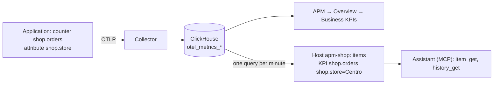

# Business KPIs

[Español](business-kpis.es.md)

Your applications already know what matters to the business: orders placed in each store, reservations of each hotel,
payments by currency. If they send it as OpenTelemetry metrics, Zabbix APM turns it into:

- the **Business KPIs** tab of **APM → Overview**: each metric with its total of the period, its trend and a breakdown
  by attribute (orders by store, reservations by hotel);
- **Zabbix items** on the host of the application, discovered by the template **APM business metrics by ClickHouse
  HTTP**: one per metric and per value of each attribute, minute by minute and hour by hour, with complete totals of
  the last hour, last 24 hours, today and yesterday, the value of each counter, and the share and rank of each store or
  hotel to compare them. Availability (rooms free, stock) is there too, as current values. History, graphs, triggers and dashboards work as with any item;
- a **comparison dashboard** per application, created by one command;
- answers of the **assistant** ([zabbix-mcp](https://github.com/SimonLexRS/zabbix-mcp)), which reads those items through
  the Zabbix MCP server: *"How many orders did the Centro store have today?"*.




Nothing is configured per metric: a new counter in the code appears in the tab at once and as items within a minute.

## 1. Send the metrics from the application

Use the metrics API of the OpenTelemetry SDK, with the same exporter and the same `service.namespace` as the traces.
Choose the instrument by what the number means:

| Instrument | For | Example | In Zabbix |
|---|---|---|---|
| **Counter** | things that happen | orders, reservations, payments, revenue | per minute and per hour; totals of the last hour, last 24 hours, today and yesterday; the value of the counter; share and rank of each value |
| **Histogram** | amounts of each event | amount of an order, nights of a reservation | the same for the count, plus sum and average of today and yesterday |
| **UpDownCounter** | levels that go up and down | rooms occupied, units in stock | current value |
| **Gauge** | levels measured from time to time: **availability** | rooms of the hotel, rooms free, occupancy %, units in stock, products out of stock | current value |

Each **attribute** of the metric becomes a breakdown: `shop.store = Centro` gets its own items. Use attributes with a
few known values (store, hotel, channel, currency, plan). Never identifiers, e-mails, URLs or free text: every value is
a set of items, and the template ignores keys that look like identifiers (`{$APM.KPI.DIMENSION.NOT_MATCHES}`).

Name the metrics with a prefix of your domain (`shop.`, `hotel.`, `billing.`), and set the unit when it is a real one
(`USD`, `s`, `By`). Annotations such as `{order}` are dropped: the name already says what is counted.

**Availability** (how many rooms there are, how many are free, how much stock is left) is a set of gauges with the same
attribute as the sales: `hotel.rooms.capacity`, `hotel.rooms.available` and `hotel.occupancy` (`%`) by `hotel.name`;
`shop.stock.available`, `shop.stock.capacity` and `shop.products.out_of_stock` by `shop.store`. Send what the
application already knows (its rooms, its stock) with an observable gauge, which the SDK reads at each export. In the
total of a metric the values are added up (220 rooms in the chain), except percentages, which are averaged. For the
occupancy of the whole chain weighted by its rooms, send it as one more metric or compare `rooms.occupied` with
`rooms.capacity`.

```python
def rooms_available(options):
    for hotel, free in inventory.free_rooms().items():       # what your application knows
        yield metrics.Observation(free, {"hotel.name": hotel})

meter.create_observable_gauge("hotel.rooms.available", [rooms_available], unit="{room}")
```

**Go** (complete in [examples/stacks/go](../examples/stacks/go/main.go), `POST /order?store=Centro`):

```go
meter := otel.Meter("shop")
orders, _ := meter.Int64Counter("shop.orders", metric.WithUnit("{order}"), metric.WithDescription("Orders placed"))
revenue, _ := meter.Float64Counter("shop.revenue", metric.WithUnit("USD"))

attrs := metric.WithAttributes(attribute.String("shop.store", store))
orders.Add(ctx, 1, attrs)
revenue.Add(ctx, amount, attrs)
```

**Python**:

```python
from opentelemetry import metrics

meter = metrics.get_meter("shop")
orders = meter.create_counter("shop.orders", unit="{order}", description="Orders placed")
orders.add(1, {"shop.store": store})
```

**Node.js**:

```js
const { metrics } = require('@opentelemetry/api');
const reservations = metrics.getMeter('hotel').createCounter('hotel.reservations', { unit: '{reservation}' });
reservations.add(1, { 'hotel.name': hotel, 'hotel.room_type': roomType });
```

**Java**:

```java
LongCounter payments = GlobalOpenTelemetry.getMeter("billing").counterBuilder("billing.payments").build();
payments.add(1, Attributes.of(AttributeKey.stringKey("billing.currency"), currency));
```

**.NET**:

```csharp
var meter = new Meter("Shop");   // and .AddMeter("Shop") in the OpenTelemetry setup
var orders = meter.CreateCounter<long>("shop.orders", "{order}");
orders.Add(1, new KeyValuePair<string, object?>("shop.store", store));
```

With the zero-code agents (Java, .NET, Node.js, Python) the meter of your code is exported by the same agent; in .NET
register it with `AddMeter`.

Check: **APM → Overview →** your application **→ Business KPIs** shows the metric within a minute (the default export
interval of the SDKs is 60 s).

## 2. Keep them as Zabbix items

Link the template to the host of the application. With the script, the same one that creates the host
([add-application.md](add-application.md)):

```sh
export ZABBIX_URL=http://<zabbix>/zabbix ZABBIX_API_TOKEN=<token>
export CH_URL=http://127.0.0.1:8123/ CH_USER=zabbix_ro CH_PASSWORD=<reader-password>
python3 scripts/zabbix-apm-app.py add shop --kpi
```

It imports **APM business metrics by ClickHouse HTTP**
([templates/apm_business_metrics_clickhouse_http.json](../templates/apm_business_metrics_clickhouse_http.json)), links
it to `apm-shop` and sets `{$APM.NAMESPACE}=shop`. The ClickHouse macros go to the host (the password as a secret
macro); without `CH_*`, define `{$CH.URL}`, `{$CH.USER}` and `{$CH.PASSWORD}` as global macros. The ClickHouse URL must
be reachable from the Zabbix server (or proxy) that monitors the host.

By hand: **Data collection → Templates → Import** the JSON file, link it to the host and set the macros.

After 2–3 minutes, **Monitoring → Latest data**, host `apm-shop`, tag `component: kpi`:

| Item | Key | Meaning |
|---|---|---|
| `KPI shop.orders (checkout-api): per minute` | `apm.kpi.value["checkout-api","shop.orders"]` | orders in each minute |
| `KPI shop.orders (checkout-api): today` | `apm.kpi.today[...]` | orders since 00:00 in `{$APM.KPI.TIMEZONE}` ¹ |
| `KPI shop.orders (checkout-api): yesterday` | `apm.kpi.yesterday[...]` | orders yesterday ¹; 400 days of history, so it keeps the total of each day |
| `KPI shop.orders (checkout-api): last hour` / `last 24 hours` | `apm.kpi.1h[...]`, `apm.kpi.24h[...]` | orders in the last 60 minutes / 24 hours ¹ |
| `KPI shop.orders (checkout-api): total (counter)` | `apm.kpi.total[...]` | the value of the counter of the application: its total since it started, the figure to compare with the application itself ¹ |
| `KPI shop.orders (checkout-api): per hour` | `apm.kpi.hour[...]` | orders of each clock hour, stored at minute 5 of the next one (400 days of history) |
| `KPI shop.orders (checkout-api): last 7 days` | `apm.kpi.7d[...]` | sum of the `per hour` values: from the history of Zabbix, it counts since the item exists |
| `KPI shop.orders shop.store=Centro (checkout-api): ...` | `apm.kpi.today["checkout-api","shop.orders","shop.store","Centro"]`... | the same items for one store |
| `KPI shop.orders shop.store=Centro (checkout-api): share today` / `rank today` | `apm.kpi.share.today[...]`, `apm.kpi.rank.today[...]` | % of the orders of today that Centro had among all the stores, and its position (1 = the most) ¹ |
| `KPI shop.order.amount (checkout-api): sum today` | `apm.kpi.sum.today[...]` | histograms: sum of the amounts; also `sum per minute`, `sum yesterday` and `average today` ¹ |
| `KPI hotel.rooms.available hotel.name=Hotel Playa (reservas-api): current` | `apm.kpi.value[...]` | gauges and up-down counters (availability, stock): current value only |

¹ From ClickHouse (master item `apm.kpi.totals.get`, every `{$APM.KPI.TOTALS.INTERVAL}`), so they are complete from the
first minute, also for items created today. ClickHouse keeps the metrics 3 days by default (`ttl: 72h` of the
collector): longer periods come from the history of Zabbix (`per hour`, `last 7 days`, the daily values of
`yesterday`).

Tags of every item: `component: kpi`, `kpi: <metric>`, `service`, `kind` and, per value, `dimension: <key>` and
`<key>: <value>` (e.g. `shop.store: Centro`). Use them in dashboards, in triggers and to find the items in the API.

The template has no triggers on the KPIs themselves: what is wrong depends on each business. Add them on the host, for
example *no orders in 15 minutes during opening hours*:

```
sum(/apm-shop/apm.kpi.value["checkout-api","shop.orders"],15m)=0 and time()>=90000 and time()<210000
```

### How it measures

- Two queries: one per minute (master item `apm.kpi.get`, the values per minute and the discovery) and one for the
  totals (`apm.kpi.totals.get`); every KPI item is dependent or calculated.
- Each value is the **last closed minute**, measured `{$APM.KPI.DELAY}` (60 s) late, so that the exports of that
  minute have arrived; Zabbix stores it about two minutes after the minute it measures. Minutes do not overlap: the sum
  of the history over any period is the total of that period.
- Counters are cumulative in the SDKs: the template takes the differences between points, counts a restart (lower
  value) as starting from 0, and adds up all instances and attribute sets. Delta counters are added as they come.
- A metric or value seen in the last `{$APM.KPI.DISCOVERY.WINDOW}` minutes (60) reports 0 in a quiet minute, so a
  store without sales has 0, not a gap. Items not seen for a day are disabled, and deleted after 30 days.
- Gauges and up-down counters count only the instances that reported in the last 5 minutes. In the total of a metric
  they are added up, except percentages (`%`), which are averaged.

### Macros

| Macro | Default | Meaning |
|---|---|---|
| `{$APM.NAMESPACE}` | | Application (`service.namespace`). Required |
| `{$APM.KPI.METRIC.MATCHES}` | `.*` | Metrics to discover, e.g. `^(shop\|hotel)\.` |
| `{$APM.KPI.METRIC.NOT_MATCHES}` | instrumentation metrics | Runtime, HTTP, RPC, database, messaging and SDK metrics (`http.`, `go.`, `jvm.`, `otel.`...) |
| `{$APM.KPI.DIMENSION.NOT_MATCHES}` | identifiers | Attribute keys that are not broken down (`*.id`, `session`, `user`, `email`, `url`, `ip`...) |
| `{$APM.KPI.VALUES.LIMIT}` | `20` | Values per attribute (the busiest); the rest still count in the total |
| `{$APM.KPI.LIMIT}` | `1000` | Rows of the query (metrics plus values) |
| `{$APM.KPI.DELAY}` | `60` | Seconds of wait for a minute to be complete. Raise it if the export interval is longer than 60 s |
| `{$APM.KPI.DISCOVERY.WINDOW}` | `60` | Minutes for discovery and for the zeros of quiet minutes |
| `{$APM.KPI.TIMEZONE}` | `UTC` | Time zone of the days of `today` and `yesterday`, e.g. `America/La_Paz` |
| `{$APM.KPI.TOTALS.INTERVAL}` | `2m` | How often the totals are read from ClickHouse |
| `{$APM.SERVICE.MATCHES}` / `NOT_MATCHES` | `.*` / | Services whose metrics are discovered |
| `{$CH.URL}`, `{$CH.USER}`, `{$CH.PASSWORD}`, `{$CH.DB}` | | ClickHouse HTTP interface, read-only user |

## 3. Compare the values on a dashboard

```sh
python3 scripts/zabbix-apm-app.py kpi-dashboard shop
```

Creates (or updates) the dashboard **KPIs shop**: at the top the totals of every metric (today, current values, value
of the counters); then, for each metric and attribute (orders by store, reservations by hotel, rooms available by
hotel...):

- a **pie chart** of today (or of the current value), with each store or hotel and the total;
- **top items** with today, share, rank and yesterday of each value;
- a **graph** per hour of the last 7 days (current values: the last 24 hours).

The widgets use item name patterns (`KPI shop.orders shop.store=*: today`), so a new store appears by itself; run the
command again for a new metric or attribute. The dashboard is private to the user of the token: share it in
**Dashboards → Sharing**.

## 4. Ask the assistant

With the [Zabbix agent module](https://github.com/SimonLexRS/zabbix-mcp) (0.2.4 or later), the assistant finds these
items by their name (`KPI <metric> ...`) and reads their values:

- *How many orders did each store have today?* → the `today` items of `shop.orders` by `shop.store`.
- *How many reservations did Hotel Playa have yesterday, and how much revenue?* → `yesterday` of `hotel.reservations`
  and `hotel.revenue` for `hotel.name: Hotel Playa`.
- *Which store sold the least in the last hour?* → `last hour` of `shop.orders` by store.
- *Which store sold the most today, and what share?* → `rank today` and `share today` of `shop.orders` by store.
- *How many rooms are free in each hotel?* → `current` of `hotel.rooms.available` by `hotel.name`.
- *Does the counter of the application match?* → `total (counter)`, the same figure the application reports.
- *How many orders between 10:00 and 12:00?* → sum of the `per hour` values of those two hours.
- *How many reservations this week?* → sum of the `per hour` values of the week (`history_get` reads up to 7 days back
  and 1000 values; a day of `per minute` values is 1440, so the assistant uses the hours).

The MCP server must expose the tools `item_get` and `history_get`, which the configuration shipped with Zabbix denies:
remove those `DenyTool` rules from `/etc/zabbix/zabbix_mcp_server.conf` (see the zabbix-mcp guide). They return item values, and the API token of the server decides
which hosts it sees.

## Try it without an application

`scripts/kpi-demo.py` sends a store (`tienda-demo`: orders, revenue and abandoned carts by store, order amounts, and the
stock of each store) and a hotel chain (`hotel-demo`: reservations by hotel and room type, cancellations, revenue, and
the rooms, rooms free, rooms occupied and occupancy of each hotel), with a server span per order and reservation. Every minute it prints the totals since it started, to compare them with Zabbix:

```sh
python3 scripts/kpi-demo.py                               # to http://127.0.0.1:4318, Ctrl+C stops
python3 scripts/zabbix-apm-app.py add tienda-demo --kpi
python3 scripts/zabbix-apm-app.py add hotel-demo --kpi
python3 scripts/zabbix-apm-app.py kpi-dashboard tienda-demo      # after 2-3 minutes
python3 scripts/zabbix-apm-app.py kpi-dashboard hotel-demo
```

The OpenTelemetry Demo already sends business metrics: `demo.payment.transactions` by currency, `demo.ad.requests`,
`demo.exchange.conversions_counter` by currency, `demo.shipping.items_shipped`, `quotes` by number of items. Add
`--kpi` to its host to keep them.

## Troubleshooting

| Symptom | Cause |
|---|---|
| The tab shows no metric | The metric has an instrumentation prefix (`http.`, `go.`...), or the application sends no metrics: check APM → Metrics |
| A metric is in the tab but has no items | The template is not linked, `{$APM.NAMESPACE}` differs, or it does not match `{$APM.KPI.METRIC.MATCHES}` |
| `APM business metrics: Get` is not supported | `{$CH.URL}` not reachable from the server or proxy, or wrong `{$CH.USER}` / `{$CH.PASSWORD}`: the error is in Latest data |
| Trigger *no data from ClickHouse* | The same: the query has returned nothing for 10 minutes |
| An attribute has no breakdown | Its key matches `{$APM.KPI.DIMENSION.NOT_MATCHES}`, or it is beyond `{$APM.KPI.VALUES.LIMIT}` values |
| The minutes are lower than the real ones and the next ones higher | The export interval is longer than `{$APM.KPI.DELAY}`: raise it (e.g. 120) |
| `today` differs from the figure of the application | The application counts since it started: compare with `total (counter)`; or the day is in another time zone: set `{$APM.KPI.TIMEZONE}` |
| `yesterday` is 0 after linking | ClickHouse had no data of yesterday (it keeps 3 days); it is right from the next day |
| Names without quotes | Quotes and backslashes are removed from names and values: item keys cannot hold them |
