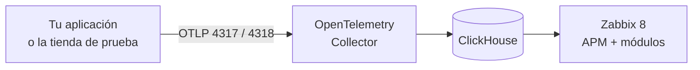

# De Zabbix 8 a APM completo, paso a paso

[English](ubuntu-step-by-step.md)

Parte de un server Ubuntu o Debian que **ya tiene Zabbix 8** y termina con APM funcionando y una tienda de prueba enviando datos. Son cuatro comandos; cada uno comprueba lo que hace y se puede repetir.



## Prerequisitos

| Necesitas | Detalle |
|---|---|
| **Zabbix 8.0 funcionando** | Server y frontend en este mismo equipo, instalados por paquetes o compilados |
| **Ubuntu o Debian**, `amd64` o `arm64` | Con un usuario que pueda usar `sudo` y salida a Internet |
| **Token de API de un Super admin** | En Zabbix: **User settings → API tokens → Create API token**. Cópialo: se pide una sola vez |
| **4 GiB de RAM y 5 GB de disco** | Con la tienda de prueba: **10 GiB de RAM y 20 GB de disco** |
| **Puertos libres** | `8123` y `9000` (ClickHouse), `4317` y `4318` (Collector); con la tienda, `18080` |

El paso 2 comprueba todo esto antes de instalar nada.

## 1. Descargar el repositorio

```sh
sudo apt-get update && sudo apt-get install -y git
git clone https://github.com/SimonLexRS/zabbix-apm-dashboard.git
cd zabbix-apm-dashboard
```

## 2. Comprobar los prerequisitos

```sh
sudo ./scripts/setup.sh check
```

Pega el token cuando lo pida (no se ve al escribir). ✅ Todas las líneas deben empezar con `✔`. Si una empieza con `✘`, la misma línea dice cómo arreglarlo.

## 3. Instalar APM

```sh
sudo ./scripts/setup.sh install
```

Tarda de 1 a 10 minutos, según tu conexión. Instala y conecta, en este orden:

| Qué | Cómo queda |
|---|---|
| **ClickHouse** | Guarda trazas, logs y métricas 72 h. Solo escucha en `localhost` |
| **OpenTelemetry Collector** | Recibe OTLP en `127.0.0.1:4317` (gRPC) y `:4318` (HTTP) y escribe en ClickHouse |
| **Módulos** | **APM → Overview**, **Real user monitoring** y dos widgets, ya habilitados |
| **Fuente de datos APM** | Zabbix lee ClickHouse con un usuario de solo lectura |
| **Prueba** | Envía una traza y comprueba que Zabbix puede leerla |

✅ Termina con `APM is ready`. Abre Zabbix: el menú tiene **APM → Overview**.

Si no vas a usar la tienda, ya puedes [conectar tu aplicación](add-application.es.md).

## 4. Integrar la tienda de prueba

La tienda es el [OpenTelemetry Demo](../examples/stacks/opentelemetry-demo/README.es.md): unos 20 servicios en Docker con tráfico simulado. Indica la IP con la que abres este server en el navegador:

```sh
sudo ./scripts/setup.sh demo 192.168.56.2
```

La primera vez descarga 8.6 GB de imágenes. Instala Docker, hace que el Collector escuche también en la red interna de Docker (no en tu red), arranca la tienda y crea su host en Zabbix.

✅ Termina con `Traces from the store are arriving in ClickHouse`. Ahora:

1. Abre la tienda en `http://<IP>:18080/` y navega por ella.
2. En Zabbix, **APM → Overview → opentelemetry-demo**: mapa de servicios, peticiones y errores.
3. En **APM → Real user monitoring** aparece tu sesión del navegador.

> [!WARNING]
> La tienda queda abierta en el puerto 18080 sin autenticación. Úsala solo en una red de pruebas.

## 5. Verificar

Espera 10 minutos, para que Zabbix tenga valores de todos los items, y compara lo que muestra con lo que hay en ClickHouse:

```sh
sudo ./scripts/setup.sh verify
```

✅ Debes ver `all checks passed` y `all required checks passed`.

En cualquier momento, `sudo ./scripts/setup.sh status` resume el estado de cada pieza.

## Si algo falla

Cada comando se puede repetir: continúa donde quedó.

| Síntoma | Solución |
|---|---|
| `Zabbix API not found` | Tu frontend está en otra dirección: `sudo ZABBIX_URL=http://127.0.0.1/zabbix ./scripts/setup.sh check` |
| `API token rejected` | El token debe ser de un usuario con rol Super admin y no estar vencido. Para cambiarlo: `sudo ZABBIX_API_TOKEN=<token> ./scripts/setup.sh check` |
| `Port ... is in use` | Otro servicio usa ese puerto: detenlo o cámbialo de puerto |
| `Could not download the images` | Fallo temporal de red o DNS: repite el comando |
| `verify` falla en `average duration` | Repítelo a los 3 minutos: hay conexiones de la tienda que duran 10 minutos |
| Ya tienes ClickHouse con contraseña | `sudo CH_ADMIN_USER=<usuario> CH_ADMIN_PASSWORD=<clave> ./scripts/setup.sh install` |

Más casos en [troubleshooting.md](troubleshooting.md).

## Operar y desinstalar

| Tarea | Comando |
|---|---|
| Detener la tienda | `sudo ./scripts/setup.sh demo stop` |
| Volver a iniciarla | `sudo ./scripts/setup.sh demo <IP>` |
| Actualizar los módulos | `git pull && sudo ./scripts/setup.sh install` |
| Quitar la tienda, los módulos y el Collector | `sudo ./scripts/setup.sh uninstall` |
| Quitar también ClickHouse **y sus datos** | `sudo ./scripts/setup.sh uninstall --purge` |

Las contraseñas de ClickHouse y el token quedan en `/root/.zabbix`, legibles solo por root. Para dar acceso a usuarios que no son Super admin, mira [install-module.es.md](install-module.es.md#paso-4-ver-datos-y-dar-acceso).

## Qué se comprobó

Estos comandos se ejecutaron tal cual, después de desinstalar todo con `uninstall --purge`, en Ubuntu 26.10 ARM64 con Zabbix 8.0.0rc3 compilado desde fuente, PostgreSQL, Nginx y PHP 8.5. No se probó en AMD64, en Debian ni con Zabbix instalado por paquetes: `check` detecta esas diferencias, pero revisa su resultado.

Para instalar a mano o en otra distribución: [installation.es.md](installation.es.md).
