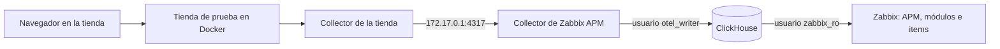

# De Zabbix 8 a APM completo en Ubuntu, paso a paso

[English](ubuntu-step-by-step.md)

Esta guía parte de un Ubuntu que **solo tiene Zabbix 8** y termina con APM funcionando: ClickHouse, OpenTelemetry Collector, los módulos, una tienda de prueba enviando datos y monitoreo de usuarios reales (RUM).

Sigue los pasos **en orden** y **en la misma terminal**, porque las variables de un paso se usan en el siguiente. Cada paso termina con lo que debes ver y, si algo falla, con la solución.

## Qué vas a construir



| Pieza | Para qué sirve | Puerto y dirección |
|---|---|---|
| **ClickHouse** | Guarda trazas, logs y métricas durante 72 h | `8123` y `9000`, solo en `localhost` |
| **Collector** | Recibe la telemetría y la escribe en ClickHouse | `4317` y `4318`, en `127.0.0.1` y en la IP de Docker |
| **Módulos** | Agregan **APM → Overview**, **Real user monitoring** y dos widgets | Dentro del frontend de Zabbix |
| **Tienda de prueba** | OpenTelemetry Demo: 23 contenedores con tráfico simulado | `18080`, abierto en la red |

### Qué se comprobó

Esta guía se ejecutó de principio a fin en un solo server, copiando sus comandos tal como están, después de retirar por completo la capa APM. Solo se omitió la ampliación del disco, que ya estaba hecha:

| Componente | Versión probada |
|---|---|
| Ubuntu | 26.10 ARM64, con 6 vCPU y 9.7 GiB de RAM |
| Zabbix | 8.0.0rc3 compilado desde fuente, con PostgreSQL |
| PHP y Nginx | 8.5 y 1.30 |
| ClickHouse, Collector y Docker | 26.10, 0.164 y 29.7 |

> [!WARNING]
> **No se comprobó** en AMD64, en otras versiones de Ubuntu ni con Zabbix instalado por paquetes. Los comandos están preparados para esos casos, pero revisa cada resultado. Usa esta instalación para pruebas: RC3 no es apta para producción, y la tienda no tiene autenticación.

## Antes de empezar

| Necesitas | Cómo conseguirlo |
|---|---|
| **Acceso con `sudo`** | Tu usuario administrador |
| **10 GiB de RAM** | Con 4 GiB se puede llegar al paso 6; la tienda no cabe |
| **20 GB de disco libres** | La tienda usa 8.6 GB; estimación de 5 GB más para ClickHouse |
| **Token de API de un Super admin** | Zabbix: **User settings → API tokens → Create API token** |
| **Salida a Internet** | Para descargar paquetes e imágenes |

## Paso 0. Definir tus datos

Cambia los dos valores: la IP con la que abres Zabbix y la tienda, y la dirección de tu Zabbix.

```sh
export SERVER_IP=192.168.56.2
export ZABBIX_URL=http://127.0.0.1
```

Pega el token cuando lo pida; no se mostrará en pantalla:

```sh
read -rs ZABBIX_API_TOKEN && export ZABBIX_API_TOKEN
```

Comprueba Zabbix y la arquitectura:

```sh
curl -s -H 'Content-Type: application/json-rpc' \
  -d '{"jsonrpc":"2.0","method":"apiinfo.version","params":{},"id":1}' "$ZABBIX_URL/api_jsonrpc.php"; echo
dpkg --print-architecture
free -h | sed -n 2p
df -h / | tail -1
```

✅ **Debes ver** `"result":"8.0.0"` (RC3 también responde así), tu arquitectura (`arm64` o `amd64`) y la memoria y el disco.

❌ **Si Zabbix no responde:** si lo abres en `/zabbix`, usa `ZABBIX_URL=http://127.0.0.1/zabbix`.

## Paso 1. Preparar el server

### 1.1 ¿Hay disco sin usar?

Ubuntu suele dejar parte del disco sin asignar:

```sh
sudo vgs
```

Si la columna `VFree` muestra espacio libre y lo necesitas, extiéndelo. **Solo aplica con LVM**, y este nombre de volumen es el habitual en Ubuntu:

```sh
sudo lvextend -r -l +100%FREE /dev/ubuntu-vg/ubuntu-lv
```

> En el server de referencia, el disco medía 52.7 GB, pero Ubuntu usaba 24.8 GB. No hizo falta ampliarlo en la VM.

### 1.2 Descargar el repositorio

```sh
sudo apt-get update
sudo apt-get install -y git curl python3
mkdir -p ~/Devs && cd ~/Devs
[ -d zabbix-apm-dashboard ] || git clone https://github.com/SimonLexRS/zabbix-apm-dashboard.git
cd ~/Devs/zabbix-apm-dashboard
```

✅ **Debes ver** tu terminal en `~/Devs/zabbix-apm-dashboard`. Los comandos que siguen se ejecutan desde ahí, salvo que un paso indique otra carpeta.

## Paso 2. Instalar ClickHouse

**Por qué:** Zabbix no guarda las trazas en su base de datos, sino que las lee de ClickHouse.

### 2.1 Instalar

```sh
curl -fsSL https://packages.clickhouse.com/rpm/lts/repodata/repomd.xml.key | sudo gpg --dearmor --yes -o /usr/share/keyrings/clickhouse-keyring.gpg
echo "deb [signed-by=/usr/share/keyrings/clickhouse-keyring.gpg] https://packages.clickhouse.com/deb stable main" | sudo tee /etc/apt/sources.list.d/clickhouse.list
sudo apt-get update
sudo DEBIAN_FRONTEND=noninteractive apt-get install -y clickhouse-server clickhouse-client
```

### 2.2 Limitar su memoria y arrancarlo

Sin esto, los procesos internos de ClickHouse pueden agotar la memoria de un server compartido con Zabbix:

```sh
sudo install -m 644 examples/clickhouse-low-memory.xml /etc/clickhouse-server/config.d/low-memory.xml
sudo systemctl enable clickhouse-server
sudo systemctl restart clickhouse-server
sleep 15
clickhouse-client -q 'select version()'
```

✅ **Debes ver** la versión, por ejemplo `26.10.3.7`.

### 2.3 Crear los usuarios

Se crean dos: `otel_writer` para el Collector y `zabbix_ro`, de solo lectura, para Zabbix. Las contraseñas son aleatorias y solo root puede leerlas:

```sh
sudo install -d -o root -g root -m 700 /root/.zabbix
sudo sh -c 'umask 077; for u in ch_writer ch_reader; do [ -s /root/.zabbix/$u ] || openssl rand -base64 33 | tr -d "/+=" | cut -c1-32 > /root/.zabbix/$u; done'
CH_WRITER=$(sudo cat /root/.zabbix/ch_writer)
CH_READER=$(sudo cat /root/.zabbix/ch_reader)
sed -e "s/<writer-password>/$CH_WRITER/; s/<reader-password>/$CH_READER/" examples/clickhouse-users.sql | clickhouse-client --multiquery
clickhouse-client --user zabbix_ro --password "$CH_READER" -q 'SHOW DATABASES' | grep -x zabbix
```

✅ **Debes ver** `zabbix`.

❌ **Problema real, más adelante:** el Collector no arrancaba con `Not enough privileges`, porque faltaba `CREATE DATABASE` en este archivo SQL. Ya está corregido en el repositorio.

## Paso 3. Instalar el OpenTelemetry Collector

**Por qué:** es la puerta de entrada: recibe los datos en formato OTLP y los escribe en ClickHouse.

### 3.1 Descargar y verificar

El nombre del paquete depende de tu arquitectura. La verificación compara el archivo con el SHA256 que publica el proyecto. Pesa 105 MB: con una conexión lenta tardó unos 8 minutos, y con una mejor, unos 3:

```sh
V=0.164.0
ARCH=$(dpkg --print-architecture)
F=otelcol-contrib_${V}_linux_${ARCH}.deb
cd /tmp
curl -fsSLO "https://github.com/open-telemetry/opentelemetry-collector-releases/releases/download/v$V/$F"
EXPECTED=$(curl -fsSL "https://github.com/open-telemetry/opentelemetry-collector-releases/releases/download/v$V/$F.sha256" | awk '{print $1}')
echo "$EXPECTED  $F" | sha256sum -c -
```

✅ **Debes ver** `otelcol-contrib_0.164.0_linux_arm64.deb: OK`. **Si no dice `OK`, no continúes.**

```sh
sudo dpkg -i "$F"
rm -f "$F"
cd ~/Devs/zabbix-apm-dashboard
```

### 3.2 Configurarlo

> [!CAUTION]
> Al instalarse, el paquete arranca con una configuración de ejemplo **abierta en todas las interfaces** (`*:4317`). Este paso la reemplaza para escuchar solo en `127.0.0.1`.

```sh
sed -e "s#endpoint: 0.0.0.0:4317.*#endpoint: 127.0.0.1:4317#; s#endpoint: 0.0.0.0:4318#endpoint: 127.0.0.1:4318#; s/<clickhouse-writer-user>/otel_writer/; s/<clickhouse-writer-password>/$CH_WRITER/" examples/otelcol-config.yaml | sudo tee /etc/otelcol-contrib/config.yaml >/dev/null
sudo chown root:otelcol-contrib /etc/otelcol-contrib/config.yaml
sudo chmod 640 /etc/otelcol-contrib/config.yaml
sudo otelcol-contrib validate --config=/etc/otelcol-contrib/config.yaml
sudo systemctl enable otelcol-contrib
sudo systemctl restart otelcol-contrib
sleep 15
```

### 3.3 Comprobar

```sh
systemctl is-active otelcol-contrib
ss -tln | grep -E ':(4317|4318) '
clickhouse-client -q 'SHOW TABLES FROM zabbix' | tr '\n' ' '; echo
```

✅ **Debes ver** `active`, los puertos solo en `127.0.0.1`, y tablas como `otel_traces` y `otel_logs`.

❌ **Si falla:** consulta el log con `sudo journalctl -u otelcol-contrib -n 30 --no-pager`. Si el comando `ss` no muestra nada, espera unos segundos: el Collector tarda en abrir los puertos.

## Paso 4. Instalar los módulos

**Por qué:** agregan el análisis por aplicación, el mapa de servicios, RUM y los widgets. Zabbix los carga desde la carpeta `modules` de su frontend, y el script la detecta:

```sh
sudo ./scripts/install.sh
python3 scripts/enable-modules.py
```

✅ **Debes ver** `Installed in .../modules: ApmOverview ApmServiceHealth ApmServiceMap` y tres líneas `enabled`. El menú de Zabbix tendrá **APM → Overview**.

❌ **Si el frontend no se encuentra:** indica la carpeta que contiene `zabbix.php`:

```text
sudo ZABBIX_UI=/ruta/al/frontend ./scripts/install.sh
```

## Paso 5. Conectar Zabbix con ClickHouse

**Por qué:** indica a Zabbix dónde leer los datos. Se usa el usuario de solo lectura:

```sh
curl -s -H 'Content-Type: application/json-rpc' -H "Authorization: Bearer $ZABBIX_API_TOKEN" \
  -d "{\"jsonrpc\":\"2.0\",\"method\":\"settings.update\",\"params\":{\"apm_global_db\":{\"status\":1,\"url\":\"http://127.0.0.1:8123\",\"db\":\"zabbix\",\"authentication_type\":0,\"username\":\"zabbix_ro\",\"password\":\"$CH_READER\"}},\"id\":1}" \
  "$ZABBIX_URL/api_jsonrpc.php"; echo
```

✅ **Debes ver** `"result":["apm_global_db"]`.

También puedes hacerlo en la web: **Administration → Data source → APM**, con los mismos valores. Pulsa **Test** y luego **Update**. La contraseña se obtiene con `sudo cat /root/.zabbix/ch_reader`.

❌ **Problema real:** `value must be empty` en `username`. Ocurre con `authentication_type: 1`, que significa **sin autenticación**. El valor para usuario y contraseña es `0`.

## Paso 6. Probar con datos de prueba

**Por qué:** comprueba toda la cadena antes de instalar la tienda.

```sh
sudo apt-get install -y golang-go
export GOBIN=/tmp/telemetrygen-bin
go install github.com/open-telemetry/opentelemetry-collector-contrib/cmd/telemetrygen@latest
python3 scripts/zabbix-apm-app.py add smoke-test
nohup "$GOBIN/telemetrygen" traces --otlp-endpoint 127.0.0.1:4317 --otlp-insecure --duration 5m --rate 5 --child-spans 2 --service smoke-api --otlp-attributes 'service.namespace="smoke-test"' > /tmp/telemetrygen.log 2>&1 &
```

Esto envía trazas durante 5 minutos. Espera 4 minutos y verifica:

```sh
sleep 240
export CH_URL=http://127.0.0.1:8123 CH_USER=zabbix_ro CH_PASSWORD="$CH_READER"
python3 scripts/verify-app.py smoke-test
```

✅ **Debes ver** `---- all checks passed`.

Borra el host de prueba. Sus datos caducan a las 72 h, y hasta entonces su pestaña seguirá en **APM → Overview**:

```sh
HOSTID=$(curl -s -H 'Content-Type: application/json-rpc' -H "Authorization: Bearer $ZABBIX_API_TOKEN" -d '{"jsonrpc":"2.0","method":"host.get","params":{"output":["hostid"],"filter":{"host":"apm-smoke-test"}},"id":1}' "$ZABBIX_URL/api_jsonrpc.php" | python3 -c "import json,sys; print(json.load(sys.stdin)['result'][0]['hostid'])")
curl -s -H 'Content-Type: application/json-rpc' -H "Authorization: Bearer $ZABBIX_API_TOKEN" -d "{\"jsonrpc\":\"2.0\",\"method\":\"host.delete\",\"params\":[\"$HOSTID\"],\"id\":1}" "$ZABBIX_URL/api_jsonrpc.php"; echo
```

> **APM ya funciona.** Si no tienes RAM para la tienda, puedes detenerte aquí y conectar tus aplicaciones con [add-application.es.md](add-application.es.md).

## Paso 7. Instalar Docker y abrirle paso al Collector

**Por qué:** la tienda corre en contenedores, y un contenedor no alcanza el `127.0.0.1` del server. Se agrega la IP interna de Docker, **sin abrir el Collector en la red**.

```sh
sudo apt-get install -y docker.io docker-compose-v2
ip -br -4 address show docker0
```

✅ **Debes ver** `172.17.0.1/16`. Si es otra IP, cámbiala en `examples/stacks/opentelemetry-demo/otelcol-docker-bridge.yaml`.

```sh
sudo install -m 644 examples/stacks/opentelemetry-demo/otelcol-docker-bridge.yaml /etc/otelcol-contrib/docker-bridge.yaml
sudo sed -i 's|--config=/etc/otelcol-contrib/config.yaml"|--config=/etc/otelcol-contrib/config.yaml --config=/etc/otelcol-contrib/docker-bridge.yaml"|' /etc/otelcol-contrib/otelcol-contrib.conf
sudo mkdir -p /etc/systemd/system/otelcol-contrib.service.d
printf '[Unit]\nAfter=docker.service\nRequires=docker.service\n' | sudo tee /etc/systemd/system/otelcol-contrib.service.d/docker.conf
sudo systemctl daemon-reload
sudo systemctl restart otelcol-contrib
sleep 10
systemctl is-active otelcol-contrib
ss -tln | grep -E ':(4317|4318) '
```

✅ **Debes ver** `active` y los puertos solo en `127.0.0.1` y `172.17.0.1`.

## Paso 8. Desplegar la tienda de prueba

**Por qué:** es una tienda real de unos 20 servicios con un generador de carga. Se usa `compose.zabbix-lite.yaml`, que deja fuera Jaeger, Grafana, Prometheus y OpenSearch porque el visor es Zabbix.

```sh
cd ~/Devs
[ -d opentelemetry-demo ] || git clone https://github.com/SimonLexRS/opentelemetry-demo.git
cd opentelemetry-demo
cp ~/Devs/zabbix-apm-dashboard/examples/stacks/opentelemetry-demo/compose.zabbix-lite.yaml .
cp ~/Devs/zabbix-apm-dashboard/examples/stacks/opentelemetry-demo/otelcol-config-zabbix.yml .
cat > .env.zabbix <<E
ZABBIX_APM_ENDPOINT=host.docker.internal:4317
ZABBIX_APM_NAMESPACE=opentelemetry-demo
ZABBIX_APM_INSECURE=true
DEMO_HOST_PORT=18080
DEMO_PUBLIC_HOST=$SERVER_IP
E
F="-f compose.yaml -f compose.full.yaml -f compose.zabbix-lite.yaml --env-file .env --env-file .env.override --env-file .env.zabbix"
sudo docker compose $F pull --quiet
sudo docker compose $F up -d --no-build
```

La descarga tardó unos 5 minutos y ocupa 8.6 GB.

❌ **Problema real:** `lookup ghcr.io on 127.0.0.53:53: server misbehaving` interrumpió la descarga. Fue un fallo temporal de DNS: **repite el mismo bloque**, y `pull` continúa donde quedó. El aviso `Some service image(s) must be built from source` no es un error mientras la descarga termine bien.

Comprueba tras un minuto:

```sh
sleep 60
sudo docker compose $F ps --format '{{.Service}}: {{.Status}}'
sudo docker logs otel-collector 2>&1 | grep -c 'Everything is ready'
curl -s -o /dev/null -w '%{http_code}\n' "http://$SERVER_IP:18080/"
```

✅ **Debes ver** 23 servicios `Up`, un número mayor que `0` y `200`. La tienda está en `http://<tu-IP>:18080/`.

## Paso 9. Crear el host en Zabbix y verificar

```sh
cd ~/Devs/zabbix-apm-dashboard
python3 scripts/zabbix-apm-app.py add opentelemetry-demo --name "OpenTelemetry Demo" --timeshift 60s
```

> [!IMPORTANT]
> `--timeshift 60s` es necesario. Sin él, la verificación falló: `FAIL Unset average duration: Zabbix 0.0814 s, ClickHouse 0.0544 s`. Los spans cruzan dos Collectors y Zabbix los leía antes de que llegaran todos.

Espera **11 minutos**, para que todos los valores sean nuevos:

```sh
sleep 660
python3 scripts/verify-app.py opentelemetry-demo
```

✅ **Debes ver** `---- all checks passed`.

❌ **Si falla `Error average duration` con un valor enorme en ClickHouse:** repite el comando a los 3 minutos. Son conexiones de `flagd` que duran 600 s y solo llegan al cerrarse. No es un fallo de la instalación.

Abre **APM → Overview → opentelemetry-demo**: tendrás el mapa de servicios y las métricas por servicio.

## Paso 10. Probar RUM

**RUM** muestra lo que vive el usuario en el navegador. La tienda ya trae el SDK web, y su generador de carga abre un navegador sin interfaz:

```sh
python3 scripts/test-rum.py opentelemetry-demo
```

✅ **Debes ver** `---- all required checks passed`. Es normal `Web Vitals: none`: la tienda no los envía.

**Prueba desde tu navegador** (no se ejecutó en la prueba de referencia):

1. Abre `http://<tu-IP>:18080/` y navega por varias páginas.
2. Espera un minuto y abre **APM → Real user monitoring**.
3. Elige `opentelemetry-demo` en las pestañas de arriba. Si ves `smoke-test does not send browser telemetry yet`, es porque abrió la pestaña de la prueba del paso 6.
4. En **Sessions**, busca tu navegador y pulsa **Timeline**.

Más pruebas, incluidos los Web Vitals sintéticos, en [rum.es.md](rum.es.md#cómo-hacer-testing).

## Paso 11. Dejarlo seguro y saber operarlo

**Antes de seguir usándolo:**

| Tarea | Cómo |
|---|---|
| Cambiar la contraseña de `Admin` | **User settings → Profile** |
| Revocar el token si ya no lo usas, o si se expuso | **User settings → API tokens** |
| Proteger el puerto 18080 | Déjalo solo en una red de pruebas |
| Proteger ClickHouse | Su usuario `default` no tiene contraseña, y solo escucha en `localhost`. Cualquier usuario del server puede administrarlo |
| Revisar PHP | Si está sin parche: [vulnerabilidades de octubre de 2026](https://github.com/SimonLexRS/Zabbix-8-rc3-Instalacion/blob/main/docs/seguridad-php.md) |

**Operación diaria:**

```text
cd ~/Devs/opentelemetry-demo
F="-f compose.yaml -f compose.full.yaml -f compose.zabbix-lite.yaml --env-file .env --env-file .env.override --env-file .env.zabbix"

sudo docker compose $F stop                 # detener la tienda y su carga
sudo docker compose $F up -d --no-build     # volver a iniciarla
sudo docker compose $F down -v              # retirarla
sudo docker image prune -a                  # liberar el disco de sus imágenes
```

Después de retirarla, borra el host `apm-opentelemetry-demo` en Zabbix.

## Problemas que aparecieron y cómo se resolvieron

| # | Paso | Síntoma | Causa | Solución |
|---|---|---|---|---|
| 1 | 2 | `otel_writer: Not enough privileges` y el Collector en `failed` | El usuario no tenía `CREATE DATABASE` | Corregido en `examples/clickhouse-users.sql`; en una instalación anterior, aplica el `GRANT` del archivo y reinicia el Collector |
| 2 | 3 | `curl: (22) ... 404` al bajar la lista de checksums, y el `.deb` se instaló sin verificar | No existe un archivo de checksums común: cada paquete publica su `.sha256` | Bajar `$F.sha256`, como en el paso 3.1, y no continuar sin el `OK` |
| 3 | 3 | `curl: (92) HTTP/2 stream ... reset` o JSON cortado al consultar la API de GitHub | La respuesta del release es enorme y lenta | No usar esa API para este paso: `$F.sha256` es un archivo pequeño |
| 4 | 3 | La descarga parece colgada | El `.deb` pesa 105 MB y la conexión era lenta | Esperar; no fue un fallo |
| 5 | 3 | Los puertos aparecen como `*:4317` | Quedó la configuración de ejemplo, abierta en la red | El paso 3.2 la reemplaza; comprueba con `ss` |
| 6 | 3 | `install: No such file or directory` al crear la configuración | `sudo install ... /dev/stdin` falló con esta tubería | Usar `sudo tee` y después `chown` y `chmod`, como en el paso 3.2 |
| 7 | 3 y 7 | `ss` no muestra puertos, aunque el servicio está `active` | El Collector tarda en abrirlos | Esperar unos segundos |
| 8 | 5 | `value must be empty` en `username` | `authentication_type: 1` significa sin autenticación | Usar `0` |
| 9 | 1 y 8 | El demo completo no cabía en 3.3 GiB de RAM | Sus límites suman 8.2 GiB | Subir a unos 10 GiB y usar `compose.zabbix-lite.yaml`, que suma 5.2 GiB |
| 10 | 8 | `lookup ghcr.io ... server misbehaving` durante `pull` | Fallo temporal de DNS | Repetir el bloque |
| 11 | 8 | `compose.local.yaml` del fork no servía | Carga la configuración de Jaeger, Prometheus y OpenSearch | Usar `compose.zabbix-lite.yaml` |
| 12 | 9 | `FAIL Unset average duration` | Con dos Collectors, Zabbix lee antes de que lleguen los spans | `--timeshift 60s` |
| 13 | 9 | `FAIL Error average duration` de vez en cuando | Spans de `flagd` de 600 s | Repetir a los 3 minutos |
| 14 | 8 | `product-catalog` se reinició con `SIGSEGV` | **Sin investigar**; viene de la imagen publicada | Docker lo reinició solo; ocurrió una vez, sin falta de memoria |
| 15 | 8 | `postgresqlreceiver ... failed to explain query` | Receptor de métricas internas del demo | Se puede ignorar: no afectó a las trazas |
| 16 | 10 | `smoke-test does not send browser telemetry yet` | La página abrió la pestaña de otra aplicación | Elegir `opentelemetry-demo` arriba |
| 17 | 10 | **Web Vitals** vacío | La tienda no los envía | Integrar `examples/web-vitals.js` o probar con `--send-sample` |

## Para comprobar todo al final

```sh
systemctl is-active clickhouse-server otelcol-contrib docker
sudo docker ps -q | wc -l
python3 scripts/verify-app.py opentelemetry-demo | tail -1
python3 scripts/test-rum.py opentelemetry-demo | tail -1
curl -s -o /dev/null -w '%{http_code}\n' "http://$SERVER_IP:18080/"
```

✅ **Debes ver** tres `active`, `23`, `all checks passed`, `all required checks passed` y `200`.

## Siguientes pasos

- Conectar tus aplicaciones: [add-application.es.md](add-application.es.md)
- Conectar el navegador de tu sitio: [rum.es.md](rum.es.md)
- Más detalles de la tienda: [examples/stacks/opentelemetry-demo](../examples/stacks/opentelemetry-demo/README.es.md)
- Permisos por rol y otras instalaciones: [install-module.es.md](install-module.es.md) e [installation.es.md](installation.es.md)
