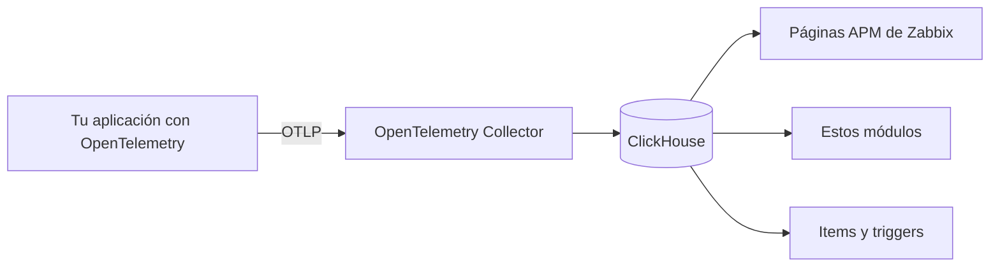
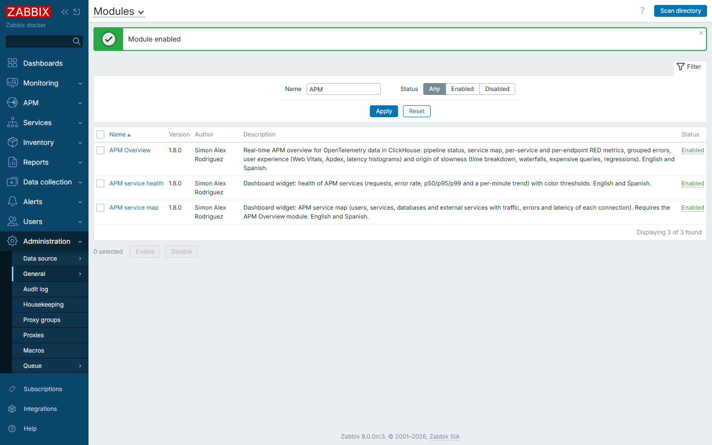
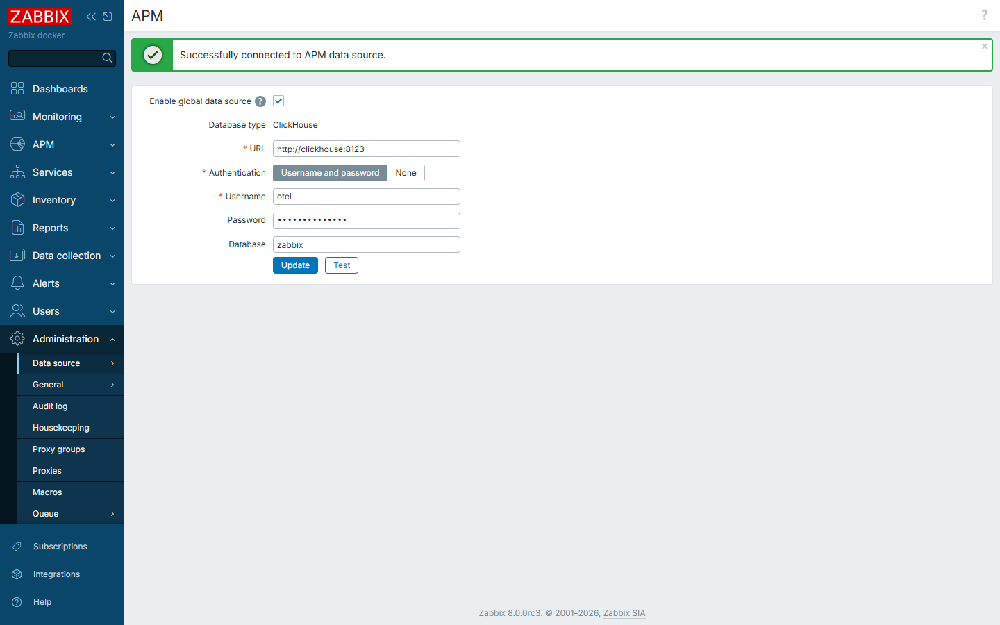
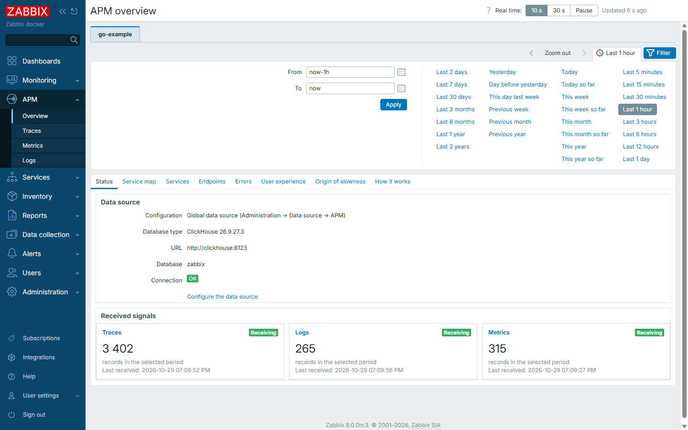

# Instalar los módulos APM en Zabbix

[English](install-module.md)

Guía para cualquier Linux con Zabbix 8.0: paquetes, compilación desde fuente o Docker.

## Cómo funciona APM

Las métricas de infraestructura dicen que un server está bien. **APM** (*Application Performance Monitoring*) responde lo que ve el usuario: qué petición es lenta, qué falla y en qué servicio o consulta se pierde el tiempo.

Cada petición genera una **traza**, formada por **spans**: uno por cada paso (API, base de datos, otro servicio). De ahí salen las métricas **RED**: tasa de peticiones (*Rate*), errores (*Errors*) y duración (*Duration*).



Zabbix **no guarda las trazas en su base**: las lee de ClickHouse. Por eso los módulos necesitan el paso 3.

## Qué aportan los módulos

Zabbix 8.0 trae páginas nativas para explorar **Traces, Logs y Metrics**. Los módulos agregan una vista de análisis por aplicación:

| Necesitas saber | Módulo | Dónde |
|---|---|---|
| Cómo se conectan tus servicios y cuál falla | Mapa de servicios en vivo | APM → Overview |
| Tasa, errores y latencia por servicio y endpoint | Métricas RED con tendencia | APM → Overview |
| Qué error se repite | Errores agrupados | APM → Overview |
| Dónde se va el tiempo: código, base de datos u otro servicio | Origen de la lentitud | APM → Overview |
| Qué viven los usuarios en el navegador | Apdex, Web Vitals y sesiones | APM → Overview y Real user monitoring |
| Ver todo esto en un dashboard | Widgets **APM service map** y **APM service health** | Dashboards |

Respetan los roles y los APM filter de Zabbix, y siguen el idioma del usuario (español o inglés).

## Requisitos

- Zabbix **8.0** y PHP **8.2 o superior**, con acceso `sudo`.
- Un token de API de un Super admin, si usas la opción por API: **User settings → API tokens**.
- **ClickHouse y el Collector** para ver datos: [installation.es.md](installation.es.md), pasos 1 y 2. Sin ellos, los módulos se instalan pero muestran "no configurada".

| Instalación de Zabbix | Carpeta de módulos habitual |
|---|---|
| Paquetes recientes | `/usr/share/zabbix/ui/modules` |
| Paquetes anteriores o compilación | `/usr/share/zabbix/modules` |
| Web root propio | `/var/www/html/zabbix/modules` |
| Docker oficial | `/usr/share/zabbix/modules` (volumen, ver [abajo](#docker)) |

No necesitas buscarla: el script del paso 1 la detecta.

## Paso 1. Copiar los módulos

```sh
git clone https://github.com/SimonLexRS/zabbix-apm-dashboard.git
cd zabbix-apm-dashboard
sudo ./scripts/install.sh
```

Busca el frontend, comprueba la sintaxis PHP, respalda la versión anterior en `/var/backups/` y copia las carpetas. Si el frontend está en otra ruta, o hay varios:

```sh
sudo ZABBIX_UI=/ruta/al/frontend ./scripts/install.sh
```

✅ **Comprobación:** termina con `Installed in <frontend>/modules: ApmOverview ApmServiceHealth ApmServiceMap`.

## Paso 2. Habilitarlos

**Opción A, por API** (la más fácil de replicar). Usa la misma dirección con la que abres Zabbix:

```sh
export ZABBIX_URL=http://<tu-zabbix>
read -rs ZABBIX_API_TOKEN && export ZABBIX_API_TOKEN   # pega el token y pulsa Enter
python3 scripts/enable-modules.py
```

**Opción B, en la web:** **Administration → General → Modules → Scan directory**, selecciona los tres y pulsa **Enable**.



✅ **Comprobación:** los tres aparecen como *Enabled* y el menú muestra **APM → Overview**.

## Paso 3. Conectar ClickHouse

**Administration → Data source → APM**: marca *Enable global data source*, completa los campos, pulsa **Test** y luego **Update**.

| Campo | Valor |
|---|---|
| URL | ClickHouse visto desde el frontend, p. ej. `http://127.0.0.1:8123` |
| Authentication | Usuario y contraseña de solo lectura (`zabbix_ro`) |
| Database | `zabbix` |



✅ **Comprobación:** **APM → Overview → Status** muestra la fuente de datos como OK.

## Paso 4. Ver datos y dar acceso

Conecta una aplicación con [add-application.es.md](add-application.es.md). Tendrás una pestaña por cada `service.namespace` en **APM → Overview**.



Para agregar los widgets: edita un dashboard → **Add widget** → **APM service map** o **APM service health**.

| Quiero | Dónde |
|---|---|
| Dar acceso a un usuario | **Users → User roles**: activa **APM → Traces** y los tres módulos en *Access to modules* |
| Limitar un equipo a su aplicación | **Users → User groups → APM filter**: Key `service.namespace`, Value `<aplicación>` |

## Docker

Monta las carpetas en el servicio web y sigue desde el paso 2 ([ejemplo completo](../examples/lab/compose.yaml)):

```yaml
  zabbix-web:
    volumes:
      - ./zabbix-apm-dashboard/modules/ApmOverview:/usr/share/zabbix/modules/ApmOverview:ro
      - ./zabbix-apm-dashboard/modules/ApmServiceHealth:/usr/share/zabbix/modules/ApmServiceHealth:ro
      - ./zabbix-apm-dashboard/modules/ApmServiceMap:/usr/share/zabbix/modules/ApmServiceMap:ro
```

## Actualizar y desinstalar

```sh
git pull && sudo ./scripts/install.sh       # actualizar y recargar la página
sudo ./scripts/install.sh --uninstall       # desinstalar, tras deshabilitarlos en Modules
```

## Problemas frecuentes

| Síntoma | Solución |
|---|---|
| `Zabbix frontend not found` o varios frontends | Indica la ruta con `ZABBIX_UI` (paso 1) |
| *Scan directory* no los muestra | Deben estar en `<frontend>/modules/<Carpeta>`, con su `manifest.json` |
| "The APM data source is not configured" | Paso 3 |
| "Cannot query the APM data source" | Revisa URL y usuario desde el frontend. En Docker, usa el nombre del servicio, no `localhost` |
| El Collector no arranca: `Not enough privileges` | El usuario de escritura necesita `CREATE DATABASE`; aplica la versión actual de [clickhouse-users.sql](../examples/clickhouse-users.sql) |
| No aparece **APM → Overview** o "Access denied" | Revisa el rol (paso 4) |
| Un usuario ve menos aplicaciones | Revisa el APM filter de sus grupos |
| Un widget pide APM Overview | Habilita también ese módulo |

Más casos: [troubleshooting.md](troubleshooting.md).
