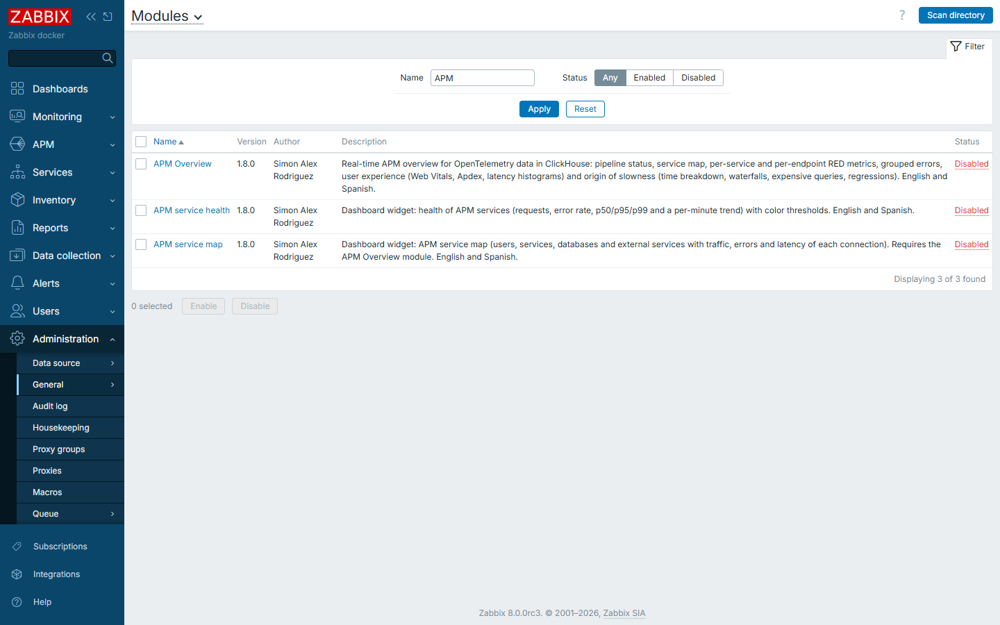
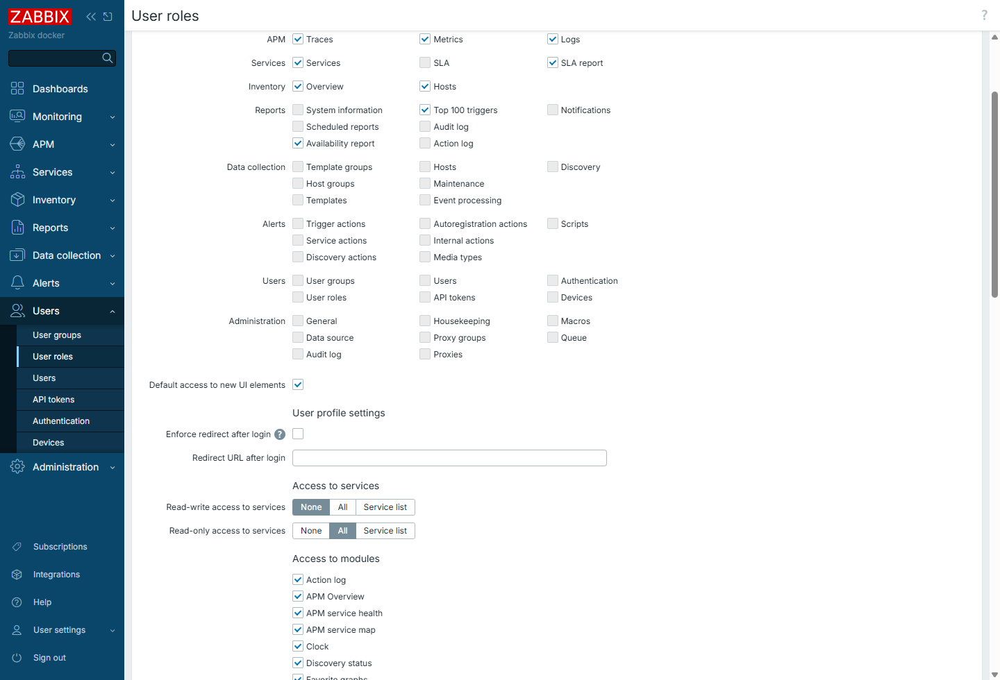
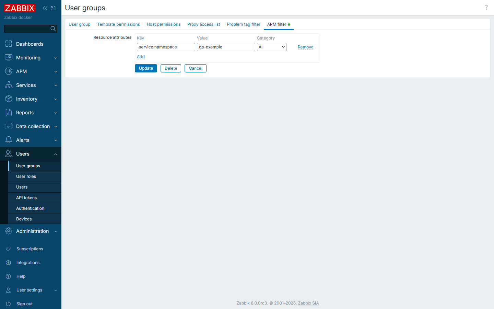
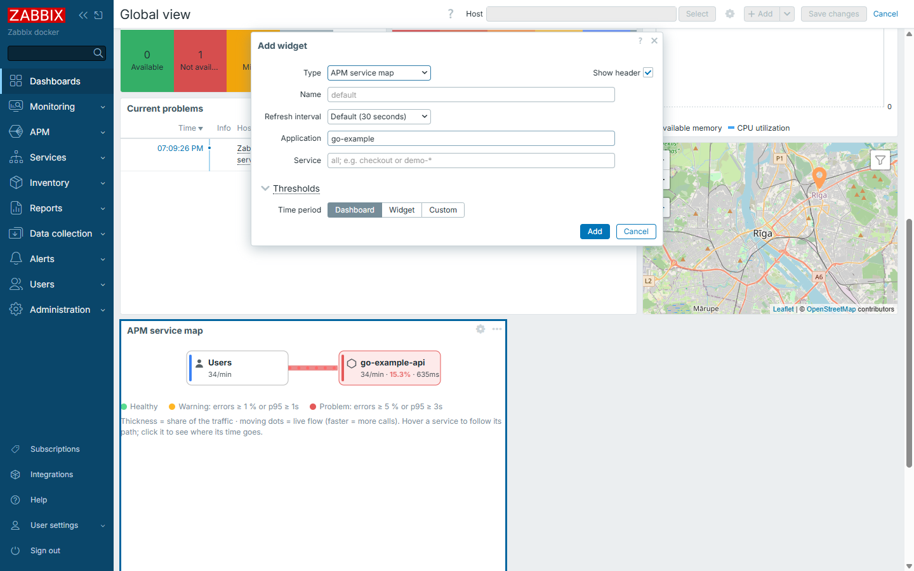

# Instalar los módulos en Zabbix

[English](install-module.md)

El repositorio trae tres módulos de frontend de Zabbix. Son carpetas PHP que Zabbix carga desde `<frontend>/modules`:

| Carpeta | Módulo | Tipo |
|---|---|---|
| `modules/ApmOverview` | **APM Overview** | Página **APM → Overview** (la necesita el widget del mapa) |
| `modules/ApmServiceMap` | **APM service map** | Widget de dashboard |
| `modules/ApmServiceHealth` | **APM service health** | Widget de dashboard |

Requisitos: Zabbix **8.0** (probado con los paquetes de 8.0.0rc3 y con las imágenes Docker de 8.0) y PHP 8.2 o
superior. La fuente de datos APM (ClickHouse) se configura en el paso 3; hasta entonces los módulos se instalan bien,
pero muestran "no configurada".


## 1. Copiar las carpetas al frontend

**Paquetes** (Ubuntu/Debian/RHEL; el frontend está en `/usr/share/zabbix/ui` o en `/usr/share/zabbix`):

```sh
git clone https://github.com/SimonLexRS/zabbix-apm-dashboard.git
cd zabbix-apm-dashboard
sudo ./scripts/install.sh            # encuentra el frontend; ZABBIX_UI=/ruta/al/frontend para otro directorio
```

El script comprueba la sintaxis PHP, respalda la versión anterior en `/var/backups/zabbix-apm-dashboard-<fecha>` y copia
las tres carpetas con propietario root y permisos de solo lectura.

**Docker** (imágenes oficiales `zabbix/zabbix-web-*`, frontend en `/usr/share/zabbix`): monta las carpetas en solo
lectura, como hace el laboratorio ([examples/lab/compose.yaml](../examples/lab/compose.yaml)):

```yaml
  zabbix-web:
    volumes:
      - ./zabbix-apm-dashboard/modules/ApmOverview:/usr/share/zabbix/modules/ApmOverview:ro
      - ./zabbix-apm-dashboard/modules/ApmServiceHealth:/usr/share/zabbix/modules/ApmServiceHealth:ro
      - ./zabbix-apm-dashboard/modules/ApmServiceMap:/usr/share/zabbix/modules/ApmServiceMap:ro
```

**Comprobación:** `ls <frontend>/modules` muestra `ApmOverview`, `ApmServiceHealth` y `ApmServiceMap`.

## 2. Registrarlos y habilitarlos

**Administration → General → Modules → Scan directory**. Los tres módulos aparecen como *Disabled*:



Haz clic en **Disabled**, en la columna *Status* de cada uno (o selecciona los tres y pulsa **Enable**). Pasan a
*Enabled*.

Por API (Super admin), para automatizarlo: `module.create` con `id` = `apmoverview` / `apmservicehealth` /
`apmservicemap`, `relative_path` = `modules/<Carpeta>` y `status` = 1. Es lo que hace
[scripts/lab-bootstrap.py](../scripts/lab-bootstrap.py).

## 3. Apuntar Zabbix a ClickHouse

**Administration → Data source → APM**: marca *Enable global data source* y completa:

| Campo | Valor |
|---|---|
| URL | URL HTTP de ClickHouse **tal como la ven el Zabbix server y el frontend**, p. ej. `http://127.0.0.1:8123`, o `http://clickhouse:8123` en Docker |
| Authentication | Usuario y contraseña: el usuario de solo lectura ([installation.es.md](installation.es.md#1-clickhouse)) |
| Database | `zabbix` |

Pulsa **Test** y después **Update**.


Las páginas APM nativas, estos módulos y los items Telemetry query del template usan esta fuente de datos. Por API:
`settings.update` con `apm_global_db` (`status` 1, `url`, `db`, `username`, `password`).

## 4. Abrirlo

**APM → Overview**. La pestaña *Status* muestra la fuente de datos y si llegan trazas, logs y métricas. En cuanto
lleguen datos, habrá una pestaña por aplicación (`service.namespace`).


Quién puede verlo: los usuarios cuyo **rol** (**Users → User roles → <rol>**) permite las dos cosas:

- el elemento de interfaz **APM → Traces** (*Access to UI elements*);
- **APM Overview**, **APM service health** y **APM service map** (*Access to modules*). Los módulos nuevos se permiten
  por defecto; revísalo si el rol está personalizado.

Los Super admin siempre pueden.



### Quién ve qué

Los módulos aplican los mismos permisos de Zabbix que las páginas APM nativas, así que no hay nada que configurar en
ellos:

| Ajuste de Zabbix | Efecto en APM Overview y en los widgets |
|---|---|
| Rol, *Access to UI elements* → **APM → Traces** | La página, la entrada del menú y los widgets. Sin él, nada |
| Rol → **APM → Logs** / **APM → Metrics** | Las cifras de logs y métricas (Status, Cómo funciona, Web Vitals) y los enlaces a las páginas Logs y Metrics. Sin ellos, esas partes se ocultan y no se consultan |
| Grupo de usuarios → **APM filter** (atributos de recurso) | Solo la telemetría que coincide: pestañas de aplicación, todas las pestañas, los widgets (también con *Application* vacío) y los spans de las trazas lentas. Los filtros se suman (cualquiera de ellos), entre todos los grupos del usuario; *Category* limita un filtro a trazas, métricas o logs. Sin filtro = todo |
| Grupo de usuarios → **Host permissions** sobre `apm-<namespace>` | El host de la aplicación, sus items y triggers (Cómo funciona solo muestra el host a quien puede leerlo) |
| Tipo de usuario **Super admin** | Todo; los APM filters no se aplican, igual que en Zabbix |

Para limitar un equipo a su aplicación: **Users → User groups → <grupo> → APM filter** → Key `service.namespace`, Value
`<namespace>`, Category *All*. El mismo filtro limita las páginas nativas **APM → Traces / Logs / Metrics**.



## 5. Widgets en un dashboard

Edita un dashboard → **Add widget** → tipo **APM service map** o **APM service health**. Ambos tienen un campo
*Application* (`service.namespace`; vacío = todas), un filtro de servicio, umbrales y el periodo de tiempo.



## Actualizar y desinstalar

- **Actualizar**: `git pull` y ejecuta otra vez `sudo ./scripts/install.sh` (en Docker basta con `git pull`: las
  carpetas montadas cambian en el sitio). Recarga la página. No hace falta volver a escanear, salvo que lo indiquen las
  notas de la versión.
- **Desinstalar**: deshabilita los tres módulos en **Administration → General → Modules** y ejecuta
  `sudo ./scripts/install.sh --uninstall` (en Docker, quita los volúmenes del compose).

## Problemas frecuentes

| Síntoma | Solución |
|---|---|
| *Scan directory* no los muestra | Carpeta equivocada: deben estar directamente en `<frontend>/modules/<Carpeta>`, con su `manifest.json` dentro |
| "The APM data source is not configured" | Paso 3 |
| "Cannot query the APM data source" | URL o usuario desde el punto de vista del Zabbix **server/frontend** (en Docker, el nombre del servicio, no `localhost`) |
| No aparece *APM → Overview*, o "Access denied" | El rol no tiene **APM → Traces** o no tiene los módulos en *Access to modules* (paso 4) |
| Un usuario ve menos aplicaciones que un administrador | APM filter de sus grupos de usuarios ([Quién ve qué](#quién-ve-qué)) |
| Un widget dice que necesita APM Overview | Habilita también el módulo **APM Overview** |

Más: [troubleshooting.md](troubleshooting.md). Siguiente: conectar una aplicación con
[add-application.es.md](add-application.es.md).
