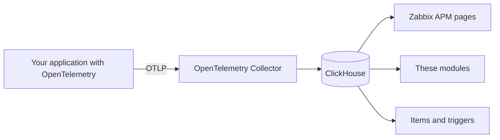

# Install the APM modules in Zabbix

[Español](install-module.es.md)

A guide for any Linux with Zabbix 8.0: packages, built from source or Docker.

## How APM works

Infrastructure metrics tell you a server is fine. **APM** (Application Performance Monitoring) answers what the user sees: which request is slow, what fails and in which service or query the time goes.

Each request produces a **trace** made of **spans**: one per step (API, database, another service). They give the **RED** metrics: Rate, Errors and Duration.



Zabbix **does not keep traces in its own database**: it reads them from ClickHouse. That is why the modules need step 3.

## What the modules add

Zabbix 8.0 has native pages to explore **Traces, Logs and Metrics**. The modules add an analysis view per application:

| You need to know | Module | Where |
|---|---|---|
| How your services connect and which one fails | Live service map | APM → Overview |
| Rate, errors and latency per service and endpoint | RED metrics with trends | APM → Overview |
| Which error keeps repeating | Grouped errors | APM → Overview |
| Where the time goes: code, database or another service | Origin of slowness | APM → Overview |
| What users experience in the browser | Apdex, Web Vitals and sessions | APM → Overview and Real user monitoring |
| All this on a dashboard | **APM service map** and **APM service health** widgets | Dashboards |

They respect Zabbix roles and APM filters, and follow the user's language (English or Spanish).

## Requirements

- Zabbix **8.0** and PHP **8.2 or later**, with `sudo` access.
- An API token of a Super admin, for the API option: **User settings → API tokens**.
- **ClickHouse and the Collector** to see data: [installation.md](installation.md), steps 1 and 2. Without them, the modules install but show "not configured".

| Zabbix installation | Usual modules folder |
|---|---|
| Recent packages | `/usr/share/zabbix/ui/modules` |
| Older packages or built from source | `/usr/share/zabbix/modules` |
| Custom web root | `/var/www/html/zabbix/modules` |
| Official Docker | `/usr/share/zabbix/modules` (volume, see [below](#docker)) |

You don't need to look for it: the script in step 1 detects it.

## Step 1. Copy the modules

```sh
git clone https://github.com/SimonLexRS/zabbix-apm-dashboard.git
cd zabbix-apm-dashboard
sudo ./scripts/install.sh
```

It finds the frontend, checks the PHP syntax, backs up the previous version in `/var/backups/` and copies the folders. If the frontend is elsewhere, or there are several:

```sh
sudo ZABBIX_UI=/path/to/frontend ./scripts/install.sh
```

✅ **Check:** it ends with `Installed in <frontend>/modules: ApmOverview ApmServiceHealth ApmServiceMap`.

## Step 2. Enable them

**Option A, API** (easiest to replicate). Use the address you open Zabbix with:

```sh
export ZABBIX_URL=http://<your-zabbix>
read -rs ZABBIX_API_TOKEN && export ZABBIX_API_TOKEN   # paste the token and press Enter
python3 scripts/enable-modules.py
```

**Option B, web:** **Administration → General → Modules → Scan directory**, select the three and press **Enable**.


✅ **Check:** the three show as *Enabled* and the menu has **APM → Overview**.

## Step 3. Connect ClickHouse

**Administration → Data source → APM**: check *Enable global data source*, fill in the fields, press **Test** and then **Update**.

| Field | Value |
|---|---|
| URL | ClickHouse as seen from the frontend, e.g. `http://127.0.0.1:8123` |
| Authentication | The read-only user and password (`zabbix_ro`) |
| Database | `zabbix` |


✅ **Check:** **APM → Overview → Status** shows the data source as OK.

## Step 4. See data and give access

Connect an application with [add-application.md](add-application.md). You get one tab per `service.namespace` in **APM → Overview**.


To add the widgets: edit a dashboard → **Add widget** → **APM service map** or **APM service health**.

| I want to | Where |
|---|---|
| Give a user access | **Users → User roles**: enable **APM → Traces** and the three modules in *Access to modules* |
| Limit a team to its application | **Users → User groups → APM filter**: Key `service.namespace`, Value `<application>` |

## Docker

Mount the folders in the web service and continue from step 2 ([full example](../examples/lab/compose.yaml)):

```yaml
  zabbix-web:
    volumes:
      - ./zabbix-apm-dashboard/modules/ApmOverview:/usr/share/zabbix/modules/ApmOverview:ro
      - ./zabbix-apm-dashboard/modules/ApmServiceHealth:/usr/share/zabbix/modules/ApmServiceHealth:ro
      - ./zabbix-apm-dashboard/modules/ApmServiceMap:/usr/share/zabbix/modules/ApmServiceMap:ro
```

## Upgrade and uninstall

```sh
git pull && sudo ./scripts/install.sh       # upgrade, then reload the page
sudo ./scripts/install.sh --uninstall       # uninstall, after disabling them in Modules
```

## Common problems

| Symptom | Solution |
|---|---|
| `Zabbix frontend not found` or several frontends | Set the path with `ZABBIX_UI` (step 1) |
| *Scan directory* doesn't list them | They must be in `<frontend>/modules/<Folder>`, with their `manifest.json` |
| "The APM data source is not configured" | Step 3 |
| "Cannot query the APM data source" | Check the URL and user from the frontend. In Docker, use the service name, not `localhost` |
| The Collector doesn't start: `Not enough privileges` | The writer user needs `CREATE DATABASE`; apply the current [clickhouse-users.sql](../examples/clickhouse-users.sql) |
| **APM → Overview** is missing or "Access denied" | Check the role (step 4) |
| A user sees fewer applications | Check the APM filter of their groups |
| A widget asks for APM Overview | Enable that module too |

More cases: [troubleshooting.md](troubleshooting.md).
