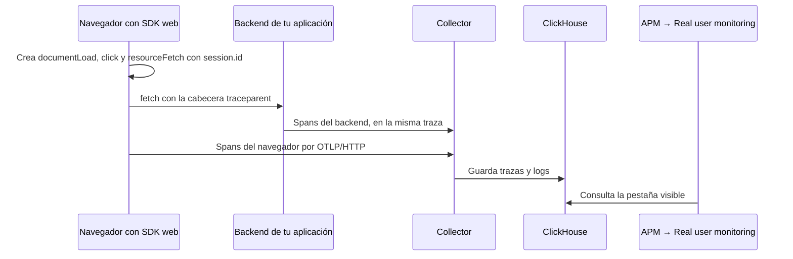
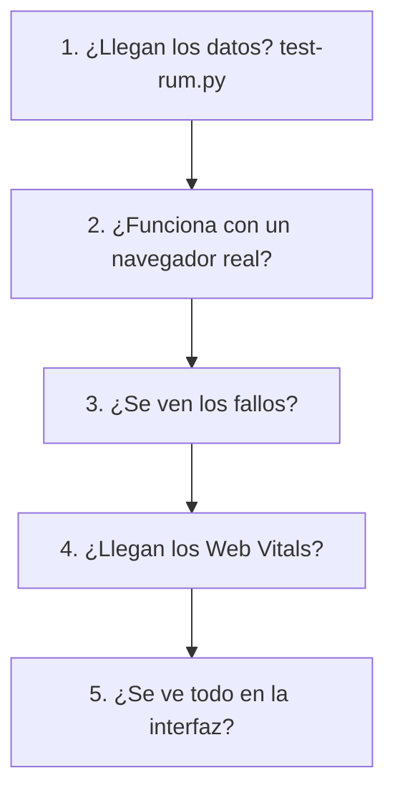

# Monitorización de usuarios reales

[English](rum.md)

**APM → Real user monitoring** muestra qué viven los usuarios reales en el navegador y qué llamada del backend hay
detrás. Lee los spans que el SDK web de OpenTelemetry ya envía (`telemetry.sdk.language = webjs`); no se instala nada
más. Como todas las páginas del módulo, tiene una pestaña por aplicación (`service.namespace`) y refresco en tiempo
real, y respeta los roles y el APM filter de los grupos de usuarios.


| Pestaña | Qué responde |
|---|---|
| **Resumen** | Sesiones, usuarios, cargas de página, acciones de usuario, peticiones del navegador y sus fallos, primer contenido visible, Core Web Vitals, actividad por minuto, páginas más lentas, peticiones que fallan, navegadores y sistemas operativos |
| **Páginas** | Una fila por página (ruta, con los ids agrupados en `:id`) con cargas, sesiones, carga p75/p95 y primer contenido visible. Abre una página para ver en qué se va el tiempo de su carga típica y de la más lenta, fase a fase |
| **Recursos** | Scripts, estilos, imágenes y fuentes por host con sus fases de red; las peticiones del código de la página (fetch, XMLHttpRequest) por método, ruta y estado, con su última traza |
| **Sesiones** | Las 100 sesiones más recientes. **Línea de tiempo** abre un panel con las cargas de página, acciones y peticiones de la sesión; cada petición muestra los servicios del backend que recorrió su traza, el que falló y el enlace a la traza |
| **Cómo funciona** | Cómo instrumentar una aplicación web, y comprobaciones en vivo: spans del navegador, `session.id`, cargas de página, acciones y peticiones enlazadas con el backend |


## Cómo funciona

El SDK web de OpenTelemetry corre en el navegador de cada usuario y crea spans de lo que ocurre en la página. Los envía al Collector como cualquier otra aplicación, y el módulo los consulta en ClickHouse. **No hay agente ni servicio adicional.**



Tres ideas lo explican todo:

| Idea | Qué hace | Si falta |
|---|---|---|
| `telemetry.sdk.language = webjs` | Distingue los spans del navegador | La aplicación no aparece como conectada |
| `session.id` | Agrupa los spans de una visita | No hay sesiones ni línea de tiempo |
| `traceparent` | Une la petición del navegador con el backend | La línea de tiempo se detiene en el navegador |

## Qué lee

| Concepto | Dato de OpenTelemetry |
|---|---|
| Sesión, usuario | `session.id`, `enduser.id` en los spans del navegador |
| Carga de página | span `documentLoad`; sus eventos (y los de su hijo `documentFetch`) dan las fases de la carga y el primer contenido visible |
| Acción de usuario | spans raíz de la instrumentación de interacción de usuario (`event_type`, `target_element`, `target_xpath`): uno por clic, aunque la instrumentación añade un span anidado por cada manejador del evento |
| Recurso | spans `resourceFetch` |
| Petición | spans del navegador de tipo `Client`; fallida = HTTP 5xx o sin respuesta (estado del span Error sin código). Un 4xx (p. ej. 401 antes de iniciar sesión) es una respuesta: se cuenta aparte, en ámbar |
| Parte de backend de una petición | los spans de otros servicios en la misma traza |
| Navegador, SO, dispositivo | `user_agent.original` |
| Core Web Vitals | registros de log con atributos `rum.*` ([más abajo](#core-web-vitals)) |

## Cómo se implementa

**Paso 1. Abre la guía con tu aplicación ya rellenada.** Entra en **APM → Real user monitoring**, elige la pestaña de tu aplicación y abre **Cómo funciona**. Indica el servicio de la parte de navegador y la URL del Collector.

**Paso 2. Copia el código del método que te corresponde** (tabla de abajo).

**Paso 3. Deja que el navegador llegue al Collector.** Un navegador no alcanza `127.0.0.1` ni una red interna del server:

| Opción | Cómo | Cuándo |
|---|---|---|
| **Ruta de tu sitio** (recomendada) | Redirige `/otlp/` al puerto 4318 del Collector | Siempre que puedas: sin CORS y con el Collector privado |
| **Collector publicado** | HTTPS y `cors.allowed_origins` en su receptor | Sitio y Collector en dominios distintos |

**Paso 4. Une las peticiones con el backend**, como se explica abajo.

**Paso 5. Comprueba** con [Cómo hacer testing](#cómo-hacer-testing).

### Detalle de cada método

Cada aplicación tiene su pestaña, también las que todavía no envían telemetría del navegador (atenuadas). Para esas,
la página ofrece **Conectar el navegador**: la pestaña **Cómo funciona** tiene una guía con la aplicación ya
rellenada. Indica el servicio de la parte de navegador y la URL del collector, elige el método y copia:

| Método | Para | Qué añades |
|---|---|---|
| **Sin compilar (script)** | cualquier sitio, renderizado en servidor o estático | un bloque en el `<head>`: un import map que carga el SDK web oficial de OpenTelemetry desde un CDN (versiones fijas) y el código de trazas |
| **npm / bundler** | Vite, webpack, React, Vue, Angular… | `npm install` de los mismos paquetes y un `otel-browser.js` importado lo primero |
| **Next.js** | Next.js 15.3 o posterior | el mismo código en `instrumentation-client.ts` |

El código de trazas es el mismo en los tres: cargas de página, acciones de usuario y peticiones fetch, un `session.id`
en cada span, `service.name` y `service.namespace` de la aplicación, y el recurso por defecto del SDK (lleva
`telemetry.sdk.language = webjs`, que distingue los spans del navegador). Después:

1. **Deja que el navegador llegue al collector**: publica su receptor OTLP/HTTP (puerto 4318) con HTTPS y CORS para el
   sitio o, más sencillo y privado, redirige una ruta del sitio (p. ej. `/otlp/`) al collector y usa esa URL.
2. **Enlaza las peticiones con el backend**: las peticiones al mismo origen llevan `traceparent` por sí solas; una API
   en otro origen va en `propagateTraceHeaderCorsUrls` y permite `traceparent` y `tracestate` en su CORS.
3. **Comprueba**: las comprobaciones bajo la guía se ponen en verde al minuto de navegar.


El laboratorio tiene una página instrumentada exactamente así ([lab.es.md](lab.es.md)), y el frontend del
[OpenTelemetry Demo](../examples/stacks/opentelemetry-demo/README.es.md) llena todas las pestañas.

## Cómo hacer testing



Los ejemplos usan el [OpenTelemetry Demo](../examples/stacks/opentelemetry-demo/README.es.md), cuyo generador de carga abre un navegador sin interfaz. Para tu aplicación, cambia el nombre `opentelemetry-demo` y las URL.

| Nivel | Estado en la prueba de referencia |
|---|---|
| 1, 4 y 5 | ✅ Ejecutados, con las salidas que se muestran. El nivel 5 se comprobó por HTTP, sin abrir un navegador |
| 2 y 3 | ⚠️ No ejecutados: requieren una persona con navegador |

### Nivel 1. Comprobar que llegan los datos

```sh
export CH_URL=http://127.0.0.1:8123 CH_USER=zabbix_ro CH_PASSWORD=<contraseña-de-solo-lectura>
python3 scripts/test-rum.py opentelemetry-demo
```

```text
OK   browser spans (telemetry.sdk.language = webjs): 15,600
OK   spans with session.id: 15,600 of 15,600, 243 sessions
OK   page loads (documentLoad): 243
INFO resources (resourceFetch): 10,248
INFO user actions: 333 (0 is normal if nobody clicked)
OK   browser requests linked with the backend: 4,533 of 4,533 traces
INFO Web Vitals: none. They need examples/web-vitals.js, or test the path with --send-sample
---- all required checks passed
```

✅ Debe terminar en `all required checks passed`, con código de salida `0`, lo que permite usarlo en una CI. El script solo lee, y `--minutes` cambia el periodo (15 por defecto).

### Nivel 2. Probar con un navegador real

1. Abre tu aplicación, por ejemplo `http://<IP-de-tu-server>:18080/`.
2. Navega por varias páginas y haz clic en algunos elementos.
3. En las herramientas de desarrollo del navegador (**F12 → Network**), busca peticiones `v1/traces`: deben responder `200`.
4. Espera un minuto y abre **APM → Real user monitoring → Sesiones**.
5. Busca tu navegador, que no será `Chrome (headless)`, y pulsa **Línea de tiempo**.

✅ Deben aparecer tus páginas y clics, y cada petición con los servicios del backend que recorrió.

### Nivel 3. Provocar un fallo

1. Abre `http://<IP-de-tu-server>:18080/feature` y activa `paymentFailure`.
2. Compra algo en la tienda y confirma el pedido.
3. En **Resumen**, comprueba los fallos de **Peticiones del navegador**, y en **Sesiones** abre tu línea de tiempo.
4. **Devuelve el flag a su valor original.**

✅ La petición debe aparecer como fallida, con el servicio que falló y el enlace a la traza.

### Nivel 4. Probar los Web Vitals

**El demo no envía Web Vitals**, de modo que esta sección queda vacía aunque todo funcione. Hay dos formas de probarla:

- **Real:** integra [examples/web-vitals.js](../examples/web-vitals.js), como se explica en [Core Web Vitals](#core-web-vitals).
- **Sintética, para probar el recorrido sin navegador:**

```sh
python3 scripts/test-rum.py opentelemetry-demo --send-sample http://<IP-de-tu-server>:18080/otlp-http/v1/logs
```

```text
sent 5 synthetic Web Vitals to http://192.168.56.2:18080/otlp-http/v1/logs: HTTP 200
OK   Web Vitals in ClickHouse: {'CLS': 1, 'FCP': 1, 'INP': 1, 'LCP': 1, 'TTFB': 1}
---- all required checks passed
```

> [!WARNING]
> **Son datos falsos** (`rum.page = /rum-test`, servicio `rum-test`) y se mezclan con los reales en **Resumen** hasta que caducan a las 72 horas. Evítalo en producción.

### Nivel 5. Revisar la interfaz

Abre **APM → Real user monitoring** y elige tu aplicación arriba. La página puede abrir otra pestaña, como en el problema 1 de abajo.

| Pestaña | Qué deberías ver | Resultado de referencia, 1 hora |
|---|---|---|
| **Resumen** | Sesiones, cargas y peticiones con cifras | 934 sesiones, carga p75 de 596 ms, 18 139 peticiones y 0 fallos |
| **Páginas** | Rutas con los ids agrupados | `/cart`, `/product/:id` y `/` |
| **Recursos** | Scripts, estilos e imágenes por host | Scripts, imágenes, estilos y fuentes |
| **Sesiones** | Una fila por sesión, con **Línea de tiempo** | `Chrome (headless) · Linux` |
| **Cómo funciona** | Todas las comprobaciones en **OK** | 5 de 5 en OK |

## Problemas frecuentes

| # | Síntoma | Causa | Comprobación o solución | Origen |
|---|---|---|---|---|
| 1 | "*X* does not send browser telemetry yet", aunque tu aplicación sí envía | La página abrió otra aplicación con trazas recientes, como una prueba de humo | Elige tu aplicación en las pestañas de arriba | 🔴 Ocurrió |
| 2 | La sección de Web Vitals está vacía | El demo no los envía | [Nivel 4](#nivel-4-probar-los-web-vitals) | 🔴 Ocurrió |
| 3 | Peticiones `v1/traces` bloqueadas por CORS | Sitio y Collector en orígenes distintos | Usa una ruta de tu sitio o configura `cors.allowed_origins` | 🟡 Posible |
| 4 | Peticiones `v1/traces` a `localhost` | Una URL pública del Collector mal configurada. En el demo, `DEMO_PUBLIC_HOST` | Revísala y recrea el servicio | 🟡 Posible |
| 5 | Página en HTTPS y Collector en HTTP | El navegador bloquea el contenido mixto | Publica el Collector con HTTPS o usa una ruta del sitio | 🟡 Posible |
| 6 | Sesiones vacías, pero sí hay spans | Falta `session.id` | `test-rum.py` lo indica; revisa el código de trazas | 🟡 Posible |
| 7 | Las peticiones no muestran el backend | No se propaga `traceparent` | Revisa `propagateTraceHeaderCorsUrls` y el CORS de la API | 🟡 Posible |
| 8 | Sin datos en navegadores de usuarios | Un bloqueador de anuncios filtra la ruta | Prueba sin extensiones y usa una ruta propia del sitio | 🟡 Posible |

## Límites

- Los cambios de ruta de las aplicaciones de una sola página no crean cargas de página con la instrumentación
  estándar: aparecen como acciones y peticiones.
- Sin propagación de `traceparent`, las peticiones no muestran traza de backend.
- La reproducción de sesiones, el profiling del navegador y la geografía no forman parte de los datos de
  OpenTelemetry.
- `enduser.id` debe ser un id seudónimo, nunca un correo ni un nombre.

## Core Web Vitals

La pestaña **Resumen** de esta página y la pestaña **User experience** de APM Overview muestran los Core Web Vitals
medidos en los navegadores de usuarios reales: LCP, INP, CLS, FCP y TTFB, como percentil 75 (como los evalúa Google),
por página, por dispositivo y por hora.

### Formato de los datos

Un **registro de log** OTLP por métrica y carga de página, con estos atributos (cualquier `service.name`, p. ej.
`mi-app-browser`):

| Atributo | Valor |
|---|---|
| `rum.metric` | `LCP`, `INP`, `CLS`, `FCP` o `TTFB` |
| `rum.value` | número: milisegundos (CLS: puntuación sin unidad) |
| `rum.rating` | `good`, `needs-improvement` o `poor` (de la librería web-vitals) |
| `rum.page` | plantilla de ruta de la página, p. ej. `/orders/{id}`: sin ids, tokens ni query strings |
| `rum.device` | `mobile` o `desktop` (opcional) |
| `rum.id` | id aleatorio de la carga de página (opcional): CLS e INP se envían otra vez al ocultar la pestaña; el módulo se queda con el último valor por id |

El filtro de servicio de la página se le aplica como a cualquier otro servicio.

### Enviarlos

[examples/web-vitals.js](../examples/web-vitals.js) recoge las métricas con la librería
[web-vitals](https://github.com/GoogleChrome/web-vitals) y las envía como OTLP/HTTP JSON con `sendBeacon` cuando la
página se oculta. Dos formas de llegar al collector:

1. **A través de tu propio sitio** (recomendada): redirige una ruta como `/otlp/v1/logs` a
   `http://<collector>:4318/v1/logs`. Mismo origen, sin CORS, y el collector sigue siendo privado.
2. **Directamente**: publica el receptor OTLP/HTTP del collector y permite el origen de tu sitio:

   ```yaml
   receivers:
     otlp:
       protocols:
         http:
           endpoint: 0.0.0.0:4318
           cors:
             allowed_origins: ["https://tu.sitio"]
   ```

Una tercera opción es un endpoint de tu backend que valida el beacon y emite los registros de log con su propio SDK de
OpenTelemetry; así lo hace [Flowspock](https://app.flowspock.com), lo que además le permite reducir la ruta a una
plantilla en el servidor y limitar por IP.

### Privacidad

No envíes ids de usuario, correos, direcciones IP, query strings ni títulos de página: solo la plantilla de ruta, el
tipo de dispositivo y la métrica. El ejemplo del collector además ofusca las direcciones de cliente de los spans de
servidor (`attributes/privacy`).
