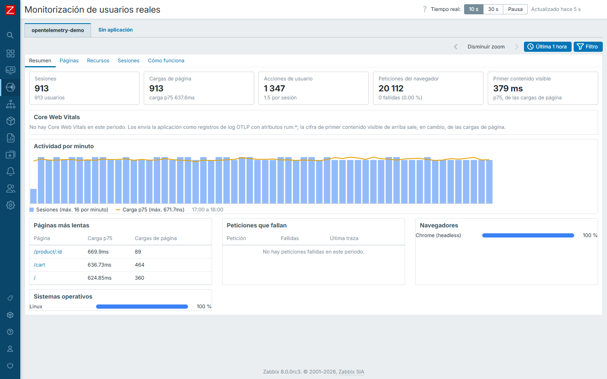
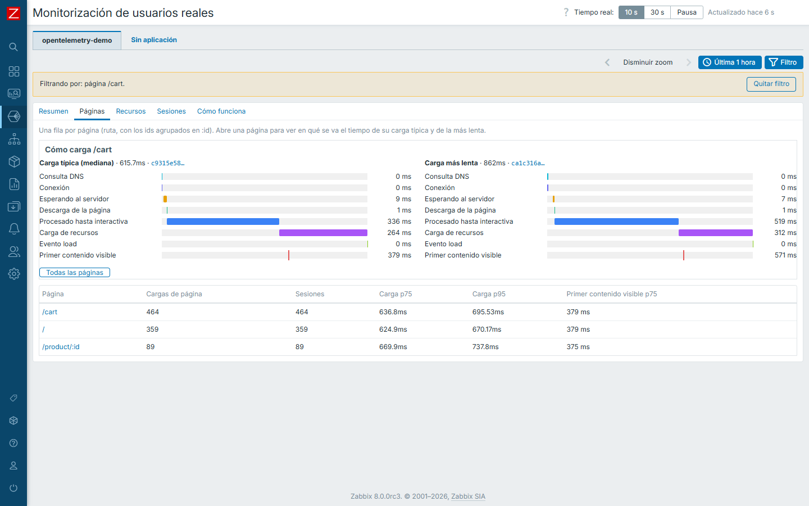
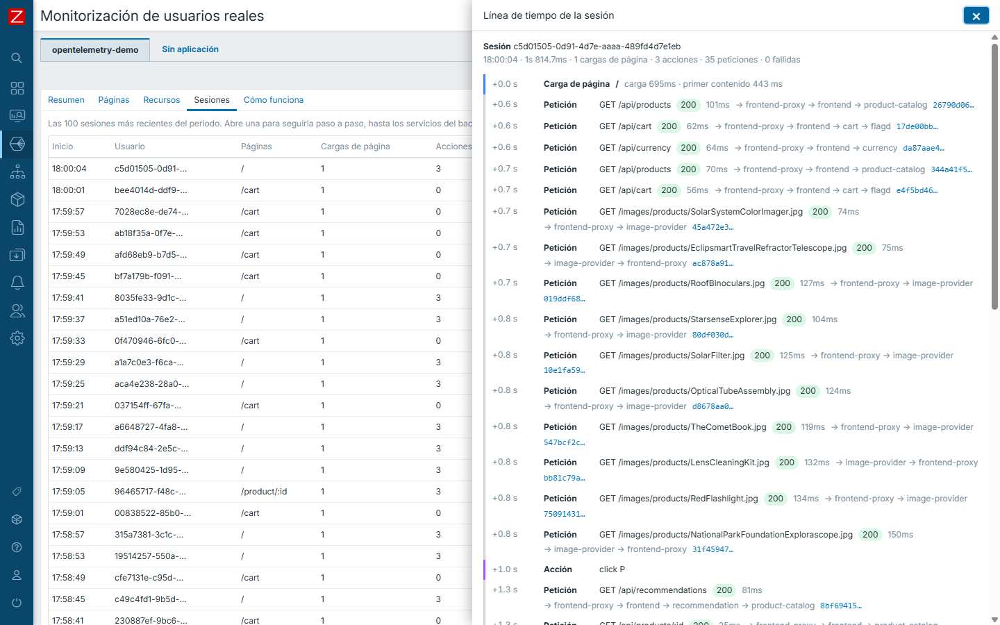
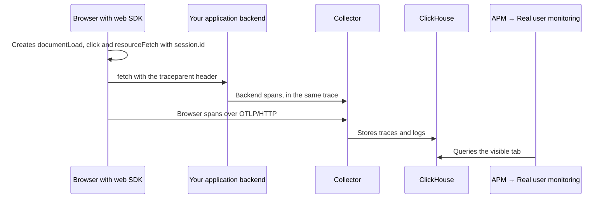
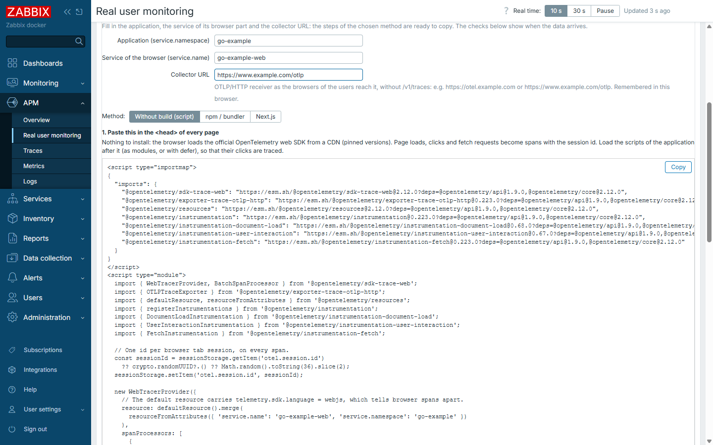
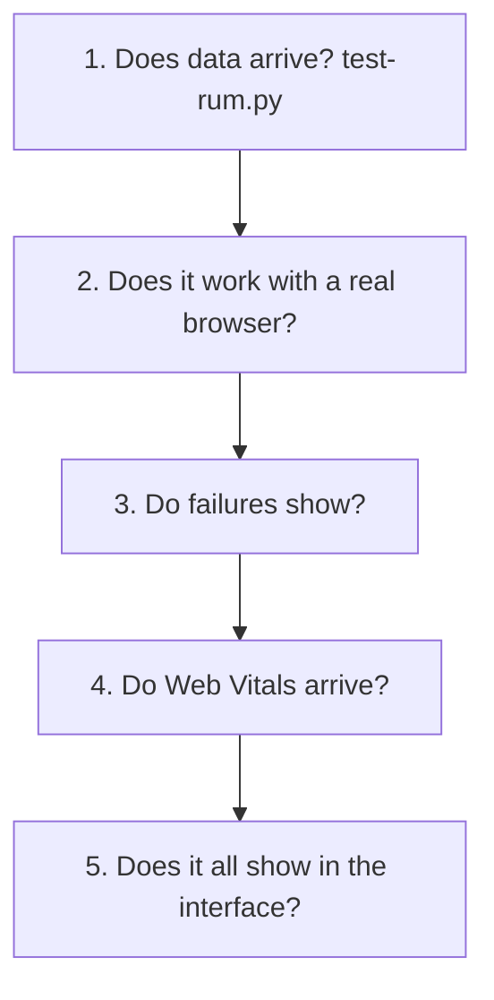

# Real user monitoring

[Español](rum.es.md)

**APM → Real user monitoring** shows what real users experience in the browser, and which backend call is behind it. It
reads the spans that the OpenTelemetry web SDK already sends (`telemetry.sdk.language = webjs`); nothing else is
installed. Like every page of the module, it has one tab per application (`service.namespace`), real-time refresh,
and it respects the roles and the APM filter of the user groups.



| Tab | What it answers |
|---|---|
| **Overview** | Sessions, users, page loads, user actions, browser requests and their failures, first content visible, Core Web Vitals, activity per minute, slowest pages, requests that fail, browsers and operating systems |
| **Pages** | One row per page (path, ids folded into `:id`) with loads, sessions, load p75/p95 and first content visible. Open a page to see where its typical and its slowest load spend the time, phase by phase |
| **Resources** | Scripts, styles, images and fonts by host with their network phases; the requests of the page code (fetch, XMLHttpRequest) by method, path and status, with their latest trace |
| **Sessions** | The 100 most recent sessions. **Timeline** opens a panel with the page loads, actions and requests of the session; each request shows the backend services its trace went through, the one that failed, and links to the trace |
| **How it works** | How to instrument a web application, and live checks: browser spans, `session.id`, page loads, actions, requests linked to the backend |





## How it works

The OpenTelemetry web SDK runs in each user's browser and creates spans of what happens on the page. It sends them to the Collector like any other application, and the module queries them in ClickHouse. **There is no agent or additional service.**



Three ideas explain it all:

| Idea | What it does | If it's missing |
|---|---|---|
| `telemetry.sdk.language = webjs` | Identifies the browser spans | The application doesn't show as connected |
| `session.id` | Groups the spans of a visit | No sessions or timeline |
| `traceparent` | Joins the browser request with the backend | The timeline stops at the browser |

## What it reads

| Concept | OpenTelemetry data |
|---|---|
| Session, user | `session.id`, `enduser.id` on the browser spans |
| Page load | `documentLoad` span; its events (and those of its `documentFetch` child) give the load phases and the first contentful paint |
| User action | root spans of the user interaction instrumentation (`event_type`, `target_element`, `target_xpath`): one per click, although the instrumentation adds a nested span per event listener |
| Resource | `resourceFetch` spans |
| Request | browser spans of kind `Client`; failed = HTTP 5xx or no response (span status Error without a status). A 4xx (e.g. 401 before signing in) is an answer: counted apart, in amber |
| Backend part of a request | the spans of other services in the same trace |
| Browser, OS, device | `user_agent.original` |
| Core Web Vitals | log records with `rum.*` attributes ([below](#core-web-vitals)) |

## How to implement it

**Step 1. Open the guide with your application filled in.** Go to **APM → Real user monitoring**, choose the tab of your application and open **How it works**. Enter the service of the browser part and the Collector URL.

**Step 2. Copy the code of your method** (table below).

**Step 3. Let the browser reach the Collector.** A browser cannot reach `127.0.0.1` or an internal network of the server:

| Option | How | When |
|---|---|---|
| **A path of your site** (recommended) | Redirect `/otlp/` to port 4318 of the Collector | Whenever you can: no CORS and the Collector stays private |
| **Published Collector** | HTTPS and `cors.allowed_origins` in its receiver | Site and Collector on different domains |

**Step 4. Join the requests with the backend**, as explained below.

**Step 5. Check it** with [How to test](#how-to-test).

### Details of each method

Every application has a tab, also the ones that send no browser telemetry yet (muted). For those, the page offers
**Connect the browser**: the **How it works** tab has a guide with the application already filled in. Set the
service of the browser part and the collector URL, pick the method, and copy:

| Method | For | What you add |
|---|---|---|
| **Without build (script)** | any site, server-rendered or static | one block in the `<head>`: an import map that loads the official OpenTelemetry web SDK from a CDN (pinned versions) and the tracing code |
| **npm / bundler** | Vite, webpack, React, Vue, Angular… | `npm install` of the same packages and an `otel-browser.js` imported first |
| **Next.js** | Next.js 15.3 or later | the same code in `instrumentation-client.ts` |

The tracing code is the same in the three: page loads, user actions and fetch requests, a `session.id` on every span,
`service.name` and `service.namespace` of the application, and the default resource of the SDK (it carries
`telemetry.sdk.language = webjs`, which tells browser spans apart). Then:

1. **Let the browser reach the collector**: publish its OTLP/HTTP receiver (port 4318) through HTTPS with CORS for the
   site, or, simpler and private, forward a path of the site (e.g. `/otlp/`) to the collector and use that URL.
2. **Link the requests to the backend**: requests to the same origin carry `traceparent` by themselves; an API on
   another origin goes in `propagateTraceHeaderCorsUrls` and allows `traceparent` and `tracestate` in its CORS.
3. **Check**: the checks under the guide turn green within a minute of browsing.



The lab has a page instrumented exactly this way ([lab.md](lab.md)), and the
[OpenTelemetry Demo](../examples/stacks/opentelemetry-demo/README.md) frontend fills every tab.

## How to test



The examples use the [OpenTelemetry Demo](../examples/stacks/opentelemetry-demo/README.md), whose load generator opens a headless browser. For your application, change the name `opentelemetry-demo` and the URLs.

| Level | Status in the reference test |
|---|---|
| 1, 4 and 5 | ✅ Run, with the outputs shown. Level 5 was checked over HTTP, without opening a browser |
| 2 and 3 | ⚠️ Not run: they need a person with a browser |

### Level 1. Check that data arrives

```sh
export CH_URL=http://127.0.0.1:8123 CH_USER=zabbix_ro CH_PASSWORD=<read-only-password>
python3 scripts/test-rum.py opentelemetry-demo
```

```text
OK   browser spans (telemetry.sdk.language = webjs): 15,600
OK   spans with session.id: 15,600 of 15,600, 243 sessions
OK   page loads (documentLoad): 243
INFO resources (resourceFetch): 10,248
INFO user actions: 333 (0 is normal if nobody clicked)
OK   browser requests linked with the backend: 4,533 of 4,533 traces
INFO Web Vitals: none. They need examples/web-vitals.js, or test the path with --send-sample
---- all required checks passed
```

✅ It must end with `all required checks passed` and exit code `0`, so you can use it in CI. The script only reads, and `--minutes` changes the period (15 by default).

### Level 2. Test with a real browser

1. Open your application, for example `http://<your-server-IP>:18080/`.
2. Browse several pages and click on some elements.
3. In the browser developer tools (**F12 → Network**), look for `v1/traces` requests: they must answer `200`.
4. Wait a minute and open **APM → Real user monitoring → Sessions**.
5. Look for your browser, which won't be `Chrome (headless)`, and press **Timeline**.

✅ Your pages and clicks must appear, and each request with the backend services it crossed.

### Level 3. Cause a failure

1. Open `http://<your-server-IP>:18080/feature` and enable `paymentFailure`.
2. Buy something in the store and confirm the order.
3. In **Overview**, check the failures of **Requests from the browser**, and in **Sessions** open your timeline.
4. **Set the flag back to its original value.**

✅ The request must appear as failed, with the service that failed and the link to the trace.

### Level 4. Test Web Vitals

**The demo doesn't send Web Vitals**, so that section stays empty even when everything works. There are two ways to test it:

- **Real:** integrate [examples/web-vitals.js](../examples/web-vitals.js), as explained in [Core Web Vitals](#core-web-vitals).
- **Synthetic, to test the path without a browser:**

```sh
python3 scripts/test-rum.py opentelemetry-demo --send-sample http://<your-server-IP>:18080/otlp-http/v1/logs
```

```text
sent 5 synthetic Web Vitals to http://192.168.56.2:18080/otlp-http/v1/logs: HTTP 200
OK   Web Vitals in ClickHouse: {'CLS': 1, 'FCP': 1, 'INP': 1, 'LCP': 1, 'TTFB': 1}
---- all required checks passed
```

> [!WARNING]
> **This is fake data** (`rum.page = /rum-test`, service `rum-test`), and it mixes with the real data in **Overview** until it expires after 72 hours. Avoid it in production.

### Level 5. Review the interface

Open **APM → Real user monitoring** and choose your application at the top. The page may open another tab, as in problem 1 below.

| Tab | What you should see | Reference result, 1 hour |
|---|---|---|
| **Overview** | Sessions, loads and requests with figures | 934 sessions, load p75 of 596 ms, 18,139 requests and 0 failures |
| **Pages** | Routes with the ids grouped | `/cart`, `/product/:id` and `/` |
| **Resources** | Scripts, styles and images per host | Scripts, images, styles and fonts |
| **Sessions** | One row per session, with **Timeline** | `Chrome (headless) · Linux` |
| **How it works** | Every check **OK** | 5 of 5 OK |

## Troubleshooting

| # | Symptom | Cause | Check or solution | Origin |
|---|---|---|---|---|
| 1 | "*X* does not send browser telemetry yet", although your application does | The page opened another application with recent traces, such as a smoke test | Choose your application in the tabs at the top | 🔴 Happened |
| 2 | The Web Vitals section is empty | The demo doesn't send them | [Level 4](#level-4-test-web-vitals) | 🔴 Happened |
| 3 | `v1/traces` requests blocked by CORS | Site and Collector on different origins | Use a path of your site or set `cors.allowed_origins` | 🟡 Possible |
| 4 | `v1/traces` requests to `localhost` | A wrongly set public Collector URL. In the demo, `DEMO_PUBLIC_HOST` | Check it and recreate the service | 🟡 Possible |
| 5 | HTTPS page and HTTP Collector | The browser blocks mixed content | Publish the Collector with HTTPS or use a path of the site | 🟡 Possible |
| 6 | Empty sessions, but there are spans | `session.id` is missing | `test-rum.py` shows it; check the tracing code | 🟡 Possible |
| 7 | Requests don't show the backend | `traceparent` isn't propagated | Check `propagateTraceHeaderCorsUrls` and the API's CORS | 🟡 Possible |
| 8 | No data from users' browsers | An ad blocker filters the path | Test without extensions and use a path of your own site | 🟡 Possible |

## Limits

- Route changes of single page applications create no page loads with the standard instrumentation: they appear as
  actions and requests.
- Without `traceparent` propagation, requests show no backend trace.
- Session replay, browser profiling and geography are not part of OpenTelemetry data.
- `enduser.id` should be a pseudonymous id, never an e-mail or a name.

## Core Web Vitals

The **Overview** tab of this page and the **User experience** tab of APM Overview show the Core Web Vitals measured in
the browsers of real users: LCP, INP, CLS, FCP and TTFB, as the 75th percentile (how Google evaluates them), per page,
per device and per hour.

### Data format

One OTLP **log record** per metric and page load, with these attributes (any `service.name`, e.g. `my-app-browser`):

| Attribute | Value |
|---|---|
| `rum.metric` | `LCP`, `INP`, `CLS`, `FCP` or `TTFB` |
| `rum.value` | number: milliseconds (CLS: unitless score) |
| `rum.rating` | `good`, `needs-improvement` or `poor` (from the web-vitals library) |
| `rum.page` | route template of the page, e.g. `/orders/{id}`: no ids, tokens or query strings |
| `rum.device` | `mobile` or `desktop` (optional) |
| `rum.id` | random id of the page load (optional): CLS and INP are reported again when the tab is hidden; the module keeps the last value per id |

The service filter of the page applies to it like to any other service.

### Sending them

[examples/web-vitals.js](../examples/web-vitals.js) collects the metrics with the
[web-vitals](https://github.com/GoogleChrome/web-vitals) library and posts OTLP/HTTP JSON with `sendBeacon` when the
page is hidden. Two ways to reach the collector:

1. **Through your own site** (recommended): proxy a path such as `/otlp/v1/logs` to `http://<collector>:4318/v1/logs`.
   Same origin, no CORS, the collector stays private.
2. **Directly**: expose the collector's OTLP/HTTP receiver and allow your site's origin:

   ```yaml
   receivers:
     otlp:
       protocols:
         http:
           endpoint: 0.0.0.0:4318
           cors:
             allowed_origins: ["https://your.site"]
   ```

A third option is an endpoint in your backend that validates the beacon and emits the log records with its own
OpenTelemetry SDK; that is how [Flowspock](https://app.flowspock.com) does it, which also lets it reduce the path to a
route template on the server and rate-limit by IP.

### Privacy

Send no user ids, e-mails, IP addresses, query strings or page titles: only the route template, the device class and
the metric. The collector example also hashes client addresses of server spans (`attributes/privacy`).
