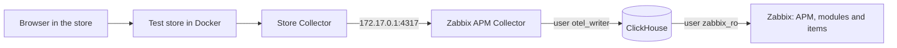

# From Zabbix 8 to full APM on Ubuntu, step by step

[Español](guia-ubuntu-paso-a-paso.md)

This guide starts from an Ubuntu server that **only has Zabbix 8** and ends with APM working: ClickHouse, the OpenTelemetry Collector, the modules, a test store sending data and real user monitoring (RUM).

Follow the steps **in order** and **in the same terminal**, because the variables of one step are used in the next. Each step ends with what you must see and, if something fails, with the solution.

## What you will build



| Piece | What it's for | Port and address |
|---|---|---|
| **ClickHouse** | Stores traces, logs and metrics for 72 h | `8123` and `9000`, only on `localhost` |
| **Collector** | Receives telemetry and writes it to ClickHouse | `4317` and `4318`, on `127.0.0.1` and the Docker IP |
| **Modules** | Add **APM → Overview**, **Real user monitoring** and two widgets | Inside the Zabbix frontend |
| **Test store** | OpenTelemetry Demo: 23 containers with simulated traffic | `18080`, open on the network |

### What was checked

This guide was run from start to finish on a single server, copying its commands as they are, after fully removing the APM layer. Only the disk extension, already done, was skipped:

| Component | Tested version |
|---|---|
| Ubuntu | 26.10 ARM64, with 6 vCPU and 9.7 GiB of RAM |
| Zabbix | 8.0.0rc3 built from source, with PostgreSQL |
| PHP and Nginx | 8.5 and 1.30 |
| ClickHouse, Collector and Docker | 26.10, 0.164 and 29.7 |

> [!WARNING]
> **Not checked** on AMD64, on other Ubuntu versions or with Zabbix installed from packages. The commands are prepared for those cases, but review every result. Use this installation for testing: RC3 is not suitable for production, and the store has no authentication.

## Before you start

| You need | How to get it |
|---|---|
| **`sudo` access** | Your administrator user |
| **10 GiB of RAM** | With 4 GiB you can reach step 6; the store doesn't fit |
| **20 GB of free disk** | The store uses 8.6 GB; an estimated 5 GB more for ClickHouse |
| **API token of a Super admin** | Zabbix: **User settings → API tokens → Create API token** |
| **Internet access** | To download packages and images |

## Step 0. Set your data

Change both values: the IP you use to open Zabbix and the store, and the address of your Zabbix.

```sh
export SERVER_IP=192.168.56.2
export ZABBIX_URL=http://127.0.0.1
```

Paste the token when asked; it won't be shown on screen:

```sh
read -rs ZABBIX_API_TOKEN && export ZABBIX_API_TOKEN
```

Check Zabbix and the architecture:

```sh
curl -s -H 'Content-Type: application/json-rpc' \
  -d '{"jsonrpc":"2.0","method":"apiinfo.version","params":{},"id":1}' "$ZABBIX_URL/api_jsonrpc.php"; echo
dpkg --print-architecture
free -h | sed -n 2p
df -h / | tail -1
```

✅ **You must see** `"result":"8.0.0"` (RC3 also answers this), your architecture (`arm64` or `amd64`), and the memory and disk.

❌ **If Zabbix doesn't answer:** if you open it under `/zabbix`, use `ZABBIX_URL=http://127.0.0.1/zabbix`.

## Step 1. Prepare the server

### 1.1 Is there unused disk?

Ubuntu often leaves part of the disk unallocated:

```sh
sudo vgs
```

If the `VFree` column shows free space and you need it, extend the volume. **This only applies to LVM**, and this volume name is the usual one on Ubuntu:

```sh
sudo lvextend -r -l +100%FREE /dev/ubuntu-vg/ubuntu-lv
```

> On the reference server, the disk was 52.7 GB but Ubuntu used 24.8 GB. There was no need to grow it in the VM.

### 1.2 Download the repository

```sh
sudo apt-get update
sudo apt-get install -y git curl python3
mkdir -p ~/Devs && cd ~/Devs
[ -d zabbix-apm-dashboard ] || git clone https://github.com/SimonLexRS/zabbix-apm-dashboard.git
cd ~/Devs/zabbix-apm-dashboard
```

✅ **You must see** your terminal in `~/Devs/zabbix-apm-dashboard`. The next commands run from there, unless a step says otherwise.

## Step 2. Install ClickHouse

**Why:** Zabbix doesn't keep traces in its database; it reads them from ClickHouse.

### 2.1 Install

```sh
curl -fsSL https://packages.clickhouse.com/rpm/lts/repodata/repomd.xml.key | sudo gpg --dearmor --yes -o /usr/share/keyrings/clickhouse-keyring.gpg
echo "deb [signed-by=/usr/share/keyrings/clickhouse-keyring.gpg] https://packages.clickhouse.com/deb stable main" | sudo tee /etc/apt/sources.list.d/clickhouse.list
sudo apt-get update
sudo DEBIAN_FRONTEND=noninteractive apt-get install -y clickhouse-server clickhouse-client
```

### 2.2 Limit its memory and start it

Without this, the internal processes of ClickHouse can exhaust the memory of a server shared with Zabbix:

```sh
sudo install -m 644 examples/clickhouse-low-memory.xml /etc/clickhouse-server/config.d/low-memory.xml
sudo systemctl enable clickhouse-server
sudo systemctl restart clickhouse-server
sleep 15
clickhouse-client -q 'select version()'
```

✅ **You must see** the version, for example `26.10.3.7`.

### 2.3 Create the users

There are two: `otel_writer` for the Collector and the read-only `zabbix_ro` for Zabbix. The passwords are random and only root can read them:

```sh
sudo install -d -o root -g root -m 700 /root/.zabbix
sudo sh -c 'umask 077; for u in ch_writer ch_reader; do [ -s /root/.zabbix/$u ] || openssl rand -base64 33 | tr -d "/+=" | cut -c1-32 > /root/.zabbix/$u; done'
CH_WRITER=$(sudo cat /root/.zabbix/ch_writer)
CH_READER=$(sudo cat /root/.zabbix/ch_reader)
sed -e "s/<writer-password>/$CH_WRITER/; s/<reader-password>/$CH_READER/" examples/clickhouse-users.sql | clickhouse-client --multiquery
clickhouse-client --user zabbix_ro --password "$CH_READER" -q 'SHOW DATABASES' | grep -x zabbix
```

✅ **You must see** `zabbix`.

❌ **Real problem, later on:** the Collector didn't start, with `Not enough privileges`, because this SQL file lacked `CREATE DATABASE`. It's now fixed in the repository.

## Step 3. Install the OpenTelemetry Collector

**Why:** it is the entrance: it receives data in OTLP format and writes it to ClickHouse.

### 3.1 Download and verify

The package name depends on your architecture. The check compares the file with the SHA256 published by the project. It weighs 105 MB: on a slow connection it took about 8 minutes, and on a better one about 3:

```sh
V=0.164.0
ARCH=$(dpkg --print-architecture)
F=otelcol-contrib_${V}_linux_${ARCH}.deb
cd /tmp
curl -fsSLO "https://github.com/open-telemetry/opentelemetry-collector-releases/releases/download/v$V/$F"
EXPECTED=$(curl -fsSL "https://github.com/open-telemetry/opentelemetry-collector-releases/releases/download/v$V/$F.sha256" | awk '{print $1}')
echo "$EXPECTED  $F" | sha256sum -c -
```

✅ **You must see** `otelcol-contrib_0.164.0_linux_arm64.deb: OK`. **If it doesn't say `OK`, don't continue.**

```sh
sudo dpkg -i "$F"
rm -f "$F"
cd ~/Devs/zabbix-apm-dashboard
```

### 3.2 Configure it

> [!CAUTION]
> When installed, the package starts with a sample configuration **open on every interface** (`*:4317`). This step replaces it to listen only on `127.0.0.1`.

```sh
sed -e "s#endpoint: 0.0.0.0:4317.*#endpoint: 127.0.0.1:4317#; s#endpoint: 0.0.0.0:4318#endpoint: 127.0.0.1:4318#; s/<clickhouse-writer-user>/otel_writer/; s/<clickhouse-writer-password>/$CH_WRITER/" examples/otelcol-config.yaml | sudo tee /etc/otelcol-contrib/config.yaml >/dev/null
sudo chown root:otelcol-contrib /etc/otelcol-contrib/config.yaml
sudo chmod 640 /etc/otelcol-contrib/config.yaml
sudo otelcol-contrib validate --config=/etc/otelcol-contrib/config.yaml
sudo systemctl enable otelcol-contrib
sudo systemctl restart otelcol-contrib
sleep 15
```

### 3.3 Check

```sh
systemctl is-active otelcol-contrib
ss -tln | grep -E ':(4317|4318) '
clickhouse-client -q 'SHOW TABLES FROM zabbix' | tr '\n' ' '; echo
```

✅ **You must see** `active`, the ports only on `127.0.0.1`, and tables such as `otel_traces` and `otel_logs`.

❌ **If it fails:** read the log with `sudo journalctl -u otelcol-contrib -n 30 --no-pager`. If `ss` shows nothing, wait a few seconds: the Collector takes a moment to open the ports.

## Step 4. Install the modules

**Why:** they add the analysis per application, the service map, RUM and the widgets. Zabbix loads them from the `modules` folder of its frontend, and the script detects it:

```sh
sudo ./scripts/install.sh
python3 scripts/enable-modules.py
```

✅ **You must see** `Installed in .../modules: ApmOverview ApmServiceHealth ApmServiceMap` and three `enabled` lines. The Zabbix menu will have **APM → Overview**.

❌ **If the frontend isn't found:** give the folder that contains `zabbix.php`:

```text
sudo ZABBIX_UI=/path/to/frontend ./scripts/install.sh
```

## Step 5. Connect Zabbix to ClickHouse

**Why:** it tells Zabbix where to read the data. It uses the read-only user:

```sh
curl -s -H 'Content-Type: application/json-rpc' -H "Authorization: Bearer $ZABBIX_API_TOKEN" \
  -d "{\"jsonrpc\":\"2.0\",\"method\":\"settings.update\",\"params\":{\"apm_global_db\":{\"status\":1,\"url\":\"http://127.0.0.1:8123\",\"db\":\"zabbix\",\"authentication_type\":0,\"username\":\"zabbix_ro\",\"password\":\"$CH_READER\"}},\"id\":1}" \
  "$ZABBIX_URL/api_jsonrpc.php"; echo
```

✅ **You must see** `"result":["apm_global_db"]`.

You can also do it on the web: **Administration → Data source → APM**, with the same values. Press **Test** and then **Update**. Get the password with `sudo cat /root/.zabbix/ch_reader`.

❌ **Real problem:** `value must be empty` on `username`. It happens with `authentication_type: 1`, which means **no authentication**. The value for user and password is `0`.

## Step 6. Test with sample data

**Why:** it checks the whole chain before installing the store.

```sh
sudo apt-get install -y golang-go
export GOBIN=/tmp/telemetrygen-bin
go install github.com/open-telemetry/opentelemetry-collector-contrib/cmd/telemetrygen@latest
python3 scripts/zabbix-apm-app.py add smoke-test
nohup "$GOBIN/telemetrygen" traces --otlp-endpoint 127.0.0.1:4317 --otlp-insecure --duration 5m --rate 5 --child-spans 2 --service smoke-api --otlp-attributes 'service.namespace="smoke-test"' > /tmp/telemetrygen.log 2>&1 &
```

This sends traces for 5 minutes. Wait 4 minutes and verify:

```sh
sleep 240
export CH_URL=http://127.0.0.1:8123 CH_USER=zabbix_ro CH_PASSWORD="$CH_READER"
python3 scripts/verify-app.py smoke-test
```

✅ **You must see** `---- all checks passed`.

Delete the test host. Its data expires after 72 h, and until then its tab stays in **APM → Overview**:

```sh
HOSTID=$(curl -s -H 'Content-Type: application/json-rpc' -H "Authorization: Bearer $ZABBIX_API_TOKEN" -d '{"jsonrpc":"2.0","method":"host.get","params":{"output":["hostid"],"filter":{"host":"apm-smoke-test"}},"id":1}' "$ZABBIX_URL/api_jsonrpc.php" | python3 -c "import json,sys; print(json.load(sys.stdin)['result'][0]['hostid'])")
curl -s -H 'Content-Type: application/json-rpc' -H "Authorization: Bearer $ZABBIX_API_TOKEN" -d "{\"jsonrpc\":\"2.0\",\"method\":\"host.delete\",\"params\":[\"$HOSTID\"],\"id\":1}" "$ZABBIX_URL/api_jsonrpc.php"; echo
```

> **APM already works.** If you don't have the RAM for the store, you can stop here and connect your applications with [add-application.md](add-application.md).

## Step 7. Install Docker and open the way to the Collector

**Why:** the store runs in containers, and a container can't reach the server's `127.0.0.1`. The internal Docker IP is added, **without opening the Collector on the network**.

```sh
sudo apt-get install -y docker.io docker-compose-v2
ip -br -4 address show docker0
```

✅ **You must see** `172.17.0.1/16`. If the IP differs, change it in `examples/stacks/opentelemetry-demo/otelcol-docker-bridge.yaml`.

```sh
sudo install -m 644 examples/stacks/opentelemetry-demo/otelcol-docker-bridge.yaml /etc/otelcol-contrib/docker-bridge.yaml
sudo sed -i 's|--config=/etc/otelcol-contrib/config.yaml"|--config=/etc/otelcol-contrib/config.yaml --config=/etc/otelcol-contrib/docker-bridge.yaml"|' /etc/otelcol-contrib/otelcol-contrib.conf
sudo mkdir -p /etc/systemd/system/otelcol-contrib.service.d
printf '[Unit]\nAfter=docker.service\nRequires=docker.service\n' | sudo tee /etc/systemd/system/otelcol-contrib.service.d/docker.conf
sudo systemctl daemon-reload
sudo systemctl restart otelcol-contrib
sleep 10
systemctl is-active otelcol-contrib
ss -tln | grep -E ':(4317|4318) '
```

✅ **You must see** `active` and the ports only on `127.0.0.1` and `172.17.0.1`.

## Step 8. Deploy the test store

**Why:** it is a real store of about 20 services with a load generator. It uses `compose.zabbix-lite.yaml`, which leaves out Jaeger, Grafana, Prometheus and OpenSearch because the viewer is Zabbix.

```sh
cd ~/Devs
[ -d opentelemetry-demo ] || git clone https://github.com/SimonLexRS/opentelemetry-demo.git
cd opentelemetry-demo
cp ~/Devs/zabbix-apm-dashboard/examples/stacks/opentelemetry-demo/compose.zabbix-lite.yaml .
cp ~/Devs/zabbix-apm-dashboard/examples/stacks/opentelemetry-demo/otelcol-config-zabbix.yml .
cat > .env.zabbix <<E
ZABBIX_APM_ENDPOINT=host.docker.internal:4317
ZABBIX_APM_NAMESPACE=opentelemetry-demo
ZABBIX_APM_INSECURE=true
DEMO_HOST_PORT=18080
DEMO_PUBLIC_HOST=$SERVER_IP
E
F="-f compose.yaml -f compose.full.yaml -f compose.zabbix-lite.yaml --env-file .env --env-file .env.override --env-file .env.zabbix"
sudo docker compose $F pull --quiet
sudo docker compose $F up -d --no-build
```

The download took about 5 minutes and uses 8.6 GB.

❌ **Real problem:** `lookup ghcr.io on 127.0.0.53:53: server misbehaving` interrupted the download. It was a temporary DNS failure: **repeat the same block**, and `pull` continues where it stopped. The warning `Some service image(s) must be built from source` isn't an error as long as the download ends well.

Check after a minute:

```sh
sleep 60
sudo docker compose $F ps --format '{{.Service}}: {{.Status}}'
sudo docker logs otel-collector 2>&1 | grep -c 'Everything is ready'
curl -s -o /dev/null -w '%{http_code}\n' "http://$SERVER_IP:18080/"
```

✅ **You must see** 23 services `Up`, a number above `0` and `200`. The store is at `http://<your-IP>:18080/`.

## Step 9. Create the host in Zabbix and verify

```sh
cd ~/Devs/zabbix-apm-dashboard
python3 scripts/zabbix-apm-app.py add opentelemetry-demo --name "OpenTelemetry Demo" --timeshift 60s
```

> [!IMPORTANT]
> `--timeshift 60s` is needed. Without it, the verification failed: `FAIL Unset average duration: Zabbix 0.0814 s, ClickHouse 0.0544 s`. Spans cross two Collectors and Zabbix read them before they all arrived.

Wait **11 minutes**, so that all the values are new:

```sh
sleep 660
python3 scripts/verify-app.py opentelemetry-demo
```

✅ **You must see** `---- all checks passed`.

❌ **If `Error average duration` fails with a huge ClickHouse value:** repeat the command 3 minutes later. They are `flagd` connections that last 600 s and arrive only when they close. It isn't an installation fault.

Open **APM → Overview → opentelemetry-demo**: you'll have the service map and the per-service metrics.

## Step 10. Test RUM

**RUM** shows what the user experiences in the browser. The store already has the web SDK, and its load generator opens a headless browser:

```sh
python3 scripts/test-rum.py opentelemetry-demo
```

✅ **You must see** `---- all required checks passed`. `Web Vitals: none` is normal: the store doesn't send them.

**Test from your browser** (not run in the reference test):

1. Open `http://<your-IP>:18080/` and browse several pages.
2. Wait a minute and open **APM → Real user monitoring**.
3. Choose `opentelemetry-demo` in the tabs at the top. If you see `smoke-test does not send browser telemetry yet`, it opened the tab of the test in step 6.
4. In **Sessions**, look for your browser and press **Timeline**.

More tests, including synthetic Web Vitals, in [rum.md](rum.md#how-to-test).

## Step 11. Secure it and learn to operate it

**Before you keep using it:**

| Task | How |
|---|---|
| Change the `Admin` password | **User settings → Profile** |
| Revoke the token if you no longer use it, or if it was exposed | **User settings → API tokens** |
| Protect port 18080 | Keep it on a test network only |
| Protect ClickHouse | Its `default` user has no password, and it only listens on `localhost`. Any user of the server can administer it |
| Review PHP | If it's unpatched: [October 2026 vulnerabilities](https://github.com/SimonLexRS/Zabbix-8-rc3-Instalacion/blob/main/docs/seguridad-php.md) (in Spanish) |

**Daily operation:**

```text
cd ~/Devs/opentelemetry-demo
F="-f compose.yaml -f compose.full.yaml -f compose.zabbix-lite.yaml --env-file .env --env-file .env.override --env-file .env.zabbix"

sudo docker compose $F stop                 # stop the store and its load
sudo docker compose $F up -d --no-build     # start it again
sudo docker compose $F down -v              # remove it
sudo docker image prune -a                  # free the disk of its images
```

After removing it, delete the host `apm-opentelemetry-demo` in Zabbix.

## Problems that appeared and how they were solved

| # | Step | Symptom | Cause | Solution |
|---|---|---|---|---|
| 1 | 2 | `otel_writer: Not enough privileges` and the Collector `failed` | The user lacked `CREATE DATABASE` | Fixed in `examples/clickhouse-users.sql`; on an older installation, apply the file's `GRANT` and restart the Collector |
| 2 | 3 | `curl: (22) ... 404` on the checksum list, and the `.deb` installed unverified | There is no common checksum file: each package publishes its `.sha256` | Download `$F.sha256`, as in step 3.1, and don't continue without `OK` |
| 3 | 3 | `curl: (92) HTTP/2 stream ... reset` or truncated JSON from the GitHub API | The release response is huge and slow | Don't use that API for this step: `$F.sha256` is a small file |
| 4 | 3 | The download seems stuck | The `.deb` weighs 105 MB and the connection was slow | Wait; it wasn't a failure |
| 5 | 3 | The ports show as `*:4317` | The open sample configuration remained | Step 3.2 replaces it; check with `ss` |
| 6 | 3 | `install: No such file or directory` creating the configuration | `sudo install ... /dev/stdin` failed with this pipe | Use `sudo tee`, then `chown` and `chmod`, as in step 3.2 |
| 7 | 3 and 7 | `ss` shows no ports although the service is `active` | The Collector takes a moment to open them | Wait a few seconds |
| 8 | 5 | `value must be empty` on `username` | `authentication_type: 1` means no authentication | Use `0` |
| 9 | 1 and 8 | The full demo didn't fit in 3.3 GiB of RAM | Its limits add up to 8.2 GiB | Grow to about 10 GiB and use `compose.zabbix-lite.yaml`, which adds up to 5.2 GiB |
| 10 | 8 | `lookup ghcr.io ... server misbehaving` during `pull` | Temporary DNS failure | Repeat the block |
| 11 | 8 | The fork's `compose.local.yaml` didn't work here | It loads the Jaeger, Prometheus and OpenSearch configuration | Use `compose.zabbix-lite.yaml` |
| 12 | 9 | `FAIL Unset average duration` | With two Collectors, Zabbix reads before the spans arrive | `--timeshift 60s` |
| 13 | 9 | `FAIL Error average duration` now and then | `flagd` spans of 600 s | Repeat 3 minutes later |
| 14 | 8 | `product-catalog` restarted with `SIGSEGV` | **Not investigated**; it comes from the published image | Docker restarted it; it happened once, with no memory shortage |
| 15 | 8 | `postgresqlreceiver ... failed to explain query` | Receiver of the demo's internal metrics | You can ignore it: it didn't affect traces |
| 16 | 10 | `smoke-test does not send browser telemetry yet` | The page opened the tab of another application | Choose `opentelemetry-demo` at the top |
| 17 | 10 | **Web Vitals** empty | The store doesn't send them | Integrate `examples/web-vitals.js` or test with `--send-sample` |

## To check everything at the end

```sh
systemctl is-active clickhouse-server otelcol-contrib docker
sudo docker ps -q | wc -l
python3 scripts/verify-app.py opentelemetry-demo | tail -1
python3 scripts/test-rum.py opentelemetry-demo | tail -1
curl -s -o /dev/null -w '%{http_code}\n' "http://$SERVER_IP:18080/"
```

✅ **You must see** three `active`, `23`, `all checks passed`, `all required checks passed` and `200`.

## Next steps

- Connect your applications: [add-application.md](add-application.md)
- Connect the browser of your site: [rum.md](rum.md)
- More details of the store: [examples/stacks/opentelemetry-demo](../examples/stacks/opentelemetry-demo/README.md)
- Permissions per role and other installations: [install-module.md](install-module.md) and [installation.md](installation.md)
