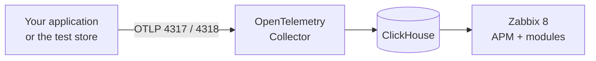

# From Zabbix 8 to full APM, step by step

[Español](guia-ubuntu-paso-a-paso.md)

It starts from an Ubuntu or Debian server that **already runs Zabbix 8** and ends with APM working and a test store sending data. Four commands; each one checks what it does and can be run again.



## Prerequisites

| You need | Detail |
|---|---|
| **Zabbix 8.0 running** | Server and frontend on this same machine, installed from packages or built from source |
| **Ubuntu or Debian**, `amd64` or `arm64` | With a user that can use `sudo`, and Internet access |
| **API token of a Super admin** | In Zabbix: **User settings → API tokens → Create API token**. Copy it: it is asked only once |
| **4 GiB of RAM and 5 GB of disk** | With the test store: **10 GiB of RAM and 20 GB of disk** |
| **Free ports** | `8123` and `9000` (ClickHouse), `4317` and `4318` (Collector); with the store, `18080`; with the Fault Shop, `18090` |

Step 2 checks all of this before installing anything.

## 1. Download the repository

```sh
sudo apt-get update && sudo apt-get install -y git
git clone https://github.com/SimonLexRS/zabbix-apm-dashboard.git
cd zabbix-apm-dashboard
```

## 2. Check the prerequisites

```sh
sudo ./scripts/setup.sh check
```

Paste the token when asked (it is not shown while typing). ✅ Every line must start with `✔`. If one starts with `✘`, the same line says how to fix it.

## 3. Install APM

```sh
sudo ./scripts/setup.sh install
```

It takes 1 to 10 minutes, depending on your connection. It installs and connects, in this order:

| What | Result |
|---|---|
| **ClickHouse** | Keeps traces, logs and metrics for 72 h. Listens on `localhost` only |
| **OpenTelemetry Collector** | Receives OTLP on `127.0.0.1:4317` (gRPC) and `:4318` (HTTP) and writes to ClickHouse |
| **Modules** | **APM → Overview**, **Real user monitoring** and two widgets, already enabled |
| **APM data source** | Zabbix reads ClickHouse with a read-only user |
| **Test** | Sends one trace and checks that Zabbix can read it |

✅ It ends with `APM is ready`. Open Zabbix: the menu has **APM → Overview**.

If you will not use the store, you can already [connect your application](add-application.md).

## 4. Integrate the test store

The store is the [OpenTelemetry Demo](../examples/stacks/opentelemetry-demo/README.md): about 20 services in Docker with simulated traffic. Give the IP you open this server with in the browser:

```sh
sudo ./scripts/setup.sh demo 192.168.56.2
```

The first time it downloads 8.6 GB of images. It installs Docker, makes the Collector also listen on Docker's internal network (not on yours), starts the store and creates its host in Zabbix.

✅ It ends with `Traces from the store are arriving in ClickHouse`. Now:

1. Open the store at `http://<IP>:18080/` and browse it.
2. In Zabbix, **APM → Overview → opentelemetry-demo**: service map, requests and errors.
3. **APM → Real user monitoring** shows your browser session.

> [!WARNING]
> The store is open on port 18080 without authentication. Use it on a test network only.

### A smaller store, with failures on demand

The [Fault Shop](../examples/stacks/fault-shop/README.md) needs 300 MiB instead of 10 GiB and has a panel of switches: slow database, failed purchases, a service down. It can run alone or next to the store above:

```sh
sudo ./scripts/setup.sh shop 192.168.56.2
```

✅ It ends with `Traces from the shop are arriving in ClickHouse`. Store at `http://<IP>:18090/`, panel at `http://<IP>:18090/faults.html`, and in Zabbix **APM → Overview → fault-shop**. Compare it with ClickHouse with `sudo ./scripts/setup.sh verify fault-shop`.

## 5. Verify

Wait 10 minutes, so that Zabbix has values for every item, and compare what it shows with what is in ClickHouse:

```sh
sudo ./scripts/setup.sh verify
```

✅ You must see `all checks passed` and `all required checks passed`.

At any time, `sudo ./scripts/setup.sh status` summarizes the state of each piece.

## If something fails

Every command can be run again: it continues where it stopped.

| Symptom | Solution |
|---|---|
| `Zabbix API not found` | Your frontend is at another address: `sudo ZABBIX_URL=http://127.0.0.1/zabbix ./scripts/setup.sh check` |
| `API token rejected` | The token must belong to a user with the Super admin role and not be expired. To change it: `sudo ZABBIX_API_TOKEN=<token> ./scripts/setup.sh check` |
| `Port ... is in use` | Another service uses that port: stop it or move it |
| `Could not download the images` | Temporary network or DNS failure: run the command again |
| `verify` fails on `average duration` | Run it again after 3 minutes: some connections of the store last 10 minutes |
| You already have ClickHouse with a password | `sudo CH_ADMIN_USER=<user> CH_ADMIN_PASSWORD=<password> ./scripts/setup.sh install` |

More cases in [troubleshooting.md](troubleshooting.md).

## Operate and uninstall

| Task | Command |
|---|---|
| Stop the store | `sudo ./scripts/setup.sh demo stop` |
| Stop the Fault Shop | `sudo ./scripts/setup.sh shop stop` |
| Start it again | `sudo ./scripts/setup.sh demo <IP>` |
| Update the modules | `git pull && sudo ./scripts/setup.sh install` |
| Remove the store, the modules and the Collector | `sudo ./scripts/setup.sh uninstall` |
| Also remove ClickHouse **and its data** | `sudo ./scripts/setup.sh uninstall --purge` |

The ClickHouse passwords and the token are kept in `/root/.zabbix`, readable by root only. To give access to users who are not Super admin, see [install-module.md](install-module.md#step-4-see-data-and-give-access).

## What was checked

These commands were run as they are, after removing everything with `uninstall --purge`, on Ubuntu 26.10 ARM64 with Zabbix 8.0.0rc3 built from source, PostgreSQL, Nginx and PHP 8.5. Not tested on AMD64, on Debian or with Zabbix installed from packages: `check` detects those differences, but review its result.

To install by hand or on another distribution: [installation.md](installation.md).
