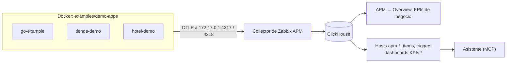

# Aplicaciones de ejemplo

[English](README.md)

Cuatro aplicaciones que envían OpenTelemetry a Zabbix APM, cada una para mostrar una parte. Córrelas junto a tu Zabbix
para ver cada página con datos reales, y copia de ellas lo que necesita tu propia aplicación.

| Aplicación | Qué es | Qué envía | Dónde la ves en Zabbix |
|---|---|---|---|
| **go-example** | API en Go con el SDK de OpenTelemetry ([código](../stacks/go/main.go)), que se llama a sí misma cuatro veces por segundo | trazas (de servidor y de cliente), logs, métricas de runtime, errores (falla 1 de cada 8 llamadas), pedidos e ingresos por tienda | APM → Overview (mapa, servicios, endpoints, errores, lentitud, KPIs), host `apm-go-example` |
| **tienda-demo** | una tienda con tres sucursales ([kpi-demo.py](../../scripts/kpi-demo.py)) | pedidos por tienda y canal, ingresos, carritos abandonados, importes de los pedidos y el **stock** de cada tienda | pestaña KPIs de negocio, host `apm-tienda-demo`, dashboard **KPIs tienda-demo** |
| **hotel-demo** | una cadena de tres hoteles ([kpi-demo.py](../../scripts/kpi-demo.py)) | reservas por hotel y tipo de habitación, cancelaciones, ingresos, y las **habitaciones, libres, ocupadas y la ocupación** de cada hotel | pestaña KPIs de negocio, host `apm-hotel-demo`, dashboard **KPIs hotel-demo** |
| **opentelemetry-demo** | la tienda oficial de OpenTelemetry, unos 20 servicios en 10 lenguajes | todo, más datos del navegador (RUM) y métricas de negocio como los pagos por moneda | todas las páginas; guía propia: [OpenTelemetry Demo](../stacks/opentelemetry-demo/README.es.md) |



Las tres primeras corren con el `compose.yaml` de esta carpeta; la OpenTelemetry Demo tiene su propio compose y su guía.

## 1. Levantarlas

Necesitas Docker y el Collector de Zabbix APM escuchando en la dirección de Docker del host, como en el paso 3 de la
[guía de la OpenTelemetry Demo](../stacks/opentelemetry-demo/README.es.md) (`otelcol-docker-bridge.yaml`).
Comprueba:

```sh
ss -tln | grep -E '172.17.0.1:(4317|4318)'
```

✅ Deben aparecer los dos puertos. Después, desde una copia de este repositorio:

```sh
cd examples/demo-apps
cp .env.example .env
docker compose up -d --build
docker compose ps                     # tres servicios "running"
docker compose logs -f tienda-demo    # cada minuto: pedidos y stock de cada tienda desde que arrancó
```

Se reinician con Docker y con el servidor (`restart: unless-stopped`). El ejemplo en Go responde solo en esta máquina:
`curl http://127.0.0.1:8090/hello`.

En menos de un minuto **APM → Overview** tiene las pestañas **go-example**, **tienda-demo** y **hotel-demo**.

## 2. Integrarlas con Zabbix

Un host por aplicación, con el template de APM y los KPIs de negocio, y un dashboard de comparación para las dos que
tienen atributos para comparar. Necesitas un token de API de un Super admin y la contraseña de lectura de ClickHouse:

```sh
cd ../..                              # raíz del repositorio
export ZABBIX_URL=http://127.0.0.1 ZABBIX_API_TOKEN=<token>
export CH_URL=http://127.0.0.1:8123/ CH_USER=zabbix_ro CH_PASSWORD="$(sudo cat /root/.zabbix/ch_reader)"

for app in go-example tienda-demo hotel-demo; do
  python3 scripts/zabbix-apm-app.py add $app --kpi
done

# a los 2-3 minutos, cuando se descubrieron los ítems:
python3 scripts/zabbix-apm-app.py kpi-dashboard tienda-demo
python3 scripts/zabbix-apm-app.py kpi-dashboard hotel-demo

python3 scripts/verify-app.py tienda-demo --kpi     # all checks passed
```

| Comando | Qué hace |
|---|---|
| `add <app>` | host `apm-<app>` en *Applications/APM* con **OpenTelemetry application by OTLP** (spans, errores, logs, triggers) |
| `--kpi` | también **APM business metrics by ClickHouse HTTP**: un ítem por métrica y por tienda u hotel ([KPIs de negocio](../../docs/business-kpis.es.md)) |
| `kpi-dashboard <app>` | dashboard **KPIs &lt;app&gt;**: torta, ranking y participación de cada tienda u hotel, tendencia por hora y la disponibilidad actual |
| `verify-app.py <app> --kpi` | comprueba el host, los templates, que las consultas respondan y que `today` coincida con ClickHouse |

Todos son idempotentes: vuelve a correrlos después de actualizar el repositorio. Pon `{$APM.KPI.TIMEZONE}` en los hosts
(por ejemplo `America/La_Paz`) para que *hoy* sea tu día.

## 3. Qué vas a ver

**APM → Overview → go-example:** el mapa de servicios (usuarios → `go-example-api`), los endpoints `GET /hello`,
`GET /slow` (200–800 ms), `GET /fail` (siempre 500) y `POST /order`, el error agrupado *payment declined*, la cascada de
las peticiones lentas y, en **KPIs de negocio**, los pedidos y los ingresos por tienda.

**KPIs de negocio** de tienda-demo y hotel-demo:


**Ítems** (Monitoreo → Últimos datos, host `apm-tienda-demo`, tag `component: kpi`), por ejemplo:

| Ítem | Valor |
|---|---|
| `KPI shop.orders shop.store=Centro (tienda-api): today` | pedidos de Centro hoy |
| `KPI shop.orders shop.store=Centro (tienda-api): share today` / `rank today` | su % de los pedidos de hoy y su posición entre las tiendas |
| `KPI shop.orders (tienda-api): total (counter)` | lo que contó la aplicación desde que arrancó: la misma cifra que `docker compose logs tienda-demo` |
| `KPI shop.stock.available shop.store=Sur (tienda-api): current` | unidades en stock en Sur; también `shop.stock.capacity` y `shop.products.out_of_stock` |
| `KPI hotel.rooms.available hotel.name=Hotel Playa (reservas-api): current` | habitaciones libres; también `hotel.rooms.capacity`, `hotel.rooms.occupied` y `hotel.occupancy` (%) |
| `KPI hotel.reservations hotel.name=Hotel Playa (reservas-api): yesterday` | reservas de ayer (un valor por día, 400 días) |

**Dashboards → KPIs tienda-demo / KPIs hotel-demo:** arriba los totales de cada métrica; después una fila por métrica y
atributo: hoy por tienda u hotel (torta), las tiendas u hoteles de mayor a menor, su participación y su tendencia por
hora; para la disponibilidad, el valor actual y las últimas 24 horas.

**Asistente** (módulo de [zabbix-mcp](https://github.com/SimonLexRS/zabbix-mcp)):

- *¿Cuántos pedidos tuvo hoy cada tienda y qué porcentaje es cada una?*
- *¿Cuántas habitaciones libres tiene cada hotel y cuál es la ocupación?*
- *¿Qué tienda tiene productos agotados?*
- *¿Por qué falla go-example?* (errores y trazas de `GET /fail`)

## 4. Comparar con la aplicación

Las cifras de Zabbix deben ser las de la aplicación:

```sh
docker compose logs --tail 2 tienda-demo
# 20:09:48 tienda-demo since start: Centro: 234 orders / 19455.99 USD, stock 551/600, ...
```

`KPI shop.orders shop.store=Centro (tienda-api): total (counter)` muestra 234 para el mismo minuto (los ítems leen hasta
dos minutos tarde). Un pedido tuyo en el ejemplo en Go aparece en sus contadores:

```sh
curl -X POST 'http://127.0.0.1:8090/order?store=Centro'      # order placed in Centro: 57.21 USD
```

`verify-app.py <app> --kpi` hace la comparación para cada ítem `today`.

## 5. Del ejemplo a tu aplicación

| Quieres | Mira |
|---|---|
| Trazas, logs y métricas de un servicio en Go | [examples/stacks/go](../stacks/go/README.es.md): `telemetry.Setup`, `otelhttp`, `otelslog` |
| Java, Python, Node.js o .NET sin cambiar el código | [agentes sin código](../stacks/zero-code/README.es.md) |
| Ventas, reservas o cualquier número del negocio por tienda, hotel… | [KPIs de negocio](../../docs/business-kpis.es.md): contadores con atributos, `POST /order` en [main.go](../stacks/go/main.go) |
| Disponibilidad (habitaciones libres, stock) | [KPIs de negocio](../../docs/business-kpis.es.md): gauges observables, como `Gauge` en [kpi-demo.py](../../scripts/kpi-demo.py) |
| Conectarla a Zabbix | [agregar una aplicación](../../docs/add-application.es.md): `service.namespace`, el Collector, `add <app> --kpi` |
| El navegador de tus usuarios | [monitoreo de usuarios reales](../../docs/rum.es.md) |

Lo único que une una aplicación con su pestaña, su host y su dashboard es `service.namespace`: dale uno propio a la tuya
y repite el paso 2 con él.

## 6. Detener y quitar

```sh
docker compose stop                # las detiene, conserva los contenedores
docker compose down --rmi local    # borra los contenedores y la imagen del ejemplo en Go
```

En Zabbix, los hosts `apm-go-example`, `apm-tienda-demo` y `apm-hotel-demo` (Recolección de datos → Hosts → Eliminar) y
los dashboards **KPIs tienda-demo** y **KPIs hotel-demo** (Dashboards → Eliminar) son solo de la demo. ClickHouse borra
sus datos a los 3 días.

## Problemas

| Síntoma | Causa |
|---|---|
| No aparece la pestaña de las aplicaciones | El Collector no escucha en `172.17.0.1` (paso 1), o un firewall bloquea las redes de Docker: `docker compose logs go-example` muestra `connection refused` |
| `tienda-demo: send failed` en los logs | Lo mismo, para el puerto 4318 (OTLP/HTTP) |
| Los contadores volvieron a 0 | Se reinició el contenedor (una instancia nueva): `total (counter)` cuenta desde entonces; `today` conserva todo el día |
| Los valores son el doble de lo que imprime la aplicación | `kpi-demo.py` también corre a mano con el mismo `--app`: detén uno de los dos |
| Las horas parecen corridas | Revisa el reloj del servidor (`timedatectl`); los contenedores usan el mismo |
