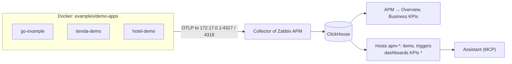

# Example applications

[Español](README.es.md)

Four applications that send OpenTelemetry to Zabbix APM, each showing one part of it. Run them next to your Zabbix to
see every page with real data, and copy from them what your own application needs.

| Application | What it is | What it sends | Where you see it in Zabbix |
|---|---|---|---|
| **go-example** | Go API with the OpenTelemetry SDK ([code](../stacks/go/main.go)), calling itself four times per second | traces (server and client), logs, runtime metrics, errors (1 in 8 calls fails), orders and revenue by store | APM → Overview (map, services, endpoints, errors, slowness, KPIs), host `apm-go-example` |
| **tienda-demo** | a store with three branches ([kpi-demo.py](../../scripts/kpi-demo.py)) | orders by store and channel, revenue, abandoned carts, order amounts, and the **stock** of each store | Business KPIs tab, host `apm-tienda-demo`, dashboard **KPIs tienda-demo** |
| **hotel-demo** | a chain of three hotels ([kpi-demo.py](../../scripts/kpi-demo.py)) | reservations by hotel and room type, cancellations, revenue, and the **rooms, rooms free, rooms occupied and occupancy** of each hotel | Business KPIs tab, host `apm-hotel-demo`, dashboard **KPIs hotel-demo** |
| **opentelemetry-demo** | the official OpenTelemetry store, about 20 services in 10 languages | everything, plus browser data (RUM) and business metrics such as payments by currency | every page; own guide: [OpenTelemetry Demo](../stacks/opentelemetry-demo/README.md) |



The first three run with this directory's `compose.yaml`; the OpenTelemetry Demo has its own compose and guide.

## 1. Start them

You need Docker and the Collector of Zabbix APM listening on the Docker address of the host, as in step 3 of the
[OpenTelemetry Demo guide](../stacks/opentelemetry-demo/README.md#3-let-the-containers-reach-the-zabbix-collector)
(`otelcol-docker-bridge.yaml`). Check:

```sh
ss -tln | grep -E '172.17.0.1:(4317|4318)'
```

✅ It must show both ports. Then, from a copy of this repository:

```sh
cd examples/demo-apps
cp .env.example .env
docker compose up -d --build
docker compose ps                     # three services "running"
docker compose logs -f tienda-demo    # every minute: orders and stock of each store since it started
```

They restart with Docker and with the server (`restart: unless-stopped`). The Go example answers only on this machine:
`curl http://127.0.0.1:8090/hello`.

Within a minute **APM → Overview** has the tabs **go-example**, **tienda-demo** and **hotel-demo**.

## 2. Integrate them with Zabbix

One host per application, with the APM template and the business KPIs, and a comparison dashboard for the two that
have attributes to compare. You need an API token of a Super admin and the read-only password of ClickHouse:

```sh
cd ../..                              # root of the repository
export ZABBIX_URL=http://127.0.0.1 ZABBIX_API_TOKEN=<token>
export CH_URL=http://127.0.0.1:8123/ CH_USER=zabbix_ro CH_PASSWORD="$(sudo cat /root/.zabbix/ch_reader)"

for app in go-example tienda-demo hotel-demo; do
  python3 scripts/zabbix-apm-app.py add $app --kpi
done

# after 2-3 minutes, when the items are discovered:
python3 scripts/zabbix-apm-app.py kpi-dashboard tienda-demo
python3 scripts/zabbix-apm-app.py kpi-dashboard hotel-demo

python3 scripts/verify-app.py tienda-demo --kpi     # all checks passed
```

| Command | What it does |
|---|---|
| `add <app>` | host `apm-<app>` in *Applications/APM* with **OpenTelemetry application by OTLP** (spans, errors, logs, triggers) |
| `--kpi` | also **APM business metrics by ClickHouse HTTP**: one item per metric and per store or hotel ([business KPIs](../../docs/business-kpis.md)) |
| `kpi-dashboard <app>` | dashboard **KPIs &lt;app&gt;**: pie chart, ranking and share of each store or hotel, trend per hour, and the current availability |
| `verify-app.py <app> --kpi` | checks the host, the templates, that the queries answer and that `today` matches ClickHouse |

All of them are idempotent: run them again after updating the repository. Set `{$APM.KPI.TIMEZONE}` on the hosts
(e.g. `America/La_Paz`) so that *today* is your day.

## 3. What you see

**APM → Overview → go-example:** the service map (users → `go-example-api`), the endpoints `GET /hello`,
`GET /slow` (200–800 ms), `GET /fail` (always 500) and `POST /order`, the grouped error *payment declined*, the
waterfall of the slow requests and, in **Business KPIs**, the orders and revenue by store.

**Business KPIs** of tienda-demo and hotel-demo:


**Items** (Monitoring → Latest data, host `apm-tienda-demo`, tag `component: kpi`), for example:

| Item | Value |
|---|---|
| `KPI shop.orders shop.store=Centro (tienda-api): today` | orders of Centro today |
| `KPI shop.orders shop.store=Centro (tienda-api): share today` / `rank today` | its % of the orders of today and its position among the stores |
| `KPI shop.orders (tienda-api): total (counter)` | what the application counted since it started: the same figure as `docker compose logs tienda-demo` |
| `KPI shop.stock.available shop.store=Sur (tienda-api): current` | units in stock in Sur; also `shop.stock.capacity` and `shop.products.out_of_stock` |
| `KPI hotel.rooms.available hotel.name=Hotel Playa (reservas-api): current` | rooms free; also `hotel.rooms.capacity`, `hotel.rooms.occupied` and `hotel.occupancy` (%) |
| `KPI hotel.reservations hotel.name=Hotel Playa (reservas-api): yesterday` | reservations of yesterday (one value per day, 400 days) |

**Dashboards → KPIs tienda-demo / KPIs hotel-demo:** the totals of every metric at the top, then one row per metric and
attribute: today by store or hotel (pie chart), the stores or hotels from largest to smallest, their share, and their
trend per hour; for the availability, the current value and the last 24 hours.

**Assistant** (module of [zabbix-mcp](https://github.com/SimonLexRS/zabbix-mcp)):

- *How many orders did each store have today, and what share is each one?*
- *How many rooms are free in each hotel, and what is the occupancy?*
- *Which store has products out of stock?*
- *Why does go-example fail?* (errors and traces of `GET /fail`)

## 4. Compare with the application

The figures of Zabbix must be the ones of the application:

```sh
docker compose logs --tail 2 tienda-demo
# 20:09:48 tienda-demo since start: Centro: 234 orders / 19455.99 USD, stock 551/600, ...
```

`KPI shop.orders shop.store=Centro (tienda-api): total (counter)` shows 234 for the same minute (the items read up to
two minutes late). An order of your own in the Go example appears in its counters:

```sh
curl -X POST 'http://127.0.0.1:8090/order?store=Centro'      # order placed in Centro: 57.21 USD
```

`verify-app.py <app> --kpi` makes the comparison for every `today` item.

## 5. From the example to your application

| You want | Look at |
|---|---|
| Traces, logs and metrics from a Go service | [examples/stacks/go](../stacks/go/README.md): `telemetry.Setup`, `otelhttp`, `otelslog` |
| Java, Python, Node.js or .NET without changing the code | [zero-code agents](../stacks/zero-code/README.md) |
| Sales, reservations or any business number by store, hotel... | [business KPIs](../../docs/business-kpis.md): counters with attributes, `POST /order` in [main.go](../stacks/go/main.go) |
| Availability (rooms free, stock) | [business KPIs](../../docs/business-kpis.md): observable gauges, as `Gauge` in [kpi-demo.py](../../scripts/kpi-demo.py) |
| Connect it to Zabbix | [add an application](../../docs/add-application.md): `service.namespace`, the Collector, `add <app> --kpi` |
| The browser of your users | [real user monitoring](../../docs/rum.md) |

The only thing that ties an application to its tab, host and dashboard is `service.namespace`: give yours its own and
repeat step 2 with it.

## 6. Stop and remove

```sh
docker compose stop           # stop them, keep the containers
docker compose down --rmi local    # remove containers and the image of the Go example
```

In Zabbix, the hosts `apm-go-example`, `apm-tienda-demo` and `apm-hotel-demo` (Data collection → Hosts → Delete) and
the dashboards **KPIs tienda-demo** and **KPIs hotel-demo** (Dashboards → Delete) are only for the demo. ClickHouse
drops their data after 3 days.

## Problems

| Symptom | Cause |
|---|---|
| No tab for the applications | The Collector does not listen on `172.17.0.1` (step 1), or a firewall blocks the Docker networks: `docker compose logs go-example` shows `connection refused` |
| `tienda-demo: send failed` in the logs | The same, for port 4318 (OTLP/HTTP) |
| The counters started again from 0 | The container restarted (a new instance): `total (counter)` counts since then; `today` keeps the whole day |
| Values double what the application prints | `kpi-demo.py` also runs by hand with the same `--app`: stop one of them |
| Times look shifted | Check the clock of the server (`timedatectl`); the containers use it |
