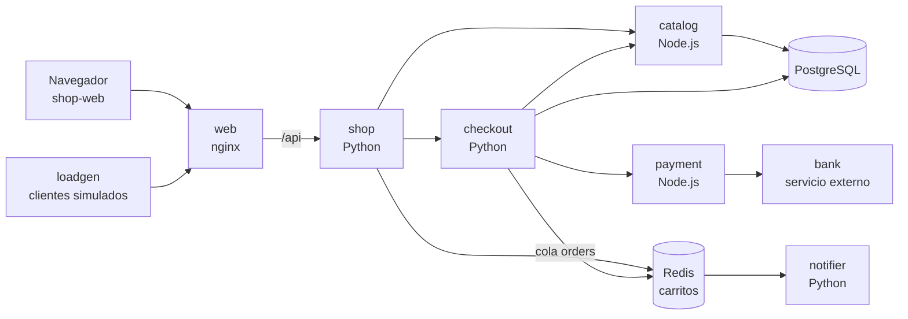
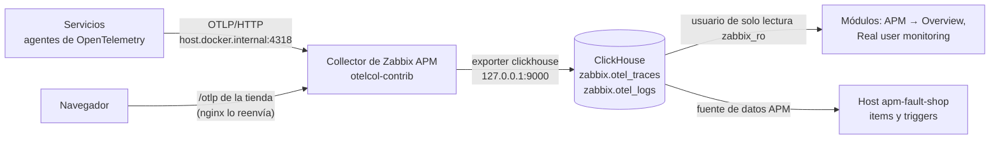

# Fault Shop: una tienda que rompes a mano

[English](README.md)

Una tienda pequeña en Docker, con un **panel de fallos**: interruptores que vuelven lenta la base de datos, hacen fallar las compras o tiran un servicio, hasta que los apagas. Sirve para ver cómo se ve cada tipo de fallo en Zabbix APM, probar triggers y practicar la búsqueda de una causa.

> **Con un comando: `sudo ./scripts/setup.sh shop <IP>`.** Necesita Zabbix APM ya instalado ([guía paso a paso](../../../docs/guia-ubuntu-paso-a-paso.md), pasos 1 a 3). Esta página explica qué hace el comando y cómo hacerlo a mano.

Es ligera: 10 contenedores, unos 300 MiB de RAM, imágenes que se construyen en 2 a 5 minutos. El [OpenTelemetry Demo](../opentelemetry-demo/README.es.md) necesita 10 GiB y falla por su cuenta; esta falla cuando tú lo decides.



`bank` no envía telemetría, como un servicio que no es tuyo: Zabbix lo muestra como un host externo, con lo que mide `payment` al llamarlo.

## 1. Arrancarla

```sh
sudo ./scripts/setup.sh shop 192.168.56.2     # la dirección con la que abres este servidor en el navegador
```

✅ Termina con `Traces from the shop are arriving in ClickHouse` y muestra las dos direcciones:

| Página | Dirección |
|---|---|
| Tienda | `http://<IP>:18090/` |
| Panel de fallos | `http://<IP>:18090/faults.html` |

El comando instala Docker si falta, hace que el Collector escuche también en la red interna de Docker, construye y arranca los contenedores y crea el host `apm-fault-shop` en Zabbix. Se puede repetir; para otro puerto: `sudo SHOP_PORT=18091 ./scripts/setup.sh shop <IP>`.

> [!WARNING]
> La tienda y su panel de fallos quedan abiertos en el puerto 18090 sin autenticación. Úsala solo en una red de pruebas.

## 2. Romper algo

Abre el panel de fallos y enciende un fallo. Actúa en unos segundos, sobre los clientes simulados y sobre lo que hagas tú en la tienda. **Volver todo a la normalidad** apaga todo. El panel sale en español o en inglés según el idioma del navegador; la tienda está en inglés.

| Interruptor | Qué hace | Dónde se ve en Zabbix (**APM → Overview → fault-shop**) |
|---|---|---|
| **Base de datos lenta** (500 ms, 2 s, 6 s) | Cada consulta de `catalog` tarda ese tiempo | **Slowness**: `GET /products` de `catalog` y de `shop`; en la traza, el tiempo está en el span de PostgreSQL. Problema *Span duration is too big* |
| **Consultas N+1** | La lista de productos hace una consulta por producto | Traza de `GET /products`: 17 consultas en vez de 1 |
| **Las compras fallan en el pago** (20, 50, 100 %) | `payment` rechaza esa parte de los cobros | **Errors**: `CardDeclinedError` en `payment`. Mapa: `checkout` y `payment` con arco rojo. Problema *High span error rate* |
| **Banco lento** (1 s, 3 s, 6 s) | El servicio externo responde tarde; `payment` espera 4 s como máximo | Mapa: línea lenta `payment → bank`. Con 6 s, `BankTimeoutError` y compras fallidas |
| **Servicio caído** (`catalog`, `checkout`, `payment`, `bank`) | El servicio responde 503; `bank` cierra la conexión | Mapa: nodos en rojo desde el caído hasta `shop`. **Errors**: `BankUnreachableError`, `RuntimeError: payment answered HTTP 503` |
| **Un producto rompe el código** | Solo falla *Mystery box* (id 13), con un `TypeError` | **Errors**: un grupo en `GET /products/:id`. En la página de ese endpoint en `shop`, **Why slow, why failing** señala `app.product.id = 13` |
| **Sin existencias** | Las compras se rechazan con 409 | Nadie falló: `catalog`, `checkout` y `shop` responden 4xx y siguen en verde en el mapa. Solo las llamadas entre ellos quedan marcadas como error, como hace OpenTelemetry con un 4xx visto desde quien llama, así que la tasa de errores del host de Zabbix sí sube |
| **Checkout con la CPU ocupada** (200 ms, 800 ms, 2 s) | `checkout` gasta ese tiempo en su propio código | Traza de `POST /orders`: span `validate order` sin llamadas dentro |
| **Cola de correos lenta** (1 s, 5 s) | `notifier` tarda eso por pedido | La compra responde rápido; su traza se alarga en `orders process` |
| **Los correos fallan** | `notifier` no puede enviar | **Errors**: `ConnectionError` en `notifier`, mientras las compras salen bien |
| **Error de JavaScript en «Add to cart»** | La página se rompe al hacer clic | **Real user monitoring → Errors**: `TypeError`. Haz clic tú: los clientes simulados no tienen navegador |
| **Clientes simulados** (parados, 1, 2, 5 por segundo) | El tráfico de `loadgen` | Parados: solo tu tráfico; a los 10 minutos, problema *No spans received* |

Los colores del mapa y el estado de cada error siguen los últimos 15 minutos: un fallo se ve en menos de un minuto, y un grupo de errores pasa a *Resolved* 15 minutos después de apagarlo. Los problemas de Zabbix necesitan los valores de varios minutos; se abren y se cierran solos.

### Fallos que no son un interruptor

Ejecútalos en `examples/stacks/fault-shop` de la copia del repositorio desde la que instalaste.

| Fallo | Comando | Qué se ve |
|---|---|---|
| Caída real de un servicio (conexión rechazada, no un 503) | `sudo docker compose -p fault-shop stop payment` y, para recuperarlo, `start payment` | `requests.exceptions.ConnectionError` en `checkout`; `payment` deja de informar en el mapa |
| Despliegue de una versión defectuosa | `sudo CHECKOUT_VERSION=1.1.0 docker compose -p fault-shop up -d checkout` | Página del servicio `checkout` → **Versions**: la 1.1.0 falla con `KeyError` en los pedidos de 3 o más productos distintos; la 1.0.0 no |
| Volver a la versión anterior | `sudo docker compose -p fault-shop up -d checkout` | Los errores de la 1.1.0 paran y pasan a *Resolved* |
| Toda la aplicación caída | `sudo ./scripts/setup.sh shop stop` | Problema *No spans received* a los 10 minutos |

## Cómo llegan los datos a ClickHouse y a Zabbix



Nada en la tienda conoce ClickHouse. Cada pieza hace solo esto:

| Pieza | Qué hace | Dónde |
|---|---|---|
| **Servicios** | Arrancan con el agente de OpenTelemetry de su lenguaje, sin código de telemetría propio, y envían OTLP al Collector. Tres variables: `OTEL_EXPORTER_OTLP_ENDPOINT=http://host.docker.internal:4318`, `OTEL_SERVICE_NAME` y `OTEL_RESOURCE_ATTRIBUTES=service.namespace=fault-shop,service.version=…` | [`compose.yaml`](compose.yaml) |
| **Navegador** | Envía sus spans a `/otlp` de la propia tienda; nginx los reenvía al Collector. Mismo origen: sin CORS, y el Collector sigue privado | [`web/otel.js`](web/otel.js), [`web/nginx.conf`](web/nginx.conf) |
| **Collector** | Escucha en `127.0.0.1` y en el bridge de Docker (`172.17.0.1`), no en tu red. Su exporter `clickhouse` escribe las tablas y las conserva 72 h | `/etc/otelcol-contrib/config.yaml`, [`otelcol-docker-bridge.yaml`](../opentelemetry-demo/otelcol-docker-bridge.yaml) |
| **ClickHouse** | Guarda los spans en `zabbix.otel_traces` y los logs en `zabbix.otel_logs`. `service.namespace` es lo que Zabbix llama aplicación | lo instala `setup.sh install` |
| **Zabbix** | Los módulos consultan ClickHouse en cada página. El host `apm-fault-shop` (plantilla *OpenTelemetry application by OTLP*, macro `{$OTLP.NAMESPACE}=fault-shop`) convierte las mismas tablas en items y triggers | [`zabbix-apm-app.py`](../../../scripts/zabbix-apm-app.py) |

Comprueba cada salto en el servidor:

```sh
# 1. El Collector escucha donde los contenedores lo alcanzan
ss -tln | grep -E '172.17.0.1:(4317|4318)'

# 2. Spans de la tienda en ClickHouse, por servicio, en los últimos 5 minutos
sudo clickhouse-client --user zabbix_ro --password "$(sudo cat /root/.zabbix/ch_reader)" -q "
  SELECT ServiceName, count() AS spans, countIf(StatusCode = 'Error') AS errors
  FROM zabbix.otel_traces
  WHERE ResourceAttributes['service.namespace'] = 'fault-shop' AND Timestamp > now() - INTERVAL 5 MINUTE
  GROUP BY ServiceName ORDER BY ServiceName"

# 3. Zabbix muestra las mismas cifras que ClickHouse (espera 10 minutos tras arrancar)
sudo ./scripts/setup.sh verify fault-shop
```

✅ El paso 2 debe listar `catalog`, `checkout`, `notifier`, `payment` y `shop`, y `shop-web` cuando hayas abierto la tienda en un navegador.

## Hacerlo a mano

Lo que hace `setup.sh shop`, para otra disposición del servidor. APM debe funcionar y el Collector debe escuchar en el bridge de Docker ([paso 3 de la guía del OpenTelemetry Demo](../opentelemetry-demo/README.es.md)).

```sh
cd examples/stacks/fault-shop
sudo docker compose -p fault-shop up -d --build
sudo docker compose -p fault-shop ps          # 10 servicios "running"

# La aplicación en Zabbix: host apm-fault-shop con la plantilla de APM
export ZABBIX_URL=http://127.0.0.1 ZABBIX_API_TOKEN=<token de un Super admin>
python3 ../../../scripts/zabbix-apm-app.py add fault-shop --name 'Fault Shop' --timeshift 60s
```

Si el Collector está en otra máquina: `sudo ZABBIX_APM_HOST=<dirección> docker compose -p fault-shop up -d`, con sus puertos 4317 y 4318 alcanzables desde esta.

## Cómo está hecha

| Ruta | Contenido |
|---|---|
| [`compose.yaml`](compose.yaml) | Los 10 contenedores y las variables de OpenTelemetry de cada servicio |
| [`python/`](python) | `shop` (API y carrito), `checkout` (pedidos), `notifier` (worker de la cola), `bank` y `loadgen`; una imagen para los cinco |
| [`node/`](node) | `catalog` (productos, PostgreSQL) y `payment`; una imagen para los dos |
| [`web/`](web) | Las páginas, el panel de fallos (`faults.html`) y la telemetría del navegador (`otel.js`) |
| [`db/init.sql`](db/init.sql) | Tablas y los 16 productos |

**Cómo funciona un interruptor.** El panel envía sus interruptores a `shop` (`PUT /api/faults`), que los escribe en un archivo JSON de un volumen que montan todos los servicios. Cada servicio lee el archivo cuando le llega una petición. Es un archivo, y no Redis ni HTTP, para que leer un interruptor no añada spans a las trazas que estás mirando.

**Añadir un fallo propio:**

1. Decláralo con su valor por defecto en [`python/faults.py`](python/faults.py) (`DEFINITIONS`) y, para un servicio en Node.js, en [`node/faults.js`](node/faults.js) (`DEFAULTS`).
2. Úsalo en el servicio: `faults.get()['mi_fallo']` (Python) o `faults.get().mi_fallo` (Node.js).
3. Añade su fila a `FAULTS` en [`web/faults.html`](web/faults.html): clave, opciones y textos.
4. `sudo docker compose -p fault-shop up -d --build`.

La cola se ve como una sola traza porque `checkout` pone el contexto de la traza en cada mensaje y `notifier` lo continúa ([`checkout.py`](python/checkout.py), [`notifier.py`](python/notifier.py)): es el único código de telemetría escrito a mano, junto con los atributos `app.*` que usa el análisis de etiquetas.

## Parar y quitar

| Tarea | Comando |
|---|---|
| Pararla | `sudo ./scripts/setup.sh shop stop` |
| Arrancarla de nuevo | `sudo ./scripts/setup.sh shop <IP>` |
| Quitar los contenedores y sus datos | `sudo docker compose -p fault-shop down -v`, en este directorio |
| Quitar el host en Zabbix | **Data collection → Hosts**, borra `apm-fault-shop` |

`sudo ./scripts/setup.sh uninstall` quita también las dos cosas.

## Qué se comprobó

En Ubuntu 26.10 ARM64 con Zabbix 8.0.0rc3, Docker 29.7 y Chrome, junto al OpenTelemetry Demo: `setup.sh shop` desde cero y de nuevo sobre una tienda en marcha; cada interruptor del panel, el servicio parado y la versión 1.1.0, vistos en ClickHouse con el error o la latencia de la tabla de arriba; el mapa de `fault-shop` en Zabbix con sus nueve nodos y un problema abierto por los fallos; una compra y un error de JavaScript desde un navegador real en Real user monitoring, enlazados con sus trazas del backend.

No se comprobó: AMD64, un Collector en otra máquina (`ZABBIX_APM_HOST`) ni un navegador sin acceso a Internet: el SDK del navegador se carga de `esm.sh`, y sin él la tienda funciona pero no envía datos del navegador.
