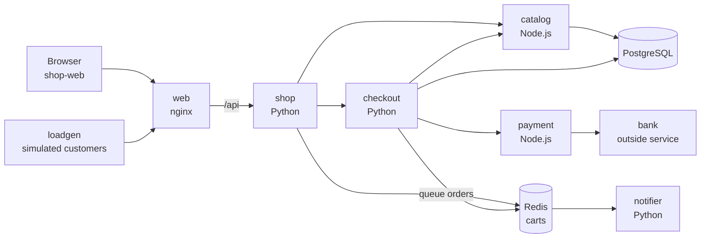
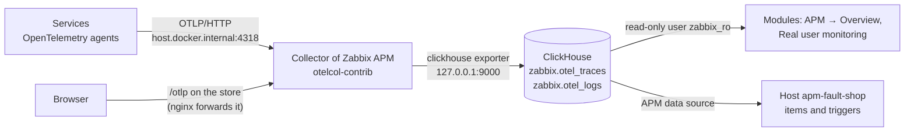

# Fault Shop: a store you break by hand

[Español](README.es.md)

A small store in Docker, with a **fault panel**: switches that make the database slow, the purchases fail or a service go down, until you turn them off. Use it to see how each kind of failure looks in Zabbix APM, to try triggers and to practise finding a cause.

> **With one command: `sudo ./scripts/setup.sh shop <IP>`.** It needs Zabbix APM already installed ([step-by-step guide](../../../docs/ubuntu-step-by-step.md), steps 1 to 3). This page explains what the command does and how to do it by hand.

It is light: 10 containers, about 300 MiB of RAM, images built in 2 to 5 minutes. The [OpenTelemetry Demo](../opentelemetry-demo/README.md) needs 10 GiB and fails on its own; this one fails when you say so.



`bank` sends no telemetry, as a service that is not yours: Zabbix shows it as an external host, with what `payment` measures when it calls it.

## 1. Start it

```sh
sudo ./scripts/setup.sh shop 192.168.56.2     # the address you open this server with in the browser
```

✅ It ends with `Traces from the shop are arriving in ClickHouse` and prints both addresses:

| Page | Address |
|---|---|
| Store | `http://<IP>:18090/` |
| Fault panel | `http://<IP>:18090/faults.html` |

The command installs Docker if it is missing, makes the Collector also listen on Docker's internal network, builds and starts the containers and creates the host `apm-fault-shop` in Zabbix. It can be run again; another port: `sudo SHOP_PORT=18091 ./scripts/setup.sh shop <IP>`.

> [!WARNING]
> The store and its fault panel are open on port 18090 without authentication. Use it on a test network only.

## 2. Break something

Open the fault panel and switch a fault on. It acts within seconds, on the simulated customers and on what you do in the store yourself. **Back to normal** turns everything off.

| Switch | What it does | Where you see it in Zabbix (**APM → Overview → fault-shop**) |
|---|---|---|
| **Slow database** (500 ms, 2 s, 6 s) | Every query of `catalog` takes that long | **Slowness**: `GET /products` of `catalog` and `shop`; in the trace, the time is in the PostgreSQL span. Problem *Span duration is too big* |
| **N+1 queries** | The product list makes one query per product | Trace of `GET /products`: 17 queries instead of 1 |
| **Purchases fail at payment** (20, 50, 100 %) | `payment` rejects that share of the charges | **Errors**: `CardDeclinedError` in `payment`. Map: `checkout` and `payment` with a red arc. Problem *High span error rate* |
| **Slow bank** (1 s, 3 s, 6 s) | The outside service answers late; `payment` waits 4 s at most | Map: slow line `payment → bank`. At 6 s, `BankTimeoutError` and failed purchases |
| **Service down** (`catalog`, `checkout`, `payment`, `bank`) | The service answers 503; `bank` closes the connection | Map: red nodes from the one that is down to `shop`. **Errors**: `BankUnreachableError`, `RuntimeError: payment answered HTTP 503` |
| **One product breaks the code** | Only *Mystery box* (id 13) fails, with a `TypeError` | **Errors**: one group on `GET /products/:id`. On the page of that endpoint in `shop`, **Why slow, why failing** points at `app.product.id = 13` |
| **Out of stock** | Purchases are refused with 409 | Nobody failed: `catalog`, `checkout` and `shop` answer 4xx and stay green on the map. Only the calls between them are marked as errors, as OpenTelemetry does with a 4xx seen from the caller, so the error rate of the Zabbix host does rise |
| **CPU-bound checkout** (200 ms, 800 ms, 2 s) | `checkout` spends that time in its own code | Trace of `POST /orders`: span `validate order` with no call inside |
| **Slow e-mail queue** (1 s, 5 s) | `notifier` takes that long per order | The purchase answers fast; its trace gets longer at `orders process` |
| **E-mails fail** | `notifier` cannot send | **Errors**: `ConnectionError` in `notifier`, while the purchases succeed |
| **JavaScript error on "Add to cart"** | The page breaks when you click | **Real user monitoring → Errors**: `TypeError`. Click yourself: the simulated customers have no browser |
| **Simulated customers** (stopped, 1, 2, 5 per second) | The traffic of `loadgen` | Stopped: only your traffic; after 10 minutes, problem *No spans received* |

Colors of the map and the state of each error follow the last 15 minutes: a fault shows in under a minute, and an error group turns *Resolved* 15 minutes after you turn it off. Zabbix problems need the values of several minutes; they open and close by themselves.

### Faults that are not a switch

Run these in `examples/stacks/fault-shop` of the copy of the repository you installed from.

| Fault | Command | What you see |
|---|---|---|
| A service really down (connection refused, not a 503) | `sudo docker compose -p fault-shop stop payment` and, to recover, `start payment` | `requests.exceptions.ConnectionError` in `checkout`; `payment` stops reporting on the map |
| A defective release | `sudo CHECKOUT_VERSION=1.1.0 docker compose -p fault-shop up -d checkout` | Service page of `checkout` → **Versions**: 1.1.0 fails with `KeyError` on orders of 3 or more different products; 1.0.0 did not |
| Roll the release back | `sudo docker compose -p fault-shop up -d checkout` | The errors of 1.1.0 stop and turn *Resolved* |
| The whole application down | `sudo ./scripts/setup.sh shop stop` | Problem *No spans received* after 10 minutes |

## How the data reaches ClickHouse and Zabbix



Nothing in the store knows about ClickHouse. Each piece only does this:

| Piece | What it does | Where |
|---|---|---|
| **Services** | Start with the OpenTelemetry agent of their language, with no telemetry code of their own, and send OTLP to the Collector. Three variables: `OTEL_EXPORTER_OTLP_ENDPOINT=http://host.docker.internal:4318`, `OTEL_SERVICE_NAME` and `OTEL_RESOURCE_ATTRIBUTES=service.namespace=fault-shop,service.version=…` | [`compose.yaml`](compose.yaml) |
| **Browser** | Sends its spans to `/otlp` of the store itself; nginx forwards them to the Collector. Same origin, so no CORS, and the Collector stays private | [`web/otel.js`](web/otel.js), [`web/nginx.conf`](web/nginx.conf) |
| **Collector** | Listens on `127.0.0.1` and on the Docker bridge (`172.17.0.1`), not on your network. Its `clickhouse` exporter writes the tables and keeps them 72 h | `/etc/otelcol-contrib/config.yaml`, [`otelcol-docker-bridge.yaml`](../opentelemetry-demo/otelcol-docker-bridge.yaml) |
| **ClickHouse** | Keeps spans in `zabbix.otel_traces` and logs in `zabbix.otel_logs`. `service.namespace` is what Zabbix calls the application | installed by `setup.sh install` |
| **Zabbix** | The modules query ClickHouse on every page. The host `apm-fault-shop` (template *OpenTelemetry application by OTLP*, macro `{$OTLP.NAMESPACE}=fault-shop`) turns the same tables into items and triggers | [`zabbix-apm-app.py`](../../../scripts/zabbix-apm-app.py) |

Check each hop on the server:

```sh
# 1. The Collector listens where the containers can reach it
ss -tln | grep -E '172.17.0.1:(4317|4318)'

# 2. Spans of the store in ClickHouse, by service, in the last 5 minutes
sudo clickhouse-client --user zabbix_ro --password "$(sudo cat /root/.zabbix/ch_reader)" -q "
  SELECT ServiceName, count() AS spans, countIf(StatusCode = 'Error') AS errors
  FROM zabbix.otel_traces
  WHERE ResourceAttributes['service.namespace'] = 'fault-shop' AND Timestamp > now() - INTERVAL 5 MINUTE
  GROUP BY ServiceName ORDER BY ServiceName"

# 3. Zabbix shows the same figures as ClickHouse (wait 10 minutes after starting)
sudo ./scripts/setup.sh verify fault-shop
```

✅ Step 2 must list `catalog`, `checkout`, `notifier`, `payment` and `shop`, and `shop-web` once you have opened the store in a browser.

## Do it by hand

What `setup.sh shop` does, for another server layout. APM must work and the Collector must listen on the Docker bridge ([step 3 of the OpenTelemetry Demo guide](../opentelemetry-demo/README.md#3-let-the-containers-reach-the-zabbix-collector)).

```sh
cd examples/stacks/fault-shop
sudo docker compose -p fault-shop up -d --build
sudo docker compose -p fault-shop ps          # 10 services "running"

# The application in Zabbix: host apm-fault-shop with the APM template
export ZABBIX_URL=http://127.0.0.1 ZABBIX_API_TOKEN=<token of a Super admin>
python3 ../../../scripts/zabbix-apm-app.py add fault-shop --name 'Fault Shop' --timeshift 60s
```

If the Collector is on another machine: `sudo ZABBIX_APM_HOST=<address> docker compose -p fault-shop up -d`, with its ports 4317 and 4318 reachable from this one.

## How it is built

| Path | Content |
|---|---|
| [`compose.yaml`](compose.yaml) | The 10 containers and the OpenTelemetry variables of each service |
| [`python/`](python) | `shop` (API and cart), `checkout` (orders), `notifier` (queue worker), `bank` and `loadgen`; one image for the five |
| [`node/`](node) | `catalog` (products, PostgreSQL) and `payment`; one image for both |
| [`web/`](web) | The pages, the fault panel (`faults.html`) and the browser telemetry (`otel.js`) |
| [`db/init.sql`](db/init.sql) | Tables and the 16 products |

**How a switch works.** The panel sends its switches to `shop` (`PUT /api/faults`), which writes them to a JSON file on a volume that every service mounts. Each service reads the file when a request arrives. It is a file, not Redis or HTTP, so that reading a switch adds no span to the traces you are looking at.

**Add a fault of your own:**

1. Declare it with its default in [`python/faults.py`](python/faults.py) (`DEFINITIONS`) and, for a Node.js service, in [`node/faults.js`](node/faults.js) (`DEFAULTS`).
2. Use it in the service: `faults.get()['my_fault']` (Python) or `faults.get().my_fault` (Node.js).
3. Add its row to `FAULTS` in [`web/faults.html`](web/faults.html): key, choices and texts.
4. `sudo docker compose -p fault-shop up -d --build`.

The queue shows as one trace because `checkout` puts the trace context in each message and `notifier` continues it ([`checkout.py`](python/checkout.py), [`notifier.py`](python/notifier.py)): the only telemetry code written by hand, with the attributes `app.*` that the tag analysis uses.

## Stop and remove

| Task | Command |
|---|---|
| Stop it | `sudo ./scripts/setup.sh shop stop` |
| Start it again | `sudo ./scripts/setup.sh shop <IP>` |
| Remove the containers and their data | `sudo docker compose -p fault-shop down -v`, in this directory |
| Remove the host in Zabbix | **Data collection → Hosts**, delete `apm-fault-shop` |

`sudo ./scripts/setup.sh uninstall` removes both too.

## What was checked

On Ubuntu 26.10 ARM64 with Zabbix 8.0.0rc3, Docker 29.7 and Chrome, next to the OpenTelemetry Demo: `setup.sh shop` from nothing and again over a running store; every switch of the panel, the stopped service and release 1.1.0, each seen in ClickHouse with the error or the latency of the table above; the map of `fault-shop` in Zabbix with its nine nodes and a problem opened by the failures; a purchase and a JavaScript error from a real browser in Real user monitoring, linked to their backend traces.

Not checked: AMD64, a Collector on another machine (`ZABBIX_APM_HOST`), and a browser without Internet access: the browser SDK is loaded from `esm.sh`, and without it the store works but sends no browser data.
