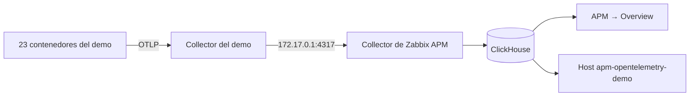

# OpenTelemetry Demo en Ubuntu con Zabbix APM

[English](README.md)

El [OpenTelemetry Demo](https://github.com/open-telemetry/opentelemetry-demo) (Astronomy Shop) es una tienda de unos 20 servicios en Go, Java, .NET, Python, Node.js, Ruby, PHP, C++, Rust y Elixir, con un generador de carga. Sirve para ver APM con tráfico real, sin instrumentar nada.

Esta guía lo despliega con Docker **en el mismo server que Zabbix**. Mantiene todos los servicios de la aplicación y Kafka, y deja fuera Jaeger, Grafana, Prometheus y OpenSearch, porque el visor es Zabbix.



## Requisitos

**Antes de empezar:** Zabbix 8.0 con ClickHouse, el Collector, la fuente de datos y los módulos ([installation.es.md](../../../docs/installation.es.md)).

| Recurso | Mínimo | Medido en la prueba, con Zabbix y ClickHouse |
|---|---|---|
| RAM | **10 GiB** | 5.6 GiB usados de 9.7 GiB; los contenedores usan 2.8 GiB |
| Disco libre | **15 GB** | Imágenes: 8.6 GB. `/var/lib/docker`: 6.4 GB |
| Carga generada | | Unos 7 450 spans por minuto, con 19 servicios |
| Crecimiento en ClickHouse | | Unos 70 MiB por hora: estimación de unos 5 GB en las 72 h de retención |

Probado en Ubuntu 26.10 ARM64, con 6 vCPU, Zabbix 8.0.0rc3, ClickHouse 26.10, otelcol-contrib 0.164 y Docker 29.7.

> [!WARNING]
> La tienda queda publicada en el puerto 18080 sin autenticación. Úsala solo en una red de pruebas.

## 1. Instalar Docker

```sh
sudo apt-get update
sudo apt-get install -y docker.io docker-compose-v2
ip -br -4 address show docker0
```

✅ Debe mostrar `172.17.0.1/16`. Si es otra dirección, cámbiala en el paso 3.

## 2. Descargar el demo y preparar la configuración

Cambia `DEMO_PUBLIC_HOST` por la IP de tu server, y `ZABBIX_APM_DASHBOARD` si clonaste el repositorio en otra ruta:

```sh
ZABBIX_APM_DASHBOARD=~/Devs/zabbix-apm-dashboard
DEMO_PUBLIC_HOST=192.168.56.2

mkdir -p ~/Devs && cd ~/Devs
git clone https://github.com/SimonLexRS/opentelemetry-demo.git
cd opentelemetry-demo
cp "$ZABBIX_APM_DASHBOARD"/examples/stacks/opentelemetry-demo/compose.zabbix-lite.yaml .
cp "$ZABBIX_APM_DASHBOARD"/examples/stacks/opentelemetry-demo/otelcol-config-zabbix.yml .

cat > .env.zabbix <<E
ZABBIX_APM_ENDPOINT=host.docker.internal:4317
ZABBIX_APM_NAMESPACE=opentelemetry-demo
ZABBIX_APM_INSECURE=true
DEMO_HOST_PORT=18080
DEMO_PUBLIC_HOST=$DEMO_PUBLIC_HOST
E
```

`ZABBIX_APM_INSECURE=true` envía gRPC sin cifrar. Aquí es aceptable porque el tráfico no sale del server.

## 3. Dejar que los contenedores lleguen al Collector de Zabbix

El Collector de Zabbix escucha en `127.0.0.1`, y los contenedores no llegan a esa dirección. Este archivo agrega la IP interna de Docker, sin abrir el puerto en la red:

```sh
cd ~/Devs/zabbix-apm-dashboard
sudo install -m 644 examples/stacks/opentelemetry-demo/otelcol-docker-bridge.yaml /etc/otelcol-contrib/docker-bridge.yaml
sudo sed -i 's|--config=/etc/otelcol-contrib/config.yaml"|--config=/etc/otelcol-contrib/config.yaml --config=/etc/otelcol-contrib/docker-bridge.yaml"|' /etc/otelcol-contrib/otelcol-contrib.conf

# La IP de Docker debe existir antes de que arranque el Collector
sudo mkdir -p /etc/systemd/system/otelcol-contrib.service.d
printf '[Unit]\nAfter=docker.service\nRequires=docker.service\n' | sudo tee /etc/systemd/system/otelcol-contrib.service.d/docker.conf
sudo systemctl daemon-reload
sudo systemctl restart otelcol-contrib
```

✅ Comprobación, tras unos segundos:

```sh
sleep 10
systemctl is-active otelcol-contrib
ss -tln | grep -E ':(4317|4318) '
```

Debe mostrar `active` y los puertos solo en `127.0.0.1` y `172.17.0.1`.

## 4. Arrancar el demo

Se usan imágenes publicadas, sin compilar nada. La descarga tardó unos 5 minutos:

```sh
cd ~/Devs/opentelemetry-demo
F="-f compose.yaml -f compose.full.yaml -f compose.zabbix-lite.yaml --env-file .env --env-file .env.override --env-file .env.zabbix"
sudo docker compose $F pull --quiet
sudo docker compose $F up -d --no-build
```

✅ Comprobación, tras un minuto:

```sh
sudo docker compose $F ps --format '{{.Service}}: {{.Status}}'
sudo docker logs otel-collector 2>&1 | grep -c 'Everything is ready'
curl -s -o /dev/null -w '%{http_code}\n' http://127.0.0.1:18080/
```

Deben aparecer 23 servicios `Up`, un número mayor que `0` y `200`. Abre la tienda en `http://<IP-de-tu-server>:18080/`.

## 5. Crear el host en Zabbix

```sh
cd ~/Devs/zabbix-apm-dashboard
export ZABBIX_URL=http://127.0.0.1
read -rs ZABBIX_API_TOKEN && export ZABBIX_API_TOKEN   # pega el token y pulsa Enter
python3 scripts/zabbix-apm-app.py add opentelemetry-demo --name "OpenTelemetry Demo" --timeshift 60s
```

> [!IMPORTANT]
> `--timeshift 60s` es necesario aquí: [ver el problema 1](#1-verify-apppy-falla-en-la-duración-media).

## 6. Verificar

Espera **11 minutos**, para que todos los valores comparados sean nuevos:

```sh
export CH_URL=http://127.0.0.1:8123 CH_USER=zabbix_ro
export CH_PASSWORD="$(sudo cat /root/.zabbix/ch_reader)"    # tu contraseña de solo lectura
python3 scripts/verify-app.py opentelemetry-demo
```

✅ Debe terminar con `all checks passed`:

```text
OK   Error average duration: Zabbix 0.0056 s, ClickHouse 0.0056 s
OK   Unset spans per 60 s, 10 values: Zabbix 7,459.6, ClickHouse 7,446.1 for opentelemetry-demo
OK   Unset average duration: Zabbix 0.0462 s, ClickHouse 0.0469 s
---- all checks passed
```

En la web:

| Dónde | Qué deberías ver |
|---|---|
| **APM → Overview → opentelemetry-demo** | Mapa de servicios, métricas por servicio y errores |
| **Monitoring → Hosts → apm-opentelemetry-demo** | Latest data con valores nuevos |
| **Dashboards → Add widget** | **APM service map** y **APM service health** con *Application* = `opentelemetry-demo` |

> [!TIP]
> Para generar errores y verlos en APM, cambia un *feature flag* en `http://<IP-de-tu-server>:18080/feature`, por ejemplo `paymentFailure`.

## Detener o retirar el demo

```sh
cd ~/Devs/opentelemetry-demo
F="-f compose.yaml -f compose.full.yaml -f compose.zabbix-lite.yaml --env-file .env --env-file .env.override --env-file .env.zabbix"
sudo docker compose $F stop                       # detener, conservando todo
sudo docker compose $F down -v                    # retirar los contenedores y sus datos
sudo docker image prune -a                        # liberar el disco de las imágenes
```

Después, elimina el host `apm-opentelemetry-demo` en Zabbix. Sus trazas caducan a las 72 horas.

## Problemas encontrados

### 1. `verify-app.py` falla en la duración media

```text
FAIL Unset average duration: Zabbix 0.0814 s, ClickHouse 0.0544 s
```

| | |
|---|---|
| **Causa** | La plantilla lee cada ventana 10 s después de cerrarla, pero aquí los spans pasan por dos collectors con lotes. Zabbix leía antes de que llegaran todos: contó un 12 % menos, y faltaban sobre todo spans cortos, por lo que el promedio subía |
| **Solución** | `--timeshift 60s` en el paso 5 o, en un host existente, la macro `{$OTLP.TIMESHIFT}` = `60s` |
| **Resultado** | Unset: 7 459.6 en Zabbix y 7 446.1 en ClickHouse; las duraciones coinciden |

Después del cambio, cada valor llega a Zabbix un minuto más tarde.

### 2. `verify-app.py` falla de vez en cuando en *Error average duration*

```text
FAIL Error average duration: Zabbix 0.0075 s, ClickHouse 22.5051 s
```

| | |
|---|---|
| **Causa** | Los spans `flagd.evaluation.v2.Service/EventStream` son conexiones que duran 600 s y terminan con error. ClickHouse los fecha en su inicio, pero solo se exportan al cerrarse, cuando Zabbix ya midió esa ventana |
| **Solución** | Vuelve a ejecutar la verificación unos minutos después. No es un fallo de la instalación: en la prueba volvió a pasar a los 3 minutos |

Compruébalo con:

```sh
clickhouse-client -q "select ServiceName, SpanName, round(Duration/1e9) s from zabbix.otel_traces where StatusCode='Error' and Timestamp > now() - 1200 and Duration > 5e9 order by s desc limit 5"
```

### 3. El demo completo no cabe en un server pequeño

| | |
|---|---|
| **Síntoma** | El server tenía 3.3 GiB de RAM, y los límites de memoria del demo completo suman 8.2 GiB |
| **Solución** | Ampliar la VM a unos 10 GiB y omitir `compose.observability.yaml` |

La RAM ampliada se ve con `free -h`. El disco puede ya tener espacio sin asignar en LVM: compruébalo con `sudo vgs` antes de ampliarlo, y extiéndelo con:

```sh
sudo lvextend -r -l +100%FREE /dev/ubuntu-vg/ubuntu-lv
```

### 4. `compose.local.yaml` del fork no sirve para esta instalación

| | |
|---|---|
| **Causa** | Carga `otelcol-config-observability.yml`, que exporta a Jaeger, Prometheus y OpenSearch, y su configuración de Zabbix fija `insecure` para un túnel |
| **Solución** | Usar `compose.zabbix-lite.yaml` de este repositorio. El fork no se modifica |

### 5. `product-catalog` se reinició una vez

```text
SIGSEGV: segmentation violation
```

Ocurrió a los 5 minutos del arranque en el primer despliegue, y Docker lo reinició solo. No hubo falta de memoria (`OOMKilled=false`) y no se repitió en el segundo despliegue. **No se investigó la causa**: viene de la imagen publicada del demo. Compruébalo con:

```sh
sudo docker inspect product-catalog --format '{{.RestartCount}} {{.State.OOMKilled}}'
```

### 6. El Collector del demo registra errores de PostgreSQL

```text
postgresqlreceiver ... failed to explain query
```

Vienen de su receptor de métricas internas de la base de datos, y esas métricas no se envían a Zabbix. En la prueba no afectaron a las trazas. Se pueden ignorar.

### 7. El Collector no arranca: `Not enough privileges`

El usuario de escritura de ClickHouse necesita `CREATE DATABASE`. Aplica la versión actual de [clickhouse-users.sql](../../clickhouse-users.sql).

## Otros problemas posibles

No ocurrieron en esta prueba:

| Síntoma | Qué revisar |
|---|---|
| El Collector del demo registra `connection refused` hacia `host.docker.internal` | El paso 3, y `ss -tln` debe mostrar `172.17.0.1:4317`. Un firewall debe permitir el tráfico desde las redes de Docker |
| `otelcol-contrib` no arranca: `cannot assign requested address` | La IP de `docker0` no es `172.17.0.1`, o Docker no ha arrancado |
| El puerto 18080 está ocupado | Cambia `DEMO_HOST_PORT` en `.env.zabbix` |
| Contenedores con `OOMKilled=true` | Falta RAM. Reduce `LOCUST_USERS` en `.env.override` |
| La pestaña no aparece en APM → Overview | Consulta si llegan datos: `clickhouse-client -q "select count() from zabbix.otel_traces where Timestamp > now() - 300"` |

## El mismo patrón en otros sitios

- **Otra aplicación con Docker Compose:** agrega un Collector con el receptor `otlp`, el processor `resource` con tu namespace y el exportador `otlp_grpc/zabbix` de [otelcol-config-zabbix.yml](otelcol-config-zabbix.yml).
- **Con Jaeger, Grafana y OpenSearch:** usa [compose.zabbix.yaml](compose.zabbix.yaml) con `compose.observability.yaml`. Requiere más RAM y no se comprobó en esta guía.
- **Kubernetes:** la misma configuración en el Helm chart o el Operator del Collector. No se comprobó en esta guía.
- **Reducir la carga:** agrega `probabilistic_sampler` a `traces/zabbix`, o baja `LOCUST_USERS`.
