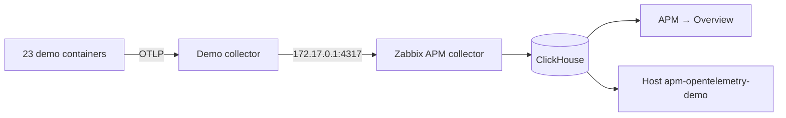

# OpenTelemetry Demo on Ubuntu with Zabbix APM

[Español](README.es.md)

The [OpenTelemetry Demo](https://github.com/open-telemetry/opentelemetry-demo) (Astronomy Shop) is a store of about 20 services in Go, Java, .NET, Python, Node.js, Ruby, PHP, C++, Rust and Elixir, with a load generator. It shows APM with real traffic, without instrumenting anything.

This guide deploys it with Docker **on the same server as Zabbix**. It keeps every application service and Kafka, and leaves out Jaeger, Grafana, Prometheus and OpenSearch, because Zabbix is the viewer.



## Requirements

**First:** Zabbix 8.0 with ClickHouse, the Collector, the data source and the modules ([installation.md](../../../docs/installation.md)).

| Resource | Minimum | Measured in the test, with Zabbix and ClickHouse |
|---|---|---|
| RAM | **10 GiB** | 5.6 GiB used of 9.7 GiB; the containers use 2.8 GiB |
| Free disk | **15 GB** | Images: 8.6 GB. `/var/lib/docker`: 6.4 GB |
| Generated load | | About 7,450 spans per minute, with 19 services |
| ClickHouse growth | | About 70 MiB per hour: an estimate of about 5 GB over the 72 h retention |

Tested on Ubuntu 26.10 ARM64, with 6 vCPU, Zabbix 8.0.0rc3, ClickHouse 26.10, otelcol-contrib 0.164 and Docker 29.7.

> [!WARNING]
> The store is published on port 18080 without authentication. Use it only on a test network.

## 1. Install Docker

```sh
sudo apt-get update
sudo apt-get install -y docker.io docker-compose-v2
ip -br -4 address show docker0
```

✅ It must show `172.17.0.1/16`. If the address differs, change it in step 3.

## 2. Download the demo and prepare the configuration

Replace `DEMO_PUBLIC_HOST` with the IP of your server, and `ZABBIX_APM_DASHBOARD` if you cloned the repository elsewhere:

```sh
ZABBIX_APM_DASHBOARD=~/Devs/zabbix-apm-dashboard
DEMO_PUBLIC_HOST=192.168.56.2

mkdir -p ~/Devs && cd ~/Devs
git clone https://github.com/SimonLexRS/opentelemetry-demo.git
cd opentelemetry-demo
cp "$ZABBIX_APM_DASHBOARD"/examples/stacks/opentelemetry-demo/compose.zabbix-lite.yaml .
cp "$ZABBIX_APM_DASHBOARD"/examples/stacks/opentelemetry-demo/otelcol-config-zabbix.yml .

cat > .env.zabbix <<E
ZABBIX_APM_ENDPOINT=host.docker.internal:4317
ZABBIX_APM_NAMESPACE=opentelemetry-demo
ZABBIX_APM_INSECURE=true
DEMO_HOST_PORT=18080
DEMO_PUBLIC_HOST=$DEMO_PUBLIC_HOST
E
```

`ZABBIX_APM_INSECURE=true` sends gRPC unencrypted. That is acceptable here because the traffic stays on the server.

## 3. Let the containers reach the Zabbix Collector

The Zabbix Collector listens on `127.0.0.1`, which containers cannot reach. This file adds the internal Docker IP, without opening the port on the network:

```sh
cd ~/Devs/zabbix-apm-dashboard
sudo install -m 644 examples/stacks/opentelemetry-demo/otelcol-docker-bridge.yaml /etc/otelcol-contrib/docker-bridge.yaml
sudo sed -i 's|--config=/etc/otelcol-contrib/config.yaml"|--config=/etc/otelcol-contrib/config.yaml --config=/etc/otelcol-contrib/docker-bridge.yaml"|' /etc/otelcol-contrib/otelcol-contrib.conf

# The Docker IP must exist before the Collector starts
sudo mkdir -p /etc/systemd/system/otelcol-contrib.service.d
printf '[Unit]\nAfter=docker.service\nRequires=docker.service\n' | sudo tee /etc/systemd/system/otelcol-contrib.service.d/docker.conf
sudo systemctl daemon-reload
sudo systemctl restart otelcol-contrib
```

✅ Check, after a few seconds:

```sh
sleep 10
systemctl is-active otelcol-contrib
ss -tln | grep -E ':(4317|4318) '
```

It must show `active` and the ports only on `127.0.0.1` and `172.17.0.1`.

## 4. Start the demo

It uses published images and compiles nothing. The download took about 5 minutes:

```sh
cd ~/Devs/opentelemetry-demo
F="-f compose.yaml -f compose.full.yaml -f compose.zabbix-lite.yaml --env-file .env --env-file .env.override --env-file .env.zabbix"
sudo docker compose $F pull --quiet
sudo docker compose $F up -d --no-build
```

✅ Check, after a minute:

```sh
sudo docker compose $F ps --format '{{.Service}}: {{.Status}}'
sudo docker logs otel-collector 2>&1 | grep -c 'Everything is ready'
curl -s -o /dev/null -w '%{http_code}\n' http://127.0.0.1:18080/
```

You must see 23 services `Up`, a number above `0` and `200`. Open the store at `http://<your-server-IP>:18080/`.

## 5. Create the host in Zabbix

```sh
cd ~/Devs/zabbix-apm-dashboard
export ZABBIX_URL=http://127.0.0.1
read -rs ZABBIX_API_TOKEN && export ZABBIX_API_TOKEN   # paste the token and press Enter
python3 scripts/zabbix-apm-app.py add opentelemetry-demo --name "OpenTelemetry Demo" --timeshift 60s
```

> [!IMPORTANT]
> `--timeshift 60s` is needed here: [see problem 1](#1-verify-apppy-fails-on-the-average-duration).

## 6. Verify

Wait **11 minutes**, so that all the compared values are new:

```sh
export CH_URL=http://127.0.0.1:8123 CH_USER=zabbix_ro
export CH_PASSWORD="$(sudo cat /root/.zabbix/ch_reader)"    # your read-only password
python3 scripts/verify-app.py opentelemetry-demo
```

✅ It must end with `all checks passed`:

```text
OK   Error average duration: Zabbix 0.0056 s, ClickHouse 0.0056 s
OK   Unset spans per 60 s, 10 values: Zabbix 7,459.6, ClickHouse 7,446.1 for opentelemetry-demo
OK   Unset average duration: Zabbix 0.0462 s, ClickHouse 0.0469 s
---- all checks passed
```

On the web:

| Where | What you should see |
|---|---|
| **APM → Overview → opentelemetry-demo** | Service map, per-service metrics and errors |
| **Monitoring → Hosts → apm-opentelemetry-demo** | Latest data with new values |
| **Dashboards → Add widget** | **APM service map** and **APM service health** with *Application* = `opentelemetry-demo` |

> [!TIP]
> To generate errors and see them in APM, change a *feature flag* at `http://<your-server-IP>:18080/feature`, for example `paymentFailure`.

## Stop or remove the demo

```sh
cd ~/Devs/opentelemetry-demo
F="-f compose.yaml -f compose.full.yaml -f compose.zabbix-lite.yaml --env-file .env --env-file .env.override --env-file .env.zabbix"
sudo docker compose $F stop                       # stop, keeping everything
sudo docker compose $F down -v                    # remove the containers and their data
sudo docker image prune -a                        # free the disk used by the images
```

Then delete the host `apm-opentelemetry-demo` in Zabbix. Its traces expire after 72 hours.

## Problems found

### 1. `verify-app.py` fails on the average duration

```text
FAIL Unset average duration: Zabbix 0.0814 s, ClickHouse 0.0544 s
```

| | |
|---|---|
| **Cause** | The template reads each window 10 s after it closes, but here spans cross two collectors with batches. Zabbix read before they all arrived: it counted 12% fewer, mostly missing short spans, so the average went up |
| **Solution** | `--timeshift 60s` in step 5 or, on an existing host, the macro `{$OTLP.TIMESHIFT}` = `60s` |
| **Result** | Unset: 7,459.6 in Zabbix and 7,446.1 in ClickHouse; the durations match |

After the change, each value reaches Zabbix one minute later.

### 2. `verify-app.py` sometimes fails on *Error average duration*

```text
FAIL Error average duration: Zabbix 0.0075 s, ClickHouse 22.5051 s
```

| | |
|---|---|
| **Cause** | The `flagd.evaluation.v2.Service/EventStream` spans are connections that last 600 s and end with an error. ClickHouse dates them at their start, but they are exported only when they close, after Zabbix measured that window |
| **Solution** | Run the verification again a few minutes later. It is not an installation fault: in the test it passed again after 3 minutes |

Check it with:

```sh
clickhouse-client -q "select ServiceName, SpanName, round(Duration/1e9) s from zabbix.otel_traces where StatusCode='Error' and Timestamp > now() - 1200 and Duration > 5e9 order by s desc limit 5"
```

### 3. The full demo doesn't fit on a small server

| | |
|---|---|
| **Symptom** | The server had 3.3 GiB of RAM, and the memory limits of the full demo add up to 8.2 GiB |
| **Solution** | Grow the VM to about 10 GiB and leave out `compose.observability.yaml` |

Check the added RAM with `free -h`. The disk may already have unallocated LVM space: check with `sudo vgs` before growing it, and extend it with:

```sh
sudo lvextend -r -l +100%FREE /dev/ubuntu-vg/ubuntu-lv
```

### 4. The fork's `compose.local.yaml` doesn't suit this installation

| | |
|---|---|
| **Cause** | It loads `otelcol-config-observability.yml`, which exports to Jaeger, Prometheus and OpenSearch, and its Zabbix configuration fixes `insecure` for a tunnel |
| **Solution** | Use `compose.zabbix-lite.yaml` from this repository. The fork is not modified |

### 5. `product-catalog` restarted once

```text
SIGSEGV: segmentation violation
```

It happened 5 minutes after the start of the first deployment, and Docker restarted it. There was no memory shortage (`OOMKilled=false`) and it did not repeat in the second deployment. **The cause was not investigated**: it comes from the demo's published image. Check it with:

```sh
sudo docker inspect product-catalog --format '{{.RestartCount}} {{.State.OOMKilled}}'
```

### 6. The demo Collector logs PostgreSQL errors

```text
postgresqlreceiver ... failed to explain query
```

They come from its receiver of internal database metrics, which are not sent to Zabbix. They did not affect the traces in the test. You can ignore them.

### 7. The Collector doesn't start: `Not enough privileges`

The ClickHouse writer user needs `CREATE DATABASE`. Apply the current [clickhouse-users.sql](../../clickhouse-users.sql).

## Other possible problems

These did not happen in this test:

| Symptom | What to check |
|---|---|
| The demo Collector logs `connection refused` to `host.docker.internal` | Step 3, and `ss -tln` must show `172.17.0.1:4317`. A firewall must allow traffic from the Docker networks |
| `otelcol-contrib` doesn't start: `cannot assign requested address` | The `docker0` IP is not `172.17.0.1`, or Docker hasn't started |
| Port 18080 is taken | Change `DEMO_HOST_PORT` in `.env.zabbix` |
| Containers with `OOMKilled=true` | Not enough RAM. Lower `LOCUST_USERS` in `.env.override` |
| The tab doesn't appear in APM → Overview | Check whether data arrives: `clickhouse-client -q "select count() from zabbix.otel_traces where Timestamp > now() - 300"` |

## The same pattern elsewhere

- **Another Docker Compose application:** add a Collector with the `otlp` receiver, the `resource` processor with your namespace and the `otlp_grpc/zabbix` exporter of [otelcol-config-zabbix.yml](otelcol-config-zabbix.yml).
- **With Jaeger, Grafana and OpenSearch:** use [compose.zabbix.yaml](compose.zabbix.yaml) with `compose.observability.yaml`. It needs more RAM and was not checked in this guide.
- **Kubernetes:** the same configuration in the Collector's Helm chart or Operator. Not checked in this guide.
- **Reduce the load:** add `probabilistic_sampler` to `traces/zabbix`, or lower `LOCUST_USERS`.
